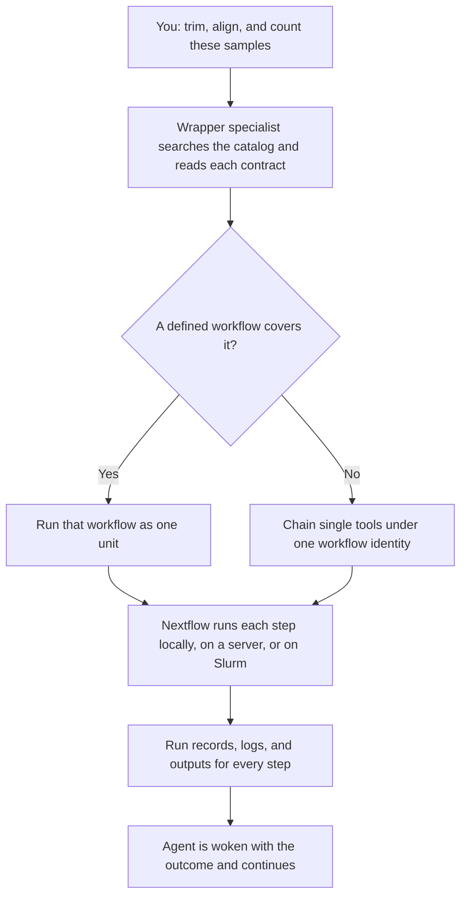
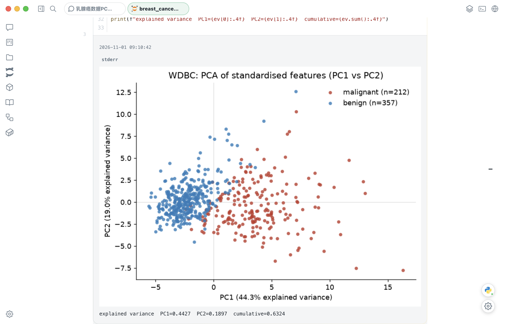
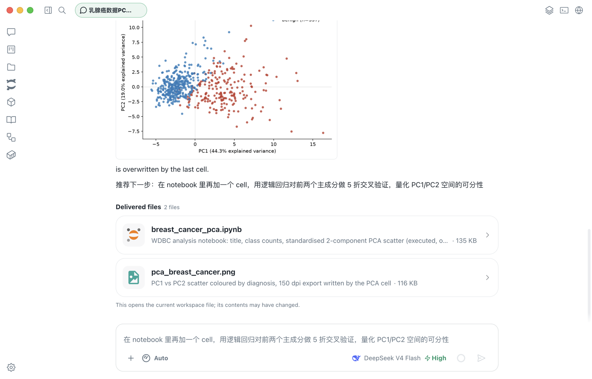
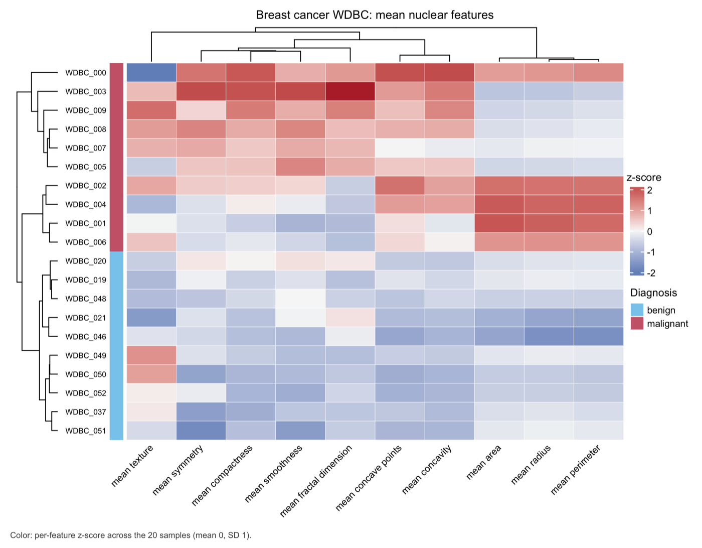

<div align="center">
  
  <h1>Phi</h1>
  <p><strong>A desktop AI workbench for scientific research: an agent that explores freely and runs known science the same way every time.</strong></p>
  <p><strong>English</strong> · <a href="README.zh-CN.md">简体中文</a></p>
  <p>
    <a href="https://phi.omicsagent.cn/">Website</a> ·
    <a href="https://phi.omicsagent.cn/docs/quickstart">Quick start</a> ·
    <a href="https://phi.omicsagent.cn/docs">Documentation</a> ·
    <a href="https://github.com/dxsbiocc/phi-packages">Packages</a> ·
    <a href="https://github.com/dxsbiocc/phi/issues">Issues</a>
  </p>
  <p>
    <a href="#availability"></a>
    <a href="LICENSE"></a>
  </p>
</div>

A general AI assistant improvises every step. That is fine for a chart and dangerous for an alignment that burns two days of cluster time. Phi is built around that difference: the agent writes code freely when you are exploring, and calls fixed, inspectable tools when the method is already known. The code, results, and run records stay in your project as ordinary files.

## Design principles

- **Improvise only where improvising helps.** Exploration happens in notebooks, where a wrong cell is cheap. Known pipelines run through [Wrappers](#wrappers-known-science-as-fixed-composable-steps), where a wrong command is expensive.
- **The environment follows the task.** Skills, specialist agents, kernels, and Wrappers declare what they need, and Phi prepares it in managed environments, isolated from your own conda and from whatever the host has installed.
- **Compute goes to the data.** Phi does not quietly upload your data. A remote run uses paths on the server, its outputs stay there, and a remote project never falls back to your desktop.
- **Specialists own their work.** The agent hands matching work to a focused specialist with its own tools and instructions, rather than attempting everything itself.
- **You approve what matters.** Modes decide how much the agent may do alone, plans wait for your review, and each run is something you can inspect and cancel.
- **Your work stays yours.** Results are ordinary files in the folder you chose, so they outlive any conversation, and any model.

## Wrappers: known science as fixed, composable steps

Phi breaks established analysis methods into atomic tools called Wrappers. Each Wrapper is one versioned Nextflow unit with its inputs, parameters, and outputs declared. It is not a prompt and not code the agent writes. The [Phi Packages](https://github.com/dxsbiocc/phi-packages) catalog has 652 of them: 630 single tools such as FastQC, fastp, STAR, Salmon, and DESeq2, 21 subworkflows, and one complete RNA-seq workflow. Most are adapted from nf-core.

This changes what the agent is responsible for. It no longer assembles environments, recalls a tool's flags, or writes pipeline commands. It chooses which tools to use, in what order, and with which inputs. Everything below that is fixed code.

### Nextflow runs every step

Phi does not reimplement execution. Every Wrapper run is a `nextflow run` of that Wrapper's source, with a parameter file and a configuration that Phi generates for the chosen target. Nextflow then manages the processes, containers or conda environments, the local or Slurm scheduler, and the CPU, memory, and time limits of each task.

### Two ways to run an analysis

- **Compose atomic tools.** For a task that no predefined workflow covers, the agent chains single-tool Wrappers into a workflow: the outputs of one step become the inputs of the next. All steps share one workflow identity with a name, a step label, and a planned step count, so Phi shows and reports them as one pipeline, even across turns. Each step is still its own Nextflow run, so it can be inspected, retried, or cancelled on its own.
- **Run a defined workflow.** When a subworkflow or complete workflow already covers the task, such as RNA-seq, the agent runs it as one unit, and the order of steps is the one its authors fixed.



### Every step leaves a trace

- **Checked before it starts.** The Wrapper specialist reads the tool's current contract before any run. Phi checks required parameters, types, allowed values, and ranges, checks that input files exist, on the server for a remote run, and rejects file patterns that would silently merge samples.
- **Recorded while it runs.** Each run has its own directory with the exact parameters and Nextflow configuration it ran with, its logs, and its outputs. Its record in the Wrappers view keeps its state and events, and the workflow it belongs to.
- **Checked after it ends.** Phi confirms that each primary output exists, and a run can be exported as reproducibility metadata: the run, its manifest, events, parameters, and outputs.

### Fixed where it matters

|                  | Notebook                          | Wrapper                                           |
| ---------------- | --------------------------------- | ------------------------------------------------- |
| Code comes from  | The agent, written live           | A fixed, versioned source                         |
| Best for         | Exploring, plotting, custom logic | Standard pipelines: QC, alignment, quantification |
| Runs             | Interactively, cell by cell       | In the background, while you keep working         |
| Environment      | A managed Python or R kernel      | Docker, Singularity, or conda, per run            |
| Where            | Your project's kernel             | Your desktop, a server, or a Slurm cluster        |
| If it goes wrong | Cheap: fix the cell and rerun     | Costly, so its contract is checked first          |

What this gives you in practice:

- **The agent does not improvise a pipeline.** Wrapper work goes to the Wrapper specialist first. The agent may fall back to other tools only if that specialist reports a failure.
- **Long runs do not hold the conversation.** A run returns an id straight away. You can keep working, and when it ends Phi wakes the conversation with the outcome so the next step can use the results.
- **Clusters are first-class.** Wrappers can submit to Slurm, on a login node or as a controller job. Remote runs keep going after you close the app. If Phi loses track of one, it reports the run as lost rather than guessing that it failed.
- **New tools stay reviewable.** The built-in Wrapper specialist can author a new Wrapper as source in Phi Packages, so it can be tested and published like the others.

Reproducibility here means fixed code and declared inputs, with a record of each run. Environments are pinned as far as each Wrapper's own definition pins them, so check that definition when exact reproduction matters.

## How to use Phi

1. **Install Phi** from [Releases](https://github.com/dxsbiocc/phi/releases), or [build from source](#build-from-source).
2. **Add a model provider** in Settings. Your requests go to that provider.
3. **Choose a project**: a local folder, or a folder on an SSH server. Or start a plain conversation with no project.
4. **Pick a mode**: Ask, Plan, Plan and execute, Auto, or Full access. Start with Ask or Plan until you trust a workflow.
5. **Describe the work** in your own words. Phi chooses among its tools, and asks when the choice is really yours.

Some ways to start:

| You want to               | Say something like                                                             | What Phi does                                                                       |
| ------------------------- | ------------------------------------------------------------------------------ | ----------------------------------------------------------------------------------- |
| Explore a dataset         | "Load `counts.csv` in a notebook and run a PCA, colored by condition."         | Writes and runs cells on a managed kernel, then saves the notebook with its outputs |
| Run a standard tool       | "Run FastQC on the reads in `data/` and summarize the failures."               | Finds the wrapper, runs it in the background, and reads the report when it ends     |
| Run a multi-step pipeline | "Trim, align, and count these samples, then test for differential expression." | Lays out the steps for your review in a plan mode, then runs them as one workflow   |
| Use a cluster             | "Run this on the cluster. The reads are in `/data/project/fastq`."             | Checks the paths on the server, submits, and stays out of your way until it ends    |
| Make a figure             | "Draw a clustered heatmap of these genes."                                     | Picks a template and writes an editable `plot.R` into your project                  |
| Follow up later           | "Why did sample 3 fail?"                                                       | Reads that run's logs and reports what they show                                    |

For a cluster, first save the connection on the Wrappers page. For a local run, Wrappers use Docker by default, and conda is available if you do not have it.

The [quick start](https://phi.omicsagent.cn/docs/quickstart) covers setup in more detail, and the [interface gallery](https://phi.omicsagent.cn/#ui-shots) shows the Wrapper catalog and other views.

## See it work

The agent was asked to run a PCA on the Wisconsin Diagnostic Breast Cancer dataset bundled with scikit-learn. It wrote the notebook cells, ran them on Phi's managed Python kernel, and saved the notebook with its outputs.

<picture>
  <source media="(prefers-color-scheme: dark)" srcset="assets/readme/notebook-dark.png">
  <source media="(prefers-color-scheme: light)" srcset="assets/readme/notebook-light.png">
  
</picture>

The conversation then lists what it produced, and each file opens in place. The Chinese line and tab title below are as the app produced them in this run.

<picture>
  <source media="(prefers-color-scheme: dark)" srcset="assets/readme/delivery-en-dark.png">
  <source media="(prefers-color-scheme: light)" srcset="assets/readme/delivery-en-light.png">
  
</picture>

<sub>Captures from the Phi 0.1.0 desktop app, resized but otherwise unedited, with the model set to DeepSeek V4 Flash.</sub>

### Figures you can keep editing

The Visualization plugin picks a template from the catalog, writes an editable `plot.R` into your project, and renders it in the managed R environment. This heatmap came from that flow.

<p align="center"></p>

<sub>Twenty samples (ten benign, ten malignant) from the same scikit-learn dataset, chosen to demonstrate the plot rather than to support a finding. The legend title was shortened by hand in `plot.R` and the figure re-rendered.</sub>

## Also in the workbench

- **Notebooks the agent can operate.** The agent reads a `.ipynb`, inserts and edits cells, runs them through Jupyter, checks the outputs, and saves. You see the same cells in the editor. Python and R kernels are managed by Phi; a host kernel must be selected explicitly.
- **Managed environments.** Versioned Python, R, Jupyter, and Nextflow environments are built on demand, so work does not depend on what the host has installed. Settings can rebuild, remove, or clean them. The first build downloads packages.
- **Conversations with explicit control.** Each conversation can be bound to a project and uses a mode: Auto, Ask, Plan, Plan and execute, or Full access. Plan modes wait for your approval before acting. Conversations keep running in the background when you switch away, and can be forked from an earlier message.
- **Plugins, Skills, and connectors.** A plugin bundles a specialist agent with its Skills and environment. Skills give task guidance, and MCP connectors reach external services. The official [Phi Packages](https://github.com/dxsbiocc/phi-packages) catalog supplies installable content.
- **Remote projects over SSH.** Files and commands in a remote project run on the host you selected and never fall back to the desktop. Check each host before relying on it.
- **A workbench around the conversation.** A terminal, in-app browser, file previews, and a background-jobs panel sit beside the conversation.

## Your data

Settings, conversations, approvals, logs, and package state live in `~/.phi`. Project files stay in the folder you chose, and Phi does not store its application data there.

Phi is not offline. Model requests go to the provider you configure, and an enabled connector may contact its service. Exported sessions can contain tool output and sensitive conversation content, so handle them as private data.

## Availability

Phi is an **internal beta**. macOS on Apple Silicon is the primary target. Linux x64 packaging is configured but has not passed clean-machine acceptance, and Windows is not validated. Updates are manual: Settings → General → Check for updates tells you when a newer release exists.

Builds are not yet signed or notarized. Preview builds, when published, appear on the [Releases](https://github.com/dxsbiocc/phi/releases) page. Upgrades keep your data in `~/.phi`.

- **macOS** (`.dmg`, `.zip`): drag Phi to Applications. macOS blocks the first launch with "Apple could not verify Phi". Open **System Settings → Privacy & Security** and click **Open Anyway**; you do this once per installed version.
- **Linux** (`.AppImage`, `.deb`): run `sudo apt install ./phi_*.deb`, or `chmod +x Phi-*.AppImage` and run the AppImage.

## Build from source

You need [Bun](https://bun.sh) 1.3.14 or later. The first launch fetches pinned runtime assets.

```bash
bun install
bun run dev
```

Configure a model provider in Settings, then choose a project.

To check a source checkout the way CI does, also install Node.js 24:

```bash
bun run helper:fetch-go && bun run build:helper
bun run lint
bun run typecheck
bun run test:gate
```

`bun run build:mac` and `bun run build:linux` produce packages. Maintainers publish releases from a `v*` tag; see [release-signing-update.md](docs/roadmap/release-signing-update.md).

## License

The source is licensed under [MIT](LICENSE). Third-party attributions are in [THIRD_PARTY_NOTICES.md](THIRD_PARTY_NOTICES.md). Report bugs and request features in [GitHub Issues](https://github.com/dxsbiocc/phi/issues).
