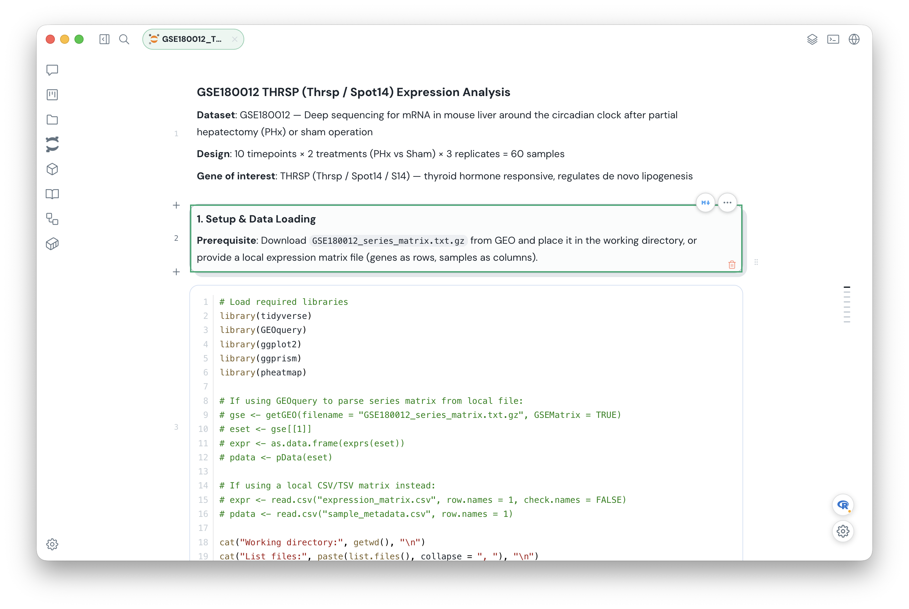
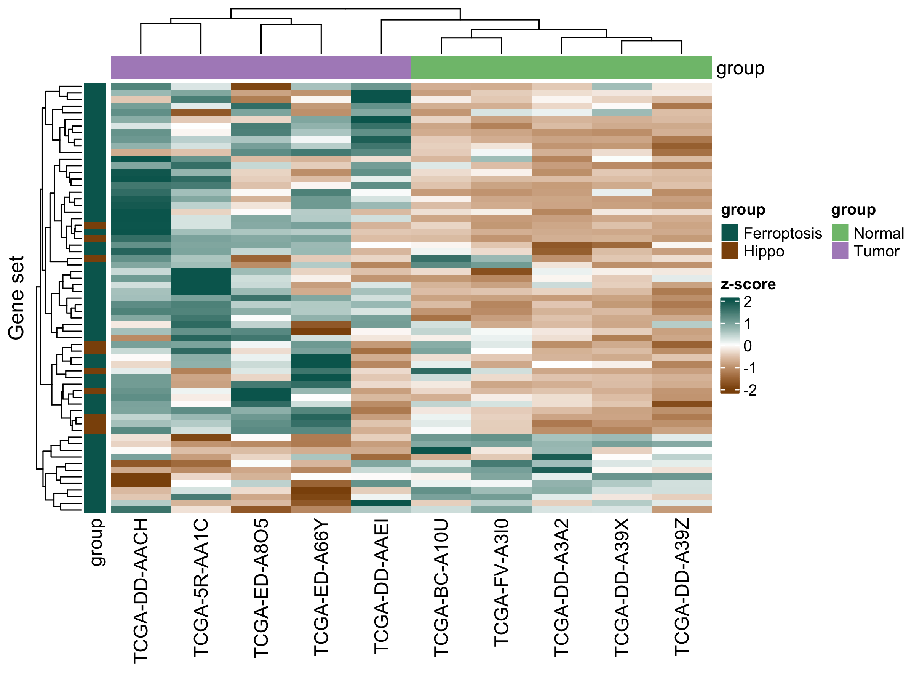

<div align="center">
  
  <h1>Phi</h1>
  <p><strong>A local-first AI workbench for scientific work.</strong></p>
  <p>Move from a research question to code, a notebook, a reproducible run, and an inspectable result—without losing the project that connects them.</p>
  <p>Managed environments · AI with Jupyter kernels · Specialist plugins · Reproducible pipelines</p>
  <p><strong>English</strong> · <a href="README.zh-CN.md">简体中文</a></p>
  <p>
    <a href="https://phi.omicsagent.cn/">Website</a> ·
    <a href="https://phi.omicsagent.cn/docs">Documentation</a> ·
    <a href="https://phi.omicsagent.cn/docs/quickstart">Quick start</a> ·
    <a href="https://github.com/dxsbiocc/phi/releases">Releases</a> ·
    <a href="https://github.com/dxsbiocc/phi/issues">Issues</a>
  </p>
  <p>
    <a href="#availability"></a>
    <a href="LICENSE"></a>
  </p>
</div>

Phi is for researchers whose work does not end with an answer in a chat window. A useful result may need project files, a Python or R notebook, a specialist tool, an external data source, or a Nextflow run on a server. Phi keeps those pieces in one desktop workspace, with visible permissions and durable local history.

<picture>
  <source media="(prefers-color-scheme: dark)" srcset="assets/readme/notebook-dark.png">
  <source media="(prefers-color-scheme: light)" srcset="assets/readme/notebook-light.png">
  
</picture>

<sub>Notebook workspace in the Phi desktop beta, shown in your GitHub theme with demonstration data.</sub>

## What makes Phi different

### Environments follow the task

Phi prepares versioned, managed Python, R, Jupyter, and Nextflow environments when work needs them. Executable Skills, specialist agents, notebook kernels, and Wrappers use declared runtimes instead of depending on an accidental collection of host packages. A ready environment can be reused; the Runtime panel shows its state and offers repair and cleanup. The first build may download dependencies, and host services such as Slurm remain separately managed.

### The agent can work with a Jupyter kernel

The agent can read a `.ipynb` notebook, insert or revise a code or Markdown cell, run a code cell through Jupyter, inspect its execution status and output summary, and save the notebook. You see the same cells and results in the editor, with write and run actions subject to Phi's approval controls. Phi offers managed Python and R kernels; Python is the default, while a host kernel requires explicit selection.

### Plugins bring a specialist and its tools together

A Phi plugin can bundle a focused agent, its Skills, callable script tools, and an environment binding. This makes the specialist's actual capabilities visible in the app and keeps its work connected to the main conversation. The official package catalog supplies installable plugins and other research resources.

### Scientific figures, with editable sources

The **Visualization** plugin is a concrete example. Its specialist uses the `omics-visualization` Skill to shortlist real templates against a result table, show previews before a choice, prepare an editable project-local `plot.R`, and render PNG, PDF, or SVG with the shared managed R environment. It can revise an existing figure and is instructed to inspect the result for clipped labels, missing legends, and misleading encodings. [Explore the plugin](https://phi.omicsagent.cn/plugins).

<p align="center"></p>

<sub>An actual bundled heatmap template preview, not a plot of user data. As a scientific figure, its white canvas is intentional in both GitHub themes.</sub>

## From question to result

1. **Choose the workspace.** Start an ordinary conversation or bind a conversation to a local or SSH project. Project files remain where they belong.
2. **Work with an agent.** Select a model, add relevant Skills or agents, and review tool actions under the project's permission mode. A plan can be reviewed before execution.
3. **Use the right surface.** Explore in a notebook, inspect files and results, or choose a packaged Wrapper when the task calls for a repeatable pipeline.
4. **Pick up where you left off.** Conversations, run history, approvals, and background tasks stay connected even as you move between projects and panels.

### Reproducible workflows instead of one-off commands

Wrappers package known tools and workflows behind discoverable inputs and run plans. Phi can prepare a run, show its status and logs, and help inspect resulting files. Remote execution includes configured SSH and Slurm paths, with host-specific validation still required before relying on a particular cluster.

The [interface gallery](https://phi.omicsagent.cn/#ui-shots) shows the Wrapper catalog and other desktop views.

### Connected research resources

Skills provide task guidance, MCP connectors reach external services, and Wrappers define reproducible command-line work. The official [Phi Packages](https://github.com/dxsbiocc/phi-packages) catalog supplies installable domain content. Phi shows resource scope and availability so you can see what is configured before asking the agent to use it.

See [plugin and connector previews](https://phi.omicsagent.cn/#ui-shots) on the product site.

The surrounding workbench includes a terminal, an in-app browser, file previews, and a background-task panel. You can keep a conversation open while inspecting a result or following a longer run.

## Local-first, with explicit boundaries

Phi stores its settings, conversations, approvals, logs, and package state under `~/.phi`. It does not turn a selected project into an application data directory. Local project files stay in the selected folder; remote project file and command operations target the selected SSH host rather than silently falling back to the desktop.

Local-first does not mean offline inference: model requests go to the provider you configure, and an enabled connector may contact its service. Project actions remain subject to the permission controls shown in Phi. Exported sessions can include tool output and sensitive conversation content, so handle them as private data.

## Get started

For a desktop build, use the official [installation guide](https://phi.omicsagent.cn/docs/install) and [quick-start guide](https://phi.omicsagent.cn/docs/quickstart). The [product documentation](https://phi.omicsagent.cn/docs) also covers Skills, MCP connectors, Wrappers, and common questions.

To run this repository from source, use **Bun 1.3.14+**. The test runner needs **Node.js 22.15+ or 24+**. The first launch may fetch pinned runtime assets.

```bash
bun install
bun run dev
```

After launch, configure a model provider in Settings and choose a project. To verify a source checkout before packaging:

```bash
bun run test
bun run lint
bun run typecheck
bun run build
```

## Availability

Phi is an **internal beta**. It is not yet a signed, notarized public desktop release. macOS is the primary development target; Linux x64 packaging is configured but still needs clean-machine acceptance, and Windows distribution is not yet validated. Remote SSH, Jupyter, and Slurm workflows need real-host validation for each environment. Updates are manual during the beta.

The source is licensed under [MIT](LICENSE). Third-party attributions are in [THIRD_PARTY_NOTICES.md](THIRD_PARTY_NOTICES.md). Feature requests and bug reports belong in [GitHub Issues](https://github.com/dxsbiocc/phi/issues).
