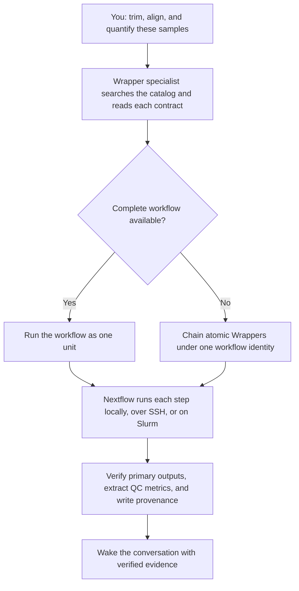
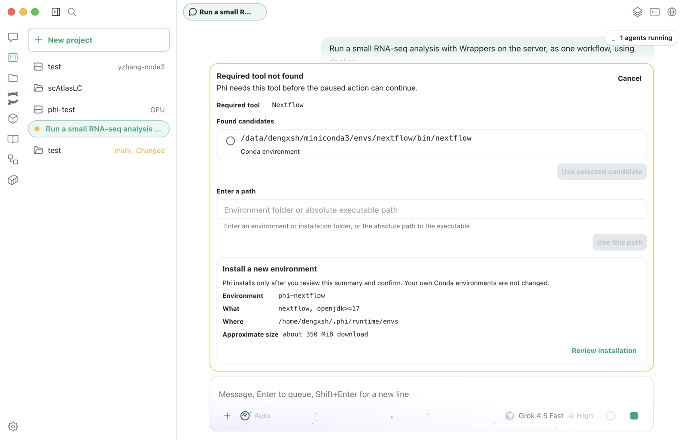
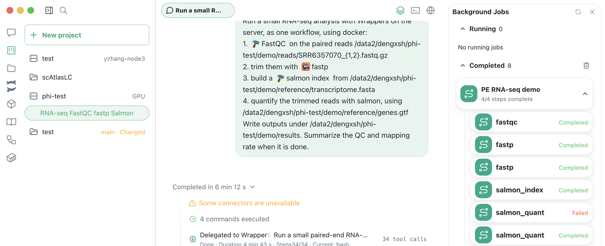
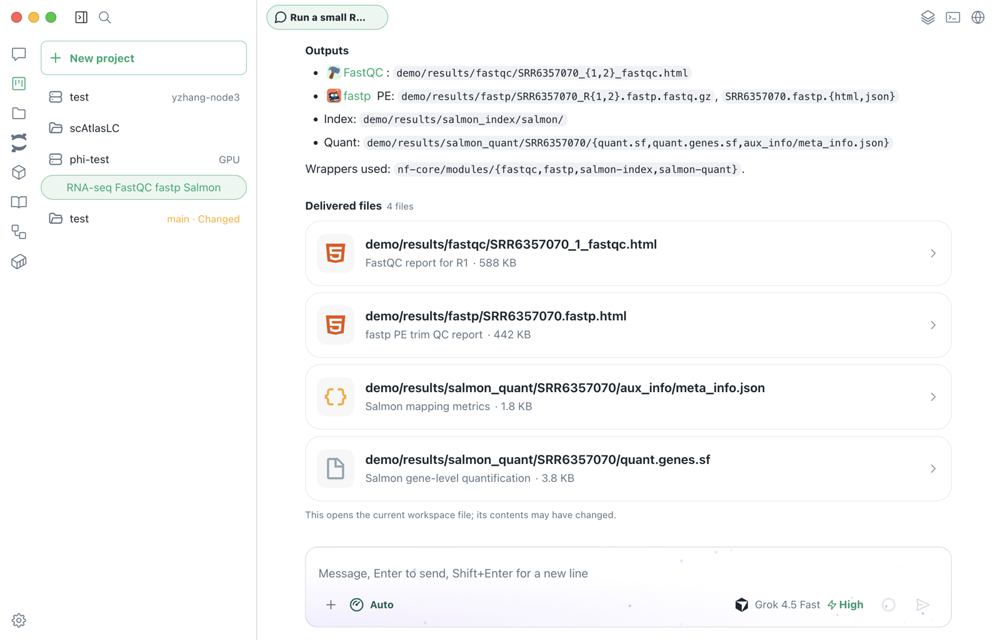
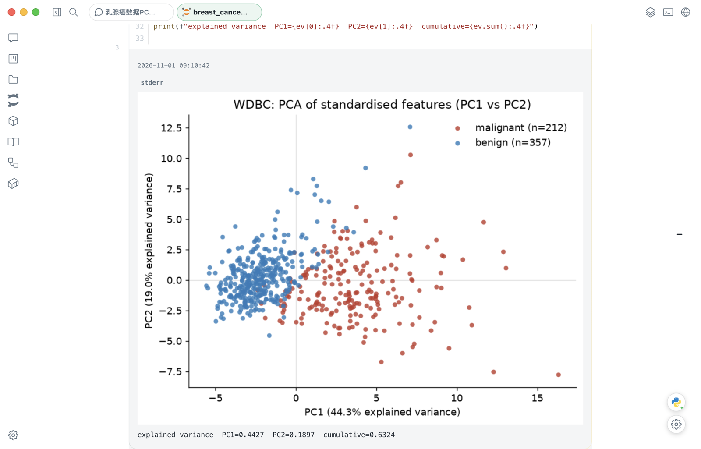
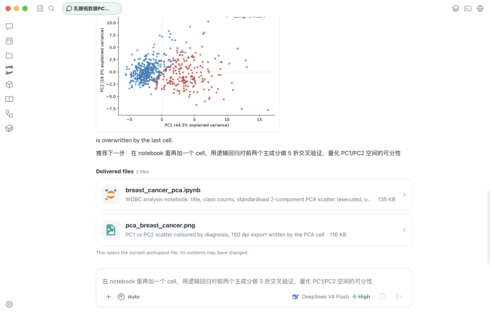
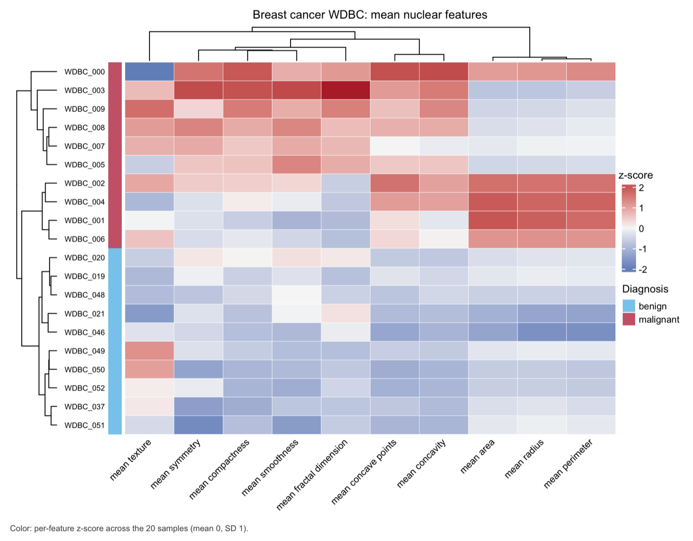

<div align="center">
  
  <h1>Phi</h1>
  <p><strong>A desktop AI workbench for scientific research: explore freely in notebooks, and run established methods through versioned, verifiable pipelines.</strong></p>
  <p><strong>English</strong> · <a href="README.zh-CN.md">简体中文</a></p>
  <p>
    <a href="https://phi.omicsagent.cn/">Website</a> ·
    <a href="https://phi.omicsagent.cn/docs/quickstart">Quick start</a> ·
    <a href="https://phi.omicsagent.cn/docs">Documentation</a> ·
    <a href="https://github.com/dxsbiocc/phi-packages">Packages</a> ·
    <a href="https://github.com/dxsbiocc/phi/releases">Releases</a> ·
    <a href="https://github.com/dxsbiocc/phi/issues">Issues</a>
  </p>
  <p>
    <a href="#availability"></a>
    <a href="LICENSE"></a>
  </p>
</div>

A general AI assistant improvises every step. That is fine for a quick plot and risky for an alignment that burns two days of cluster time. Phi separates the two modes of work: the agent writes and runs code freely when you are exploring in a notebook, and calls fixed, inspectable tools when the method is already established. Every script, figure, output table, and run record stays in your project folder as ordinary files.

## Design principles

- **Improvise only where improvising helps.** Exploratory analysis happens in Jupyter notebooks, where editing and rerunning a cell is cheap. Standard pipelines run through [Wrappers](#wrappers-known-science-as-fixed-composable-steps), where an ad-hoc shell command is expensive.
- **The environment follows the task.** Skills, specialist agents, notebook kernels, and Wrappers declare their own dependencies. Phi builds them from explicit cross-platform lockfiles in an isolated `micromamba` runtime, separate from your system Conda or host Python and R.
- **Compute goes to the data.** Phi does not upload local data behind your back. In an SSH project, paths, checks, and outputs stay on the remote server or Slurm cluster, and a remote session never falls back to your desktop.
- **Specialists own domain work.** The main agent delegates domain tasks to focused specialists equipped with validated script tools, curated workflows, and dedicated environments.
- **You approve what matters.** Execution modes control how much the agent can do on its own. Structured plans pause for your review, external installs ask for confirmation, and background jobs can be inspected or cancelled at any point.
- **Your work outlives the chat.** Outputs, editable plotting scripts, notebooks, and provenance manifests live in the project directory you chose, independent of any session or model provider.

## Wrappers: known science as fixed, composable steps

Phi packages established bioinformatics and computational biology methods into versioned Nextflow units called Wrappers. Each Wrapper declares its inputs, parameters, and expected outputs in a static contract (`wrapper.yaml`), paired with a fixed `main.nf` entrypoint and default parameter file.

The [Phi Packages](https://github.com/dxsbiocc/phi-packages) catalog provides **2,207 Wrappers**:

- **2,073 single-tool modules**, including FastQC, fastp, STAR, Salmon, DESeq2, BCFtools, GATK, AlphaFold 3, Boltz-2, Protenix, Chai-1, and LigandMPNN.
- **121 subworkflows** for multi-tool stages such as read QC and trimming, alignment and deduplication, variant annotation, and structure evaluation.
- **13 complete workflows**, including `nf-core/rna-seq`, `sarek`, `scrnaseq`, `atacseq`, `chipseq`, `methylseq`, `quantms`, `mag`, `ampliseq`, and `rnafusion`, alongside local `cutandrun`, `rnasplice`, and `protein_binder_design` pipelines.

Instead of recalling CLI flags or assembling environments from scratch, the agent selects the appropriate Wrappers, supplies the inputs, and hands execution to Nextflow.

### Nextflow runs every step

Every Wrapper run executes `nextflow run` against the Wrapper's versioned source using a generated parameter file and target configuration. Nextflow handles process isolation, Docker, Singularity, or Conda environments, local or Slurm scheduling, and per-task CPU, memory, and wall-time limits.

### Two ways to run an analysis

- **Compose atomic tools.** When no single predefined pipeline fits the study design, the agent chains individual module Wrappers under one shared workflow identity, passing verified outputs from one step into the next. Each step remains an independent Nextflow run that can be inspected, retried, or cancelled on its own.
- **Run a complete workflow.** When an established pipeline such as `nf-core/rna-seq` or `sarek` covers the task, the agent launches it as one unit with the step order fixed by its authors.



### Every step leaves a trace

- **Checked before launch.** Phi validates required parameters, types, allowed values, numeric bounds, samplesheet mate/lane pairing, and input file existence (on the remote host for SSH runs). It rejects file globs that would merge distinct samples and checks `.phi-context.json` input contracts between chained steps.
- **Recorded during execution.** Each run directory freezes a snapshot of `wrapper.yaml`, the resolved parameters, the generated Nextflow config, logs, and runtime metadata (Nextflow version, container runtime and image digests, host OS and architecture).
- **Verified on completion.** A run is marked complete only after its declared primary outputs pass existence and content checks. Completed runs emit `.phi-context.json` sidecars with SHA-256 digests and sample provenance, extract structured QC metrics, and can be exported as a self-contained reproducibility bundle.

### Notebooks and Wrappers side by side

|                  | Notebook                                    | Wrapper                                               |
| ---------------- | ------------------------------------------- | ----------------------------------------------------- |
| Code source      | Written live by you or the agent            | Versioned Nextflow source with a static contract      |
| Best for         | Exploratory analysis, custom statistics, QC | Standardized pipelines: trimming, alignment, calling  |
| Execution        | Interactive, cell by cell                   | Asynchronous in the background while you keep working |
| Environment      | Managed Python, R, or plugin Jupyter kernel | Docker, Singularity, or Conda per run                 |
| Target           | Local or remote project kernel              | Desktop, SSH server, or Slurm cluster                 |
| Cost of an error | Low: edit the cell and rerun                | High: contracts and inputs are checked before launch  |

### A real run

In this example, the user asked for FastQC, fastp, a Salmon index, and Salmon quantification on paired-end reads as one workflow on a remote GPU server using Docker. Nextflow was not on the server's login `PATH`, so Phi paused before step one, listed a Conda installation it detected on the host, and offered either a custom binary path or a managed environment build. Nothing is installed without confirmation.

<p align="center"></p>

The Wrapper specialist then ran all four steps under one workflow in Background Jobs. The first Salmon quantification attempt failed on an index path; the specialist corrected the parameter and reran only that step, finishing with 4/4 completed steps.

<p align="center"></p>

When the workflow finished, Phi woke the conversation, summarized the QC and mapping rates, cited the Wrappers executed, and presented the output reports and quantification tables.

<p align="center"></p>

<sub>Screenshots from a development build using Grok 4.5 Fast, resized; the Background Jobs capture is cropped.</sub>

## Domain plugins, skills, and MCP connectors

Beyond Nextflow Wrappers, Phi connects to the [Phi Packages](https://github.com/dxsbiocc/phi-packages) registry for domain analysis, research workflows, and external biomedical databases:

- **24 specialist plugins.** Each plugin bundles a domain agent, curated workflow skills, schema-validated script tools, and a locked Conda environment. Domains include single-cell RNA-seq (Scanpy and Seurat), spatial transcriptomics, scATAC-seq, chromatin profiling, bulk RNA-seq, proteomics, metabolomics, metagenomics, DNA methylation, multi-omics integration, genomics, statistical genetics, Mendelian randomization, pharmacogenomics, clinical survival and causal modeling, clinical germline genetics, protein design, drug discovery, immunoinformatics, CRISPR design and screens, molecular cloning, wet-lab assays, literature libraries, and scientific visualization.
- **52 skills.** Includes 19 standalone skills for study design, statistical review, literature review, research provenance, manuscript writing, polishing, peer-review response, grant proposals, slide generation, and workflow authoring, plus 33 plugin skills and built-in Office document tools (`docx`, `pptx`, `xlsx`, `pdf`).
- **25 MCP connectors.** Includes 9 Phi-hosted biomedical gateways (PubMed with PubTator 3.0 annotations, bioRxiv and medRxiv, ClinicalTrials.gov, Omics Sniffer across 30+ public omics repositories, Cancer Omics, Transcriptomics and Single-Cell, Epigenomics, Proteomics, and Metabolomics), alongside Open Targets, cBioPortal, STRING, RCSB PDB, OLS4, BioRender, Notion, Linear, Figma, Canva, Excalidraw, Tavily, SerpApi, Firecrawl, Browser Use, and Composio.
- **On-demand installation and inline sign-in.** When a task needs an uninstalled plugin, skill, or connector from Phi Packages, the agent can request installation directly in the chat for your approval. External skill searches (`skills.sh`) and GitHub imports require two-stage security confirmation with source and commit pinning. Connectors that require OAuth or an API key display a sign-in card right inside the conversation.

## Notebooks, planning, and editable figures

### Interactive notebooks with provenance

The agent reads `.ipynb` files, inserts and edits cells, executes them on Jupyter, inspects outputs and variables, and saves the notebook. You work on the exact same document in the editor. Phi manages isolated Python 3.12 and R 4.4 kernels as well as kernels contributed by installed plugins, and records the executing `envId` and `lockSha256` digest in the saved notebook metadata.

Here the agent ran a PCA on the scikit-learn Wisconsin breast cancer dataset on Phi's managed Python kernel and saved the executed notebook and figure:

<picture>
  <source media="(prefers-color-scheme: dark)" srcset="assets/readme/notebook-dark.png">
  <source media="(prefers-color-scheme: light)" srcset="assets/readme/notebook-light.png">
  
</picture>

Delivered files appear as cards at the end of the reply and open in the workbench beside the chat:

<picture>
  <source media="(prefers-color-scheme: dark)" srcset="assets/readme/delivery-en-dark.png">
  <source media="(prefers-color-scheme: light)" srcset="assets/readme/delivery-en-light.png">
  
</picture>

### Figures you can keep editing

The Visualization plugin (`plugin:viz`) selects a template from its gallery, writes a standalone `plot.R` script into your project, and renders it in its locked R environment. Because `plot.R` stays in your workspace, you or the agent can refine labels, palettes, and layout at any time without regenerating data.

<p align="center"></p>

<sub>Twenty samples from the Wisconsin breast cancer dataset, rendered through the Visualization plugin; the legend title was shortened in `plot.R` and re-rendered.</sub>

### Hypothesis-aware planning and workbench tools

- **Structured scientific plans.** In Plan and Plan-and-execute modes, plans can record verified literature citations (DOI, PMID, PMCID, arXiv), competing falsifiable hypotheses with declared statistical replication units, closed-list post-step checks (`file_exists`, `non_empty_file`, `json_valid`, `table_schema`), and provenance-bound summary reports.
- **Workbench around the chat.** An integrated local terminal, in-app browser, file tree with conflict-safe editor tabs, managed environment inspector, and unified Background Jobs panel sit alongside your conversations.
- **Concurrent sessions.** Up to four sessions can run or wait for approval in parallel while you switch across projects.

## Quick start

1. **Install Phi** from [Releases](https://github.com/dxsbiocc/phi/releases), or [build from source](#build-from-source).
2. **Configure a model provider** in **Settings -> Providers**.
3. **Open a project**: choose a local directory, connect an SSH remote directory, or start an unbound conversation.
4. **Choose a mode**: `Ask`, `Plan`, `Plan and execute`, `Auto`, or `Full access`. Start with `Ask` or `Plan` when testing a new workflow.
5. **Describe the analysis.** Phi routes work across notebooks, domain specialists, MCP connectors, and Nextflow Wrappers, pausing when an approval or scientific choice belongs to you.

| Goal                        | Example prompt                                                                     | What Phi does                                                                          |
| --------------------------- | ---------------------------------------------------------------------------------- | -------------------------------------------------------------------------------------- |
| Explore a table             | "Load `counts.csv` in a notebook and run a PCA colored by condition."              | Writes and executes cells on a managed kernel, then saves the `.ipynb` with outputs    |
| Run a standard QC tool      | "Run FastQC on the reads in `data/` and summarize any failed modules."             | Launches the FastQC Wrapper in the background and reads the report when it finishes    |
| Execute a full pipeline     | "Trim, align, and quantify these paired-end samples, then run DESeq2."             | Drafts a reviewable plan, chains or runs the matching Wrappers, and verifies outputs   |
| Submit to an HPC cluster    | "Run this on our Slurm cluster; reads are in `/scratch/project/fastq`."            | Validates paths on the remote host, submits to Slurm, and wakes the chat on finish     |
| Search public omics studies | "Find human TNBC scRNA-seq datasets with treatment response metadata."             | Queries PubMed and Omics Sniffer connectors, returning accession IDs and sample counts |
| Produce an editable figure  | "Draw a publication volcano plot and clustered heatmap from `deseq2_results.tsv`." | Prepares editable `plot.R` scripts via the Visualization plugin and renders figures    |

See the [quick start guide](https://phi.omicsagent.cn/docs/quickstart) and [documentation](https://phi.omicsagent.cn/docs) for setup details.

## Your data and privacy

Application state, session transcripts, approval records, logs, and installed packages live under `~/.phi`. Project files remain in the folder you selected, and Phi does not write hidden state into your repositories unless a project explicitly defines local `.phi` resources.

Phi connects to the model providers and MCP services you enable. Background job history in local storage retains display metadata only and strips raw commands, prompts, and logs. Session exports include full conversation and tool output; treat exported archives as private research records.

## Availability

Phi **0.2.2** is in **public beta**, with installers for **macOS (Apple Silicon)**, **Linux x64**, and **Windows x64** on the [Releases](https://github.com/dxsbiocc/phi/releases) page. Check for updates under **Settings -> General -> Check for updates** or from the **Messages** panel to review release notes, download SHA-256 verified installers with live progress, and replace your installation in place (preserving all data in `~/.phi`).

- **macOS Apple Silicon** (`.dmg`, `.zip`): drag Phi to Applications. Public beta builds use ad-hoc signing without Apple Developer ID notarization; on first launch, open **System Settings -> Privacy & Security** and click **Open Anyway** once per version.
- **Linux x64** (`.AppImage`, `.deb`): install with `sudo apt install ./phi_*.deb`, or run `chmod +x Phi-*.AppImage` and launch the AppImage. Bundled `bun`, `micromamba`, and `phi-kernel` binaries are included.
- **Windows x64** (`.exe` installer): installs per-user by default and lets you choose the target directory (Windows SmartScreen may warn because builds are not yet code-signed). Local chat and default Python 3.12 notebooks run natively on Windows; build Notebook environments in **Settings -> Environment**. R environments, Nextflow pipelines, and Linux-only bioinformatics packages (`pysam`, `harmonypy`) run through WSL2, with built-in environment diagnostics and guided WSL2 setup in chat.

## Build from source

Requires [Bun](https://bun.sh) 1.3.14 or later. The first run downloads pinned runtime binaries (`micromamba` and Go toolchain for the SSH helper).

```bash
bun install
bun run dev
```

To run the full verification suite used in CI (requires Node.js 24):

```bash
bun run helper:fetch-go && bun run build:helper
bun run lint
bun run typecheck
bun run test:gate
```

Build platform packages on the corresponding host with `bun run build:mac`, `bun run build:linux`, or `bun run build:win`. Release tagging and signing notes are documented in [release-signing-update.md](docs/roadmap/release-signing-update.md).

## License

Phi is licensed under the [MIT License](LICENSE). Third-party notices are listed in [THIRD_PARTY_NOTICES.md](THIRD_PARTY_NOTICES.md). Please report bugs and feedback in [GitHub Issues](https://github.com/dxsbiocc/phi/issues).
