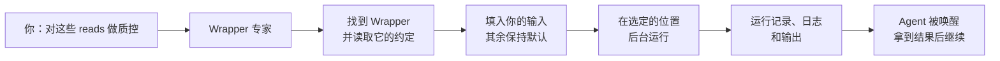
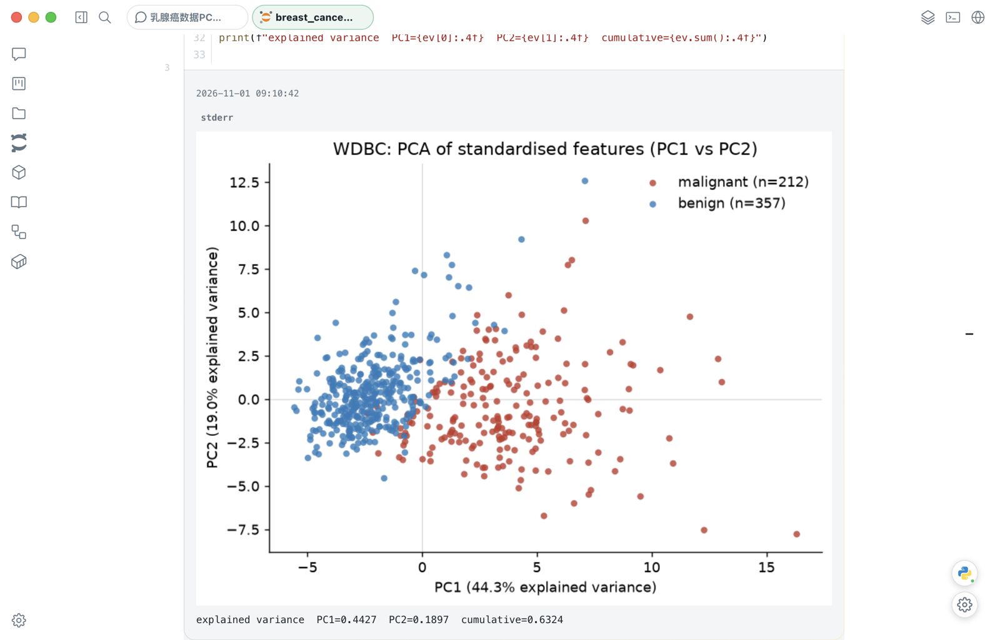
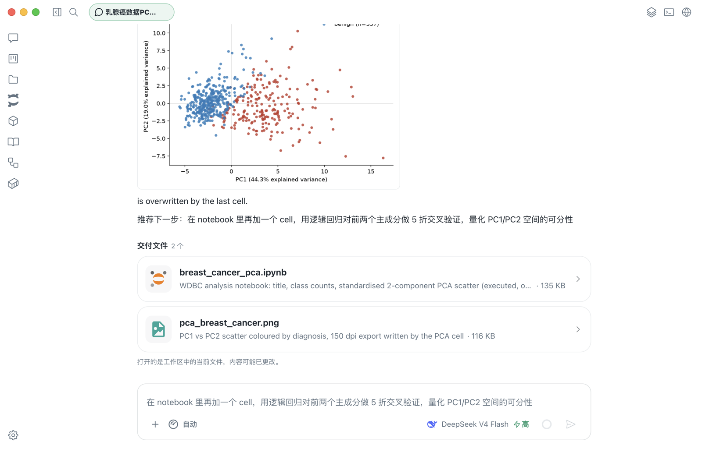
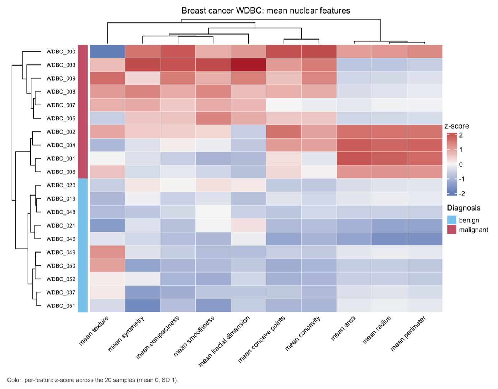

<div align="center">
  
  <h1>Phi</h1>
  <p><strong>面向科研工作的桌面 AI 工作台：探索时放手让 Agent 写代码，成熟的流程每次都按同样的方式运行。</strong></p>
  <p><a href="README.md">English</a> · <strong>简体中文</strong></p>
  <p>
    <a href="https://phi.omicsagent.cn/">官网</a> ·
    <a href="https://phi.omicsagent.cn/docs/quickstart">快速开始</a> ·
    <a href="https://phi.omicsagent.cn/docs">产品文档</a> ·
    <a href="https://github.com/dxsbiocc/phi-packages">资源包</a> ·
    <a href="https://github.com/dxsbiocc/phi/issues">问题反馈</a>
  </p>
  <p>
    <a href="#可用状态"></a>
    <a href="LICENSE"></a>
  </p>
</div>

通用 AI 助手的每一步都是临场发挥。画张图没问题，但一次比对要占用集群两天时，临场发挥就很危险。Phi 正是围绕这个差别设计的：探索时，Agent 可以自由写代码；方法已经成熟时，它调用固定、可检查的工具。代码、结果和运行记录都以普通文件的形式留在你的项目里。

## 设计理念

- **只在值得临场发挥的地方临场发挥。** 探索放在 Notebook 里，一个单元写错了代价很小。成熟流程交给 [Wrapper](#wrapper把成熟的方法变成固定工具)，因为一条命令写错了代价很大。
- **环境跟着任务走。** Skill、专家 Agent、内核和 Wrapper 各自声明需要什么，由 Phi 在受管环境中准备好，与你自己的 conda 和本机安装的软件隔离。
- **计算跟着数据走。** Phi 不会悄悄上传你的数据。远程运行使用服务器上的路径，输出也留在服务器上，远程项目不会退回到你的桌面端执行。
- **专家负责专业的事。** 主 Agent 把匹配的工作交给专注的专家，专家有自己的工具和指令，而不是什么都自己硬做。
- **关键决定由你把关。** 模式决定 Agent 能自主做多少，计划要等你审阅，每次运行都可以查看和取消。
- **成果属于你。** 结果是你选定文件夹里的普通文件，不依赖某次对话，也不依赖某个模型。

## Wrapper：把成熟的方法变成固定工具

一个 Wrapper 就是一个固定、带版本的 Nextflow 工具或流程，并声明了它的输入、参数和输出。它不是提示词，也不是 Agent 现写的代码。[Phi Packages](https://github.com/dxsbiocc/phi-packages) 目录里有 652 个，其中绝大多数改编自 nf-core 的模块和子流程，覆盖 FastQC、fastp、STAR、Salmon、DESeq2 等常用步骤。

这改变了 Agent 要负责的事情。它不必再搭环境、回忆工具参数，或猜结果放在哪里，只需要选对工具、给对输入：



|            | Notebook                | Wrapper                                 |
| ---------- | ----------------------- | --------------------------------------- |
| 代码来源   | Agent 现场编写          | 固定、带版本的源码                      |
| 适合       | 探索、作图、定制逻辑    | 标准流程：质控、比对、定量              |
| 运行方式   | 交互式，逐个单元        | 后台运行，你可以继续做别的              |
| 环境       | 受管的 Python 或 R 内核 | 每次运行选 Docker、Singularity 或 conda |
| 运行位置   | 项目的内核              | 桌面端、服务器或 Slurm 集群             |
| 出错的代价 | 很小：改单元重跑        | 较高，所以运行前先核对约定              |

实际带来的好处：

- **Agent 不会临时拼一条流程。** Wrapper 相关的工作先交给 Wrapper 专家，它在每次运行前读取工具当前的约定。只有专家报告失败后，主 Agent 才能改用其他工具。
- **长任务不占住对话。** 启动后立刻返回运行 ID，你可以继续工作。运行结束时，Phi 会带着结果唤醒对话，下一步可以直接接着用。
- **多步流程保持一体。** 多次运行可以共用一个流程标识，例如 RNA-seq 分析的各个步骤，跨多轮对话也不会散开。
- **集群是一等公民。** Wrapper 可以提交到 Slurm，主进程放在登录节点或作为控制器作业。Phi 在启动前检查远程输入是否存在，远程运行在你关闭应用后继续进行。如果跟丢了某次运行，Phi 会标记为“失联”，而不是猜它失败了。
- **新工具同样可审查。** 内置的 Wrapper 专家可以在 Phi Packages 里以源码形式编写新的 Wrapper，和其他 Wrapper 一样经过测试和发布。

这里的可复现指代码固定、输入明确，并且每次运行都有记录。环境固定到什么程度取决于各个 Wrapper 自身的定义，需要精确复现时请核对该定义。

## 怎么使用

1. **安装 Phi**：从 [Releases](https://github.com/dxsbiocc/phi/releases) 下载，或[从源码构建](#从源码构建)。
2. **在设置中添加模型提供商**。你的请求会发给这个提供商。
3. **选择项目**：本地文件夹，或 SSH 服务器上的文件夹。也可以直接开始一个不绑定项目的对话。
4. **选择模式**：询问、计划、规划并执行、自动或完全访问。在信任某个流程之前，建议先用询问或计划模式。
5. **用自己的话描述工作**。Phi 自己选择工具，只在确实需要你决定时才问你。

可以这样开始：

| 你想做的事   | 可以这样说                                              | Phi 会怎么做                                     |
| ------------ | ------------------------------------------------------- | ------------------------------------------------ |
| 探索数据     | “在 Notebook 里加载 `counts.csv`，做 PCA，按分组着色。” | 编写单元并在受管内核上运行，连同输出一起保存     |
| 运行标准工具 | “对 `data/` 里的 reads 跑 FastQC，总结没通过的项。”     | 找到 Wrapper，后台运行，结束后读取报告           |
| 运行多步流程 | “对这些样本做质控、比对和定量，再做差异表达分析。”      | 在计划模式下列出步骤供你审阅，再作为一个流程运行 |
| 使用集群     | “在集群上跑，reads 在 `/data/project/fastq`。”          | 检查服务器上的路径并提交，结束前不打扰你         |
| 作图         | “画这些基因的聚类热图。”                                | 选择模板，在项目里写一份可编辑的 `plot.R`        |
| 事后追问     | “样本 3 为什么失败了？”                                 | 读取那次运行的日志，报告其中的原因               |

使用集群前，先在 Wrappers 页面保存连接。本地运行时 Wrapper 默认使用 Docker，没有 Docker 也可以用 conda。

[快速开始](https://phi.omicsagent.cn/docs/quickstart)有更详细的配置说明，[界面图库](https://phi.omicsagent.cn/#ui-shots)可以看到 Wrapper 目录和其他界面。

## 实际效果

我们让 Agent 对 scikit-learn 自带的 Wisconsin 乳腺癌诊断数据集做 PCA。它写好 Notebook 单元，在 Phi 受管的 Python 内核上运行，并连同输出一起保存。

<picture>
  <source media="(prefers-color-scheme: dark)" srcset="assets/readme/notebook-dark.png">
  <source media="(prefers-color-scheme: light)" srcset="assets/readme/notebook-light.png">
  
</picture>

对话随后列出这次产出的文件，点击即可打开。

<picture>
  <source media="(prefers-color-scheme: dark)" srcset="assets/readme/delivery-zh-dark.png">
  <source media="(prefers-color-scheme: light)" srcset="assets/readme/delivery-zh-light.png">
  
</picture>

<sub>均为 Phi 0.1.0 桌面应用的截图，只缩放了尺寸，未作其他修改；模型为 DeepSeek V4 Flash。</sub>

### 可以继续修改的图

Visualization（科研绘图）插件从目录中选择模板，把可编辑的 `plot.R` 写入项目，再用受管 R 环境渲染。下面这张热图就来自这个流程。

<p align="center"></p>

<sub>数据是同一个 scikit-learn 数据集中的二十个样本（良性、恶性各十个），只用于演示绘图，不支持任何研究结论。图例标题是之后在 `plot.R` 中手动缩短并重新渲染的。</sub>

## 工作台里还有什么

- **Agent 能直接操作 Notebook。** Agent 可以读取 `.ipynb`，插入和修改单元，通过 Jupyter 运行，检查输出并保存。你在编辑器里看到的是同一批单元。Python 和 R 内核由 Phi 管理；使用宿主机内核需要显式选择。
- **受管环境。** 有版本记录的 Python、R、Jupyter 和 Nextflow 环境按需构建，工作不依赖宿主机装了什么。可以在设置中重建、删除或清理。首次构建需要下载软件包。
- **对话过程可控。** 每个对话都可以绑定项目，并使用一种模式：自动、询问、计划、规划并执行或完全访问。计划类模式会等你批准后才行动。切换到别处时，对话会在后台继续运行；也可以从之前的某条消息分叉。
- **插件、Skills 和连接器。** 插件把专家 Agent 与它的 Skills 和环境打包在一起。Skills 提供任务指引，MCP 连接器负责访问外部服务。官方 [Phi Packages](https://github.com/dxsbiocc/phi-packages) 目录提供可安装的内容。
- **通过 SSH 使用远程项目。** 远程项目的文件和命令都在你选定的主机上运行，不会退回到桌面端。使用前请先检查每台主机。
- **围绕对话的工作台。** 终端、内置浏览器、文件预览和后台任务面板都在对话旁边。

## 你的数据

设置、对话、审批、日志和包状态都存放在 `~/.phi`。项目文件留在你选定的文件夹里，Phi 不会把应用数据存到那里。

Phi 并非离线运行。模型请求会发往你配置的提供方，已启用的连接器也可能访问对应服务。导出的会话可能包含工具输出和敏感对话内容，请作为私有数据保管。

## 可用状态

Phi 目前是**内部测试版**。主要目标平台是 Apple Silicon 上的 macOS。Linux x64 已有打包配置，但尚未通过干净环境验收；Windows 尚未验证。更新需手动完成：在“设置 → 通用 → 检查更新”中可以查看是否有新版本。

安装包目前没有签名和公证。预览版发布后会出现在 [Releases](https://github.com/dxsbiocc/phi/releases) 页面。升级时 `~/.phi` 中的数据会保留。

- **macOS**（`.dmg`、`.zip`）：把 Phi 拖到“应用程序”。首次启动时 macOS 会提示无法验证 Phi，请打开“系统设置 → 隐私与安全性”，点击“仍要打开”；每个安装版本只需操作一次。
- **Linux**（`.AppImage`、`.deb`）：运行 `sudo apt install ./phi_*.deb`，或执行 `chmod +x Phi-*.AppImage` 后运行 AppImage。

## 从源码构建

需要 [Bun](https://bun.sh) 1.3.14 或更高版本。首次启动时会下载固定版本的运行时资源。

```bash
bun install
bun run dev
```

先在设置中配置模型提供方，再选择项目。

如果要按 CI 的方式检查源码，还需要安装 Node.js 24：

```bash
bun run helper:fetch-go && bun run build:helper
bun run lint
bun run typecheck
bun run test:gate
```

`bun run build:mac` 和 `bun run build:linux` 用于打包。维护者通过 `v*` 标签发布版本，详见 [release-signing-update.md](docs/roadmap/release-signing-update.md)。

## 许可证

源码采用 [MIT 许可证](LICENSE)。第三方来源说明见 [THIRD_PARTY_NOTICES.md](THIRD_PARTY_NOTICES.md)。错误反馈和功能建议请提交到 [GitHub Issues](https://github.com/dxsbiocc/phi/issues)。
