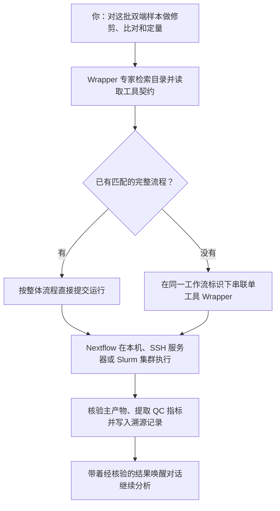
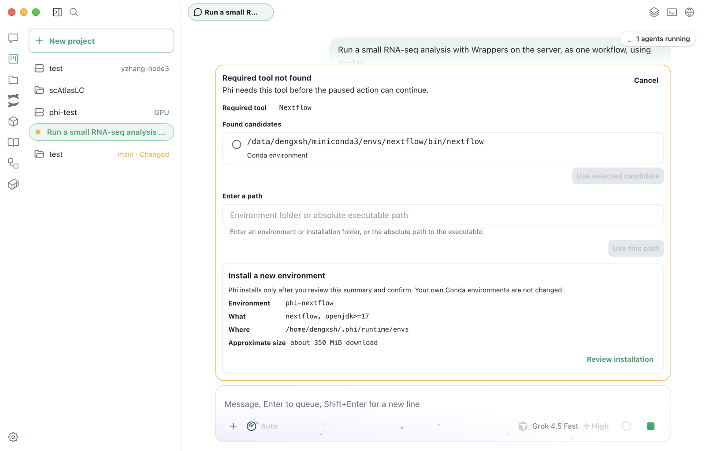
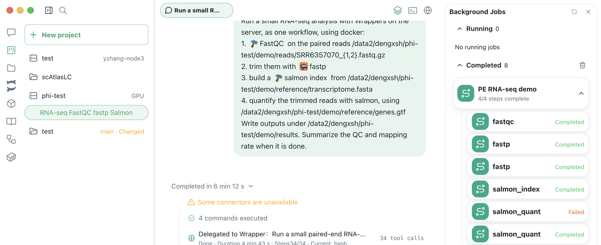
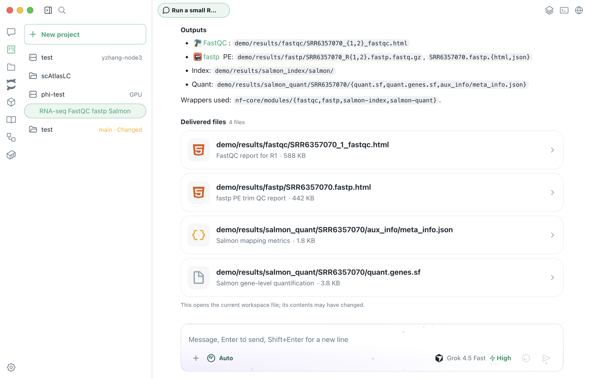
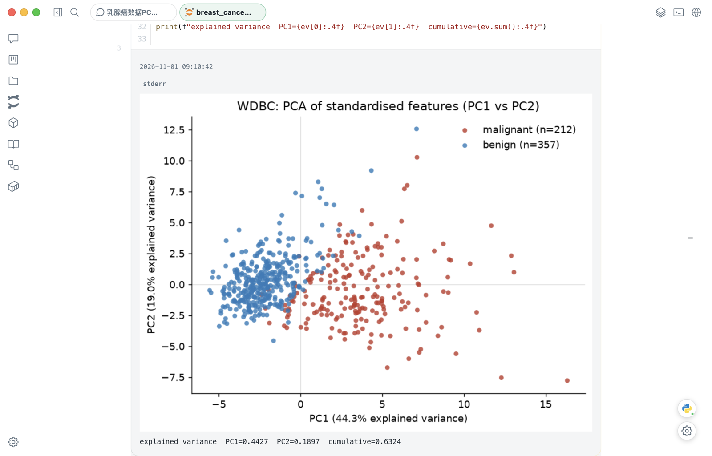
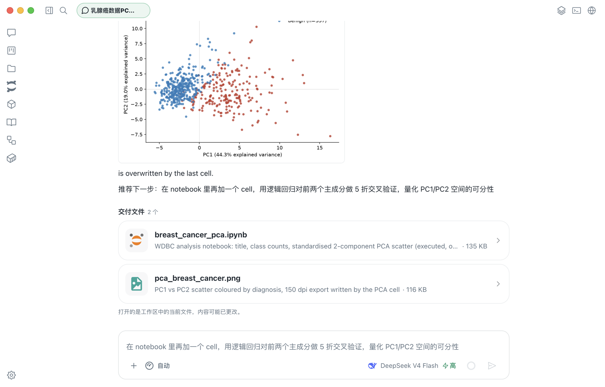
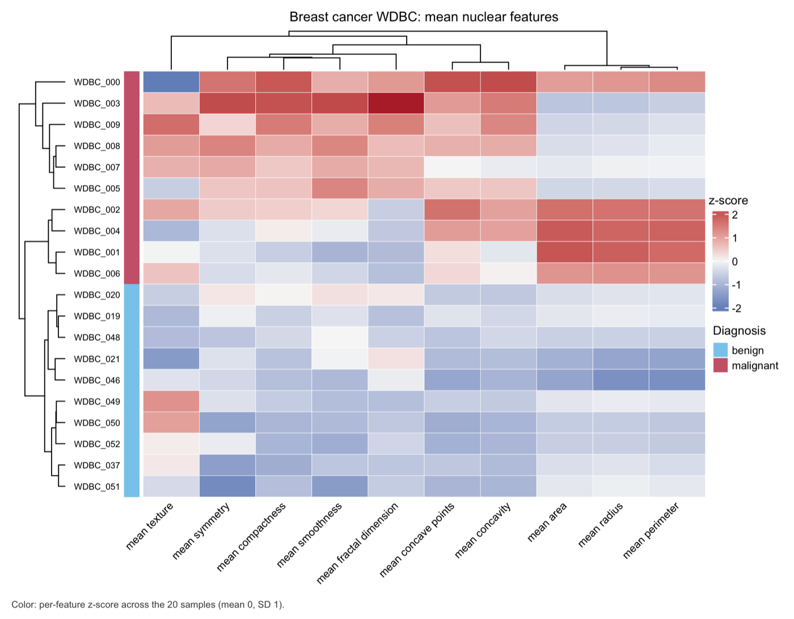

<div align="center">
  
  <h1>Phi</h1>
  <p><strong>面向科研工作的桌面 AI 工作台：在 Notebook 里自由探索，用带版本与契约校验的流程稳定运行成熟方法。</strong></p>
  <p><a href="README.md">English</a> · <strong>简体中文</strong></p>
  <p>
    <a href="https://phi.omicsagent.cn/">官网</a> ·
    <a href="https://phi.omicsagent.cn/docs/quickstart">快速开始</a> ·
    <a href="https://phi.omicsagent.cn/docs">产品文档</a> ·
    <a href="https://github.com/dxsbiocc/phi-packages">资源包</a> ·
    <a href="https://github.com/dxsbiocc/phi/releases">版本下载</a> ·
    <a href="https://github.com/dxsbiocc/phi/issues">问题反馈</a>
  </p>
  <p>
    <a href="#可用状态"></a>
    <a href="LICENSE"></a>
  </p>
</div>

通用 AI 助手习惯在每一步临场写代码。画一张探索性图表时这很方便，但跑一个要占用集群两天时间的比对流程时，临场拼凑命令和环境就非常危险。Phi 把这两类科研工作明确分开：探索数据时，Agent 在受管 Notebook 里自由编写和运行代码；执行成熟生信方法时，Agent 调用固定源码、带参数与产物契约的工具单元。所有脚本、图表、结果表和运行记录都作为普通文件留在你的项目目录里。

## 设计理念

- **只在适合临场发挥的地方写新代码。** 探索性分析放在 Jupyter Notebook 中，改一个单元格重跑的成本很低；标准组学流程交给 [Wrapper](#wrapper把成熟方法封装为可组合的固定步骤)，避免手写长命令出错。
- **运行环境跟着任务走。** 技能、领域专家 Agent、Notebook 内核和 Wrapper 各自声明依赖，由 Phi 基于显式跨平台锁文件在独立的 `micromamba` 运行时中构建，不污染宿主机原有的 Conda、Python 或 R 环境。
- **计算向数据移动。** Phi 不会在后台偷偷上传你的本地数据。绑定 SSH 远程项目后，路径检查、计算和产物全部留在服务器或 Slurm 集群上，绝不静默回退到本机执行。
- **专业任务交给领域专家。** 主 Agent 将细分领域的分析委派给对应的专家智能体，由专家携带经过输出模式校验的脚本工具、工作流指引和专属环境完成分析。
- **关键节点由人把关。** 运行模式决定 Agent 的自主边界：结构化研究计划先由你审阅，安装外部组件需经你确认，后台运行任务随时可以查看日志或中止。
- **成果独立于对话留存。** 输出文件、可继续编辑的 `plot.R` 绘图脚本、Notebook 与可复现溯源记录都保存在你选定的项目文件夹中，不绑定单次会话或特定大模型。

## Wrapper：把成熟方法封装为可组合的固定步骤

Phi 将成熟的生物信息学与计算生物学工具封装为带版本号的 Nextflow 单元，称为 Wrapper。每个 Wrapper 通过静态清单（`wrapper.yaml`）声明输入、参数和预期主产物，并配有固定的 `main.nf` 入口和默认参数文件。

官方 [Phi Packages](https://github.com/dxsbiocc/phi-packages) 仓库现已收录 **2,207 个 Wrapper**：

- **2,073 个单工具模块**：涵盖 FastQC、fastp、STAR、Salmon、DESeq2、BCFtools、GATK，以及 AlphaFold 3、Boltz-2、Protenix、Chai-1、LigandMPNN 等结构预测与蛋白设计工具。
- **121 个子工作流**：覆盖测序质控修剪、比对去重、变异注释、蛋白结构评估等常见多工具阶段。
- **13 条完整标准流程**：包含 `nf-core/rna-seq`、`sarek`、`scrnaseq`、`atacseq`、`chipseq`、`methylseq`、`quantms`、`mag`、`ampliseq`、`rnafusion`，以及本地封装的 `cutandrun`、`rnasplice` 和 `protein_binder_design` 全流程。

Agent 不再需要凭记忆拼凑命令行参数或临时配环境，只需根据研究设计挑选合适的 Wrapper、传入输入路径，执行层全部交给 Nextflow。

### 每一步都由 Nextflow 驱动

每次 Wrapper 运行都会生成确定的参数文件与目标端配置，对固定源码执行 `nextflow run`。容器或 Conda 隔离、本机或 Slurm 作业调度，以及各步骤的 CPU、内存和运行时限均由 Nextflow 统一接管。

### 两种运行方式

- **按需串联原子工具。** 当现有整套流程不完全匹配实验设计时，Agent 会在同一个工作流标识下串联多个单工具 Wrapper，将上一步核验通过的产物传给下一步。每一步仍是独立的 Nextflow 运行，支持单独查看、重试或取消。
- **直接运行完整流程。** 当 `nf-core/rna-seq` 或 `sarek` 等成熟流程已覆盖任务需求时，Agent 直接将其作为整体提交运行，步骤顺序由流程作者严格固定。



### 全链路可核验、可复现

- **启动前预检。** 运行前自动校验必填项、参数类型、枚举与数值范围、样本表配对与泳道信息，以及输入文件真实存在性（SSH 远程运行直接在远端校验）；自动拦截会把不同样本意外合并的通配符，并核对上下游步骤间的 `.phi-context.json` 输入契约。
- **运行中留档。** 每次运行都在独立目录中冻结当时的 `wrapper.yaml` 快照、实际参数、生成的 Nextflow 配置、完整日志以及运行环境摘要（Nextflow 版本、容器运行时与镜像摘要、宿主机架构）。
- **完成后验收。** 只有声明的主产物通过存在性与内容断言检查后，运行才会计为完成；同时自动生成带 SHA-256 校验与样本溯源的 `.phi-context.json` 元数据、提取结构化 QC 指标，并支持一键导出完整可复现归档包。

### Notebook 与 Wrapper 各司其职

|          | Notebook                           | Wrapper                                         |
| -------- | ---------------------------------- | ----------------------------------------------- |
| 代码来源 | 由你或 Agent 现场编写              | 带版本号与静态契约的固定 Nextflow 源码          |
| 适用场景 | 数据探索、定制统计建模、交互式质控 | 标准化计算流程：质控、比对、定量、变异          |
| 执行方式 | 交互式逐单元格运行                 | 后台异步执行，不阻塞当前对话                    |
| 运行环境 | 受管 Python、R 或插件专属内核      | 每次运行按配置使用 Docker、Singularity 或 Conda |
| 运行位置 | 本地或远程项目的 Jupyter 内核      | 桌面本机、SSH 服务器或 Slurm 集群               |
| 试错成本 | 低：修改单元格即可重跑             | 高：启动前必须先通过参数与输入契约校验          |

### 一次真实运行示例

在下面的任务中，用户要求在远程 GPU 服务器上用 Docker 串联运行 FastQC、fastp、Salmon 建索引和 Salmon 定量处理双端测序数据。服务器默认登录 `PATH` 中未找到 Nextflow，Phi 在第一步启动前暂停并弹出交互卡片，列出远端已检测到的 Conda 环境，同时提供手动填写路径或新建受管环境的选项，未经确认不会擅自安装软件。

<p align="center"></p>

确认后，Wrapper 专家将四个步骤归入同一条工作流在后台运行。首次 Salmon 定量因索引路径参数有误失败，专家修正路径后仅重跑了该步骤，最终以 4/4 步完成整条工作流。

<p align="center"></p>

全部步骤结束后，Phi 自动唤醒原对话，汇总质控与比对率指标、列出实际调用的 Wrapper，并在对话末尾附上报告与定量结果文件卡片。

<p align="center"></p>

<sub>截图来自开发版（英文界面，模型为 Grok 4.5 Fast），图片已等比缩放，后台任务局部经过裁剪。</sub>

## 领域插件、技能与 MCP 连接器生态

除 Nextflow Wrapper 外，Phi 直接对接 [Phi Packages](https://github.com/dxsbiocc/phi-packages) 官方仓库，提供细分学科分析、科研写作流程与外部公共数据库检索能力：

- **24 个领域专家插件。** 每个插件将专家智能体、工作流技能、带 JSON Schema 输出校验的脚本工具与锁定的 Conda 环境打包为一个整体，覆盖单细胞转录组（Scanpy / Seurat）、空间转录组、scATAC-seq、染色质分析、Bulk RNA-seq、蛋白质组、代谢组、宏基因组、DNA 甲基化、多组学整合、基因组学、统计遗传学、孟德尔随机化、药物基因组学、临床生存与因果推断、临床胚系遗传、蛋白质设计、药物发现、免疫信息学、CRISPR 设计与筛选、分子克隆、湿实验分析、文献知识库与科研绘图。
- **52 项科研与工具技能。** 包含 19 项独立科研技能（覆盖课题实验设计、统计审查、文献综述、研究溯源核查、论文撰写与润色、审稿回复、基金申请书、论文转演示文稿及流程编写）与 33 项插件内置技能，并自带 Office 文档处理组件（`docx`、`pptx`、`xlsx`、`pdf`）。
- **25 个 MCP 连接器。** 内置 9 个 Phi 自托管生物医学与组学数据网关（含集成 PubTator 3.0 注释的 PubMed、bioRxiv & medRxiv、ClinicalTrials.gov、跨 30+ 公共库的 Omics Sniffer，以及癌症组学、单细胞转录组、表观基因组、蛋白质组和代谢组网关），并支持 Open Targets、cBioPortal、STRING、RCSB PDB、OLS4、BioRender、Notion、Linear、Figma、Canva、Excalidraw、Tavily、SerpApi、Firecrawl、Browser Use 与 Composio。
- **对话内按需安装与一键授权。** 当任务需要尚未安装的插件、技能或 MCP 连接器时，Agent 会在对话内直接发起安装申请供你确认；检索外部 `skills.sh` 技能目录及安装第三方 GitHub 技能均执行双阶段安全提醒并固定提交哈希；需要 OAuth 登录或 API Key 的连接器会直接在对话流中弹出授权卡片，无需手动去设置页翻找。

## 交互式 Notebook、科研规划与可编辑出图

### 带环境溯源的交互式 Notebook

Agent 可以直接读取 `.ipynb`、增改代码或说明单元格、连接 Jupyter 内核执行、查看输出与变量结构并保存文件；你在右侧编辑器中看到和编辑的是同一份文档。Phi 统一管理隔离的 Python 3.12、R 4.4 内核以及已安装插件贡献的专属内核，并在保存 `.ipynb` 时自动将实际执行的受管环境 `envId` 与锁文件哈希 `lockSha256` 写入元数据。

下图展示了 Agent 在受管 Python 内核中对 scikit-learn 乳腺癌诊断数据集执行 PCA 分析并保存 Notebook 与散点图：

<picture>
  <source media="(prefers-color-scheme: dark)" srcset="assets/readme/notebook-dark.png">
  <source media="(prefers-color-scheme: light)" srcset="assets/readme/notebook-light.png">
  
</picture>

产出的文件会以卡片形式列在回复末尾，点击即可在工作台中并排打开：

<picture>
  <source media="(prefers-color-scheme: dark)" srcset="assets/readme/delivery-zh-dark.png">
  <source media="(prefers-color-scheme: light)" srcset="assets/readme/delivery-zh-light.png">
  
</picture>

### 随时可二次修改的科研图表

Visualization（科研绘图）插件从模板库匹配图型后，会先在项目目录生成一份独立的 `plot.R` 脚本，再通过其锁定的 `plugin:viz` R 环境渲染成图。由于脚本保留在项目里，无论是你手动微调图例字号、配色，还是让 Agent 接着改版式，都不需要重跑上游分析。

<p align="center"></p>

<sub>基于同一乳腺癌数据集中的二十个样本渲染；图例标题在生成的 `plot.R` 中缩短后重新渲染得到。</sub>

### 假设驱动的科学规划与多面板工作台

- **结构化科学计划。** 在“计划”与“规划并执行”模式下，计划支持文献调研决策与引文核验（DOI / PMID / PMCID / arXiv）、竞争性可证伪假设与统计独立重复单元声明、步骤完成后客观文件/表格校验（`file_exists`、`non_empty_file`、`json_valid`、`table_schema`），以及绑定证据哈希的溯源汇总报告。
- **围绕对话的完整工作台。** 本地终端、内置网页浏览器、支持冲突检测保存的文件树编辑器、受管环境管理面板与统一后台任务中心都集成在同一界面内。
- **多会话并发执行。** 全局支持最多 4 个会话同时在后台运行或等待审批，切换项目和会话不会中断后台任务。

## 快速上手

1. **安装 Phi**：前往 [Releases](https://github.com/dxsbiocc/phi/releases) 下载对应系统安装包，或[从源码构建](#从源码构建)。
2. **配置模型提供商**：打开 **设置 -> Provider** 添加 API Key 或登录模型服务。
3. **打开工作项目**：选择本地文件夹、连接 SSH 远程服务器目录，或直接开启无项目普通对话。
4. **选择运行模式**：支持“询问”、“计划”、“规划并执行”、“自动”与“完全访问”。初次跑新流程建议先选“询问”或“计划”。
5. **用自然语言描述任务**：Phi 会在 Notebook、领域专家插件、MCP 连接器与 Nextflow Wrapper 之间自动调度，只在涉及关键审批或科学决策时向你确认。

| 你想完成的事   | 示例提问                                                   | Phi 的处理方式                                               |
| -------------- | ---------------------------------------------------------- | ------------------------------------------------------------ |
| 探索表格数据   | “在 Notebook 里加载 `counts.csv`，做 PCA 并按分组着色。”   | 在受管内核中编写并执行单元格，连同输出保存 `.ipynb`          |
| 运行标准质控   | “对 `data/` 下的测序文件跑 FastQC，汇总未通过的检查项。”   | 后台启动 FastQC Wrapper，完成后自动读取结果报告              |
| 执行多步标准流 | “对这批双端样本做修剪、比对和定量，再跑差异表达分析。”     | 生成可审阅计划，运行或串联对应 Wrapper 并核验主产物          |
| 提交集群作业   | “在 Slurm 集群上跑，原始数据在 `/scratch/project/fastq`。” | 在远端核对路径后提交 Slurm，作业结束自动唤醒对话             |
| 检索公共组学库 | “查找带治疗响应元数据的三阴性乳腺癌人类单细胞数据集。”     | 调用 PubMed 与 Omics Sniffer 连接器返回项目编号与样本规模    |
| 绘制出版级图表 | “根据 `deseq2_results.tsv` 画火山图和差异基因聚类热图。”   | 通过科研绘图插件写入可编辑的 `plot.R` 并渲染高清图与质检结果 |

更多细节可参阅 [快速开始指南](https://phi.omicsagent.cn/docs/quickstart) 与 [在线文档](https://phi.omicsagent.cn/docs)。

## 数据与隐私边界

应用设置、会话历史、审批记录、运行日志和已安装包状态统一存放在 `~/.phi` 下；你的科研数据与产出文件始终留在所选项目文件夹中，Phi 不会在项目目录中写入私有运行垃圾文件。

Phi 会向你配置的模型服务商和已启用的外部 MCP 服务发送必要请求。本地持久化的后台任务历史仅保留脱敏展示元数据，自动剥离原始命令、提示词与错误日志；手动导出的完整会话归档包含对话和工具输出，请按私有科研数据妥善保管。

## 可用状态

Phi **0.2.2** 现已开启**公开测试（Public Beta）**，在 [Releases](https://github.com/dxsbiocc/phi/releases) 页面提供 **macOS（Apple Silicon）**、**Linux x64** 与 **Windows x64** 安装包。可通过 **消息中心** 或 **设置 -> 通用 -> 检查更新** 打开应用内更新弹窗，直接查看版本更新说明、实时下载并校验（SHA-256）新版本安装包并完成替换升级，完整保留 `~/.phi` 中的既有数据。

- **macOS Apple Silicon**（`.dmg`、`.zip`）：拖入“应用程序”即可。当前公测构建使用 ad-hoc 签名（暂未启用 Apple Developer ID 公证），首次打开如遇系统拦截，请前往 **系统设置 -> 隐私与安全性** 点击一次“仍要打开”。
- **Linux x64**（`.AppImage`、`.deb`）：执行 `sudo apt install ./phi_*.deb`，或执行 `chmod +x Phi-*.AppImage` 后直接运行。包内已内置固定版本的 `bun`、`micromamba` 与 `phi-kernel`。
- **Windows x64**（`.exe` 安装程序）：默认按当前用户安装并支持自选目录（因暂未配置代码签名，Windows SmartScreen 首次运行可能弹出提醒）。本地对话与默认 Python 3.12 Notebook 直接使用内置的 Windows 原生运行时（可在 **设置 -> 环境** 中一键构建）；R 环境、Nextflow 流程及 `pysam`、`harmonypy` 等仅限 Linux 的生信包通过 WSL2 运行，内置 `env_diagnose` 诊断与对话内 WSL2 配置引导。

## 从源码构建

需要安装 [Bun](https://bun.sh) 1.3.14 或更高版本。首次启动或构建会自动拉取固定版本的运行时二进制资源。

```bash
bun install
bun run dev
```

如需在本地执行与 CI 相同的完整门禁检查（另需安装 Node.js 24）：

```bash
bun run helper:fetch-go && bun run build:helper
bun run lint
bun run typecheck
bun run test:gate
```

在对应宿主机上运行 `bun run build:mac`、`bun run build:linux` 或 `bun run build:win` 可生成安装包。版本标签发布与签名说明见 [release-signing-update.md](docs/roadmap/release-signing-update.md)。

## 许可证

本项目源码基于 [MIT 许可证](LICENSE) 开源。第三方开源组件声明见 [THIRD_PARTY_NOTICES.md](THIRD_PARTY_NOTICES.md)。问题反馈与功能建议欢迎提交至 [GitHub Issues](https://github.com/dxsbiocc/phi/issues)。
