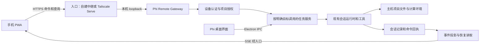
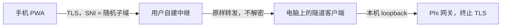
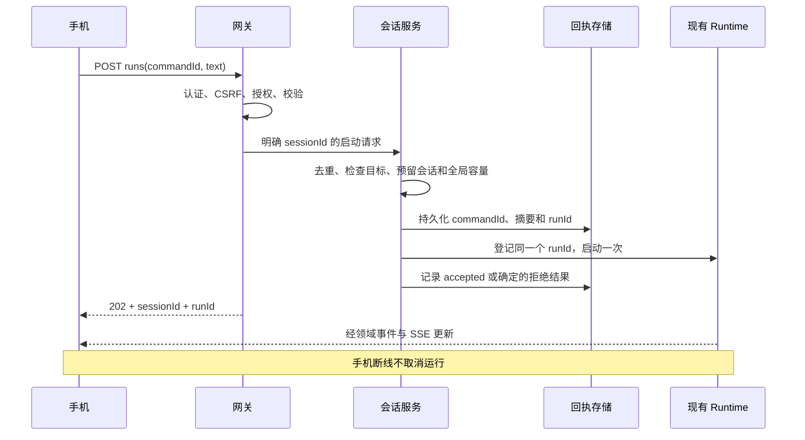

# Phi 手机伴随端：架构设计与实施方案

2026-10-24 范围澄清：当前版本只做[本地与远程统一内核](../roadmap/phi-kernel-implementation.md)，[个人版/实验室版、成员共享与通信](../roadmap/phi-personal-lab-roadmap.md)放到下一大版本。当前仅在[接口设计](../roadmap/phi-kernel-implementation.md#collaboration-compatibility)中考虑未来接入，不启动相应产品实现。下一大版本内部先实验室协作、后个人好友交流；本说明不改变手机方案的既有 iPhone 范围或授权提前开工。

日期：2026-10-21  
状态：设计提案，尚未实现；已完成代码边界核对与一次独立架构复审。接口、目录和默认参数均为拟议契约。  
2026-10-23 补充：新增第 16 节群聊（G1：一人 + 多个专家智能体）及第 8.1 节协议预留项，参考 rakazo 开源实现；同样尚未实现。  
代码核对基线：`97461c53` 附近的当前工作区；工作区已有其他未提交改动，本文不修改应用代码。  
目标读者：产品负责人、桌面端与移动端开发者、测试与安全审查人员。

## 1. 目标与推荐结论

为 Phi 增加手机控制端，让用户在手机上选择自己的电脑和项目，下达自然语言任务、查看执行进度、回应审批和提问、获取结果。文件访问、工具执行和计算发生在用户自己的主机上，手机与桌面查看同一份会话和运行记录。

推荐从 **React PWA + 用户自建的 TLS 直通中继（可选 Tailscale Serve）+ Phi 内置远程网关 + 现有会话运行时** 开始（入口选择见第 4.2 节）。先验证一个人的一台电脑与少量手机设备，再增加 Capacitor 原生 App、通知、面向普通用户的连接服务以及独立后台运行时。

这里的“本地主机执行”不等于“完全离线”：模型请求仍服从 Phi 当前配置；在线模型会接收必要的提示词与工具上下文。Tailscale 可能使用协调服务和加密中继，手机系统推送也依赖平台服务。这些服务不承担用户任务的计算，但应在产品说明中准确披露。自建中继只转发加密流量、不解密，但它的可用性和所在线路决定手机能否连上；中继服务器与域名由用户自己控制。

本次仅编写实现文档，不将路线图中的待办视作已实现功能，也不自动引入新依赖。本文新增的功能范围是一项待实施的产品增量。

### 1.1 核心使用流程

1. 电脑端开启“手机连接”，确认允许访问的本地项目，并显示配对二维码。
2. 手机打开连接页面，完成配对，看到主机状态和获准的项目。
3. 用户选择会话，输入“继续分析数据并生成 PDF 报告”。
4. 主机确认接收，返回稳定的任务标识；手机随后锁屏或断网不会取消运行。
5. 工具需要审批或 agent 需要用户补充信息时，任务进入对应等待状态。
6. 用户在手机或电脑任一端处理；另一端同步显示处理结果。
7. 任务完成后，手机查看摘要、图片和报告，也可在电脑继续同一会话。

### 1.2 首版边界

首版是任务控制面：提交、查询、停止、审批、回答、获取产物。用户授权的能力仍由 Phi 的 agent 和工具提供。操作其他桌面应用的鼠标键盘、远程桌面视频流、任意交互终端、完整 Notebook 编辑器均属于独立能力，不混入首版。

群聊（第 16 节）不属于首版任务控制面，但首版协议须按第 8.1 节预留字段，使群会话上线时不必升级协议主版本。

先支持已登记的本地项目。普通会话目录、SSH/HPC 项目、跨主机任务调度留到后续明确授权与执行位置后再接入；不得把本地项目不可用悄悄解释为改用其他目录。手机端也不直接修改供应商密钥、权限模式、MCP 配置或安装系统工具。

**2026-10-23 决定（手机平台）：**V1 与 V1.1 只面向 **iPhone**（Safari 与安装到主屏幕的 PWA），连接、推送和实机验收都以 iPhone 为准。Android 手机上可能也能打开，但不验证、不承诺；Android 支持（含国内推送）放到单独的“Android 升级”阶段（第 18 节 A1）。

**2026-10-23 决定：**手机 V1 只支持本地项目，但 C0 冻结的契约预留远程字段（第 8.1 节）。远程（SSH/HPC）项目支持和远程项目中的群聊进入 V1.1，前提是远程运行时完成[默认开启验证](../runtime/remote-default-on-validation.md)。

## 2. 与现有 Phi 的关系

依据 [内部测试路线图](../roadmap/internal-beta-implementation.md)，保留项目绑定、多会话执行、可理解审批和可恢复历史的主线。该路线图尚未将手机端纳入既定 beta 范围，且明确延后系统通知与公开分发，因此本文把移动通知和应用商店发布放到首个任务闭环之后。

| 已核对的代码                                                                                             | 现有能力或限制                                                           | 接入方式                                                               |
| -------------------------------------------------------------------------------------------------------- | ------------------------------------------------------------------------ | ---------------------------------------------------------------------- |
| [agent-ipc.ts](../../src/main/ipc/agent-ipc.ts)                                                          | 提交会先对齐目标，再读取当前会话；普通停止操作也依赖当前会话             | 新增明确目标的应用服务，桌面适配层保留现有导航行为，手机调用不切换桌面 |
| [prompt-run-admission.ts](../../src/main/session-runtime/prompt-run-admission.ts)                        | 已有目标解析、运行 ID 分配、恢复/压缩/忙碌检查                           | 复用并补上针对外部命令的授权、原子准入与回执                           |
| [prompt-run-queue.ts](../../src/main/session-runtime/prompt-run-queue.ts)                                | `submitPromptRun` 已按显式 sessionKey 执行，但返回整个运行完成的 Promise | 增加“接收完成”与“执行完成”分离的入口，原桌面调用可继续等待 done        |
| [session-runner-registry.ts](../../src/main/agent/session/session-runner-registry.ts)                    | 每会话一个活跃运行，全局默认最多 4 个；有审批与结束事件                  | 共用同一登记表与容量限制，手机不能绕过或另设一套执行器                 |
| [session-store.ts](../../src/main/agent/session/session-store.ts)                                        | manifest、messages.jsonl、runId 与随机 UUID eventId 已存在               | 增加分页、恢复游标和命令回执；eventId 只作身份，不能按 UUID 排序       |
| [session-event-persistence.ts](../../src/main/agent/session/session-event-persistence.ts)                | 已有运行事件持久化与输出投影                                             | 从领域事件/存储边界订阅，经移动端 DTO 投影后输出                       |
| [tool-ipc.ts](../../src/main/ipc/tool-ipc.ts)、[tool-approval.ts](../../src/main/agent/tool-approval.ts) | 工具审批响应绑定 Electron sender                                         | 为已认证设备增加授权入口，保留现有桌面 sender 校验                     |
| [user-interaction.ts](../../src/main/agent/user-interaction.ts)                                          | 用户提问及回答同样具有窗口身份与生命周期约束                             | 独立支持 `needs_input`，不能将提问伪装为工具审批                       |
| [present-files.ts](../../src/main/agent/deliverables/present-files.ts)                                   | 已校验工作区内普通文件，但返回的是主机路径                               | 新增受授权的远程产物登记和下载，不把路径当下载凭证                     |
| [index.ts](../../src/main/index.ts)                                                                      | 事件发送、窗口关闭清理、退出与防休眠仍在主进程组装                       | 网关挂入同一生命周期；窗口常驻行为另设明确门槛                         |

需要纠正两个容易误判的地方：任务执行核心已经部分脱离“当前显示会话”，不需要重写 agent；但 renderer 的 IPC 和推送路径仍不等于可直接公开的网络 API。现有 `appendFileSync` 及随后的 manifest 更新也不构成跨文件事务或强持久化回执。

## 3. 系统原理与信任边界



手机是控制端，主机是权威状态源。HTTP 连接只传输命令和状态，不拥有任务生命周期；断开请求不能自动中止已经接受的运行。唯一的正常用户停止入口是针对明确 `sessionId + runId` 的停止命令。

网络网关负责协议、认证、输入校验、限流和输出边界；会话应用服务负责“哪个项目、哪个会话、哪次运行、当前是否允许”；现有 runtime 负责执行。网关不构造第二套 agent，也不把任意 IPC 通道转换成远程调用。

电脑端连接网络与手机端访问项目属于不同授权层。能访问入口地址（无论经中继还是 Tailscale）不自动获得 Phi 权限；每个已配对设备仍需要自己的凭证和项目授权。

## 4. 技术路线及备选方案

### 4.1 手机界面

| 方案                     | 收益                                                | 代价                                                                             | 决策                               |
| ------------------------ | --------------------------------------------------- | -------------------------------------------------------------------------------- | ---------------------------------- |
| React PWA                | 沿用 TypeScript/React，可添加到手机桌面，发布路径短 | 手机后台连接受系统管理；本地缓存、通知与安装需实机验证                           | 首版                               |
| PWA 界面 + Capacitor     | 复用界面和协议，可增加原生通知、分享与安全存储      | 要维护 iOS/Android 构建、签名、插件及认证适配                                    | **原生路线（C8）**                 |
| React Native             | 原生交互与系统整合空间较大                          | React DOM/MUI 组件不能直接复用，需要新 UI 层；Android 推送在国内同样要接厂商通道 | 不选；原生交互成为主要需求时再评估 |
| Swift + Kotlin           | 平台控制力强                                        | 两套客户端及更高维护成本                                                         | 当前不选                           |
| 现成远程桌面或聊天机器人 | 可用于人工验证需求                                  | 难提供 Phi 的结构化审批、产物和一致会话体验；机器人另有内容传输边界              | 不作为产品主架构                   |

**2026-10-23 决定：C5 用 PWA；原生路线选 Capacitor，不选 Expo。**

- 推送不是选 Expo 的理由：Expo 推送在 Android 上同样走 Google FCM，大陆网络下收不到。Android 在国内要收到推送，无论哪种客户端都要接国内厂商通道（推送路线见第 15 节）。
- Phi 的价值主要在富内容展示（Markdown、公式、分子式、图片、Notebook 输出）。现有前端是 React DOM + MUI + react-markdown，Capacitor 可以整套复用；React Native 只能复用纯 TypeScript 逻辑，渲染要重写或嵌 WebView。
- Capacitor 沿用 `src/mobile` 的 Vite 入口，不需要引入 Metro 构建或迁移 monorepo；Expo 则要先抽共享包。
- rakazo 选 Expo，是因为它的界面本来就为移动端单独编写；它的 SSE 读取与通知分类仍可作为参考（第 16.11 节）。只有当原生交互成为主要需求时，再重新评估 React Native。

PWA 页面由主机网关同源提供，不直接复用依赖 `window.api` 的完整 Electron 页面。只提取已经适合浏览器运行的协议、格式化和消息展示能力。[Capacitor 官方文档](https://capacitorjs.com/docs)说明其 Web 与原生容器路线，但封装并不自动解决网络、认证或系统后台限制。

### 4.2 网络连接

**2026-10-23 决定：**目标用户主要在国内网络，手机上经常开代理。因此 V1 默认入口改为**用户自建的 TLS 直通中继**，Tailscale Serve 降为可选入口。网关入口做成可替换的（4.2.4）；配对、凭证和 API 协议（第 8–11 节）不随入口改变。

#### 4.2.1 约束

- **手机同一时间只能有一个 VPN 类应用生效**（iOS 与 Android 都是如此）。Tailscale 要占这个位置，与常开的代理 App 或学校 VPN 互斥。目标用户常开代理，所以任何“手机必须装 VPN”的方案都不能作为默认。
- Tailscale 的中继节点不在中国大陆，打洞失败时要绕行境外节点；部分登录方式在国内不稳定；校园网或单位网络封 UDP 时更依赖中继。这些需要 C0 实测确认。
- Cloudflare Tunnel 的非企业版在大陆通常经境外节点访问，延迟和可用性不稳定，手机往往也要走代理才稳定。
- 大陆云服务器上的域名对外提供 80/443 服务需要 ICP 备案，未备案的域名会被拦截；香港等境外节点不需要备案，但跨境线路质量因运营商而异。
- 局域网 HTTP 不是浏览器安全上下文，PWA 的 Service Worker 与 Secure Cookie 都不能用。

#### 4.2.2 方案对比

| 方案                                          | 特点                                                                                                 | 取舍                                                                                                     |
| --------------------------------------------- | ---------------------------------------------------------------------------------------------------- | -------------------------------------------------------------------------------------------------------- |
| 自建 TLS 直通中继                             | 电脑主动出站连到用户自己的中继；中继按 SNI 把手机的 TLS 连接原样转给电脑，**不解密**；TLS 在网关终止 | **V1 默认**。手机不装 VPN，与代理共存；第 8–11 节协议不变；需要一台服务器、一个域名和证书管理            |
| Tailscale + Serve                             | 设备私网、穿透、私有 HTTPS；可能直连或经加密中继                                                     | 可选入口：适合手机不常开代理、网络能稳定连接 Tailscale 的用户                                            |
| 终止 TLS 的反向代理（Caddy/Nginx、CF Tunnel） | 部署最简单，主机主动出站                                                                             | 中继能看到明文，不作为默认；Cloudflare Tunnel 在国内还有可用性问题                                       |
| 自建 WebSocket 中继 + 应用层端到端加密        | 第 21 节的产品化路线，可由 Phi 运营公共中继                                                          | 需要成熟的端到端协议与密钥管理；PWA 代码由中继分发时仍须信任中继；产品化时再做                           |
| WebRTC 数据通道                               | DTLS 端到端、可能直连；配对时固定电脑证书指纹即可防中继篡改                                          | 需要信令与 TURN，HTTP/SSE 要改成数据通道上的帧协议；移动运营商 NAT 下常需 TURN；作为原生客户端阶段的备选 |
| 公网端口映射                                  | 链路直观                                                                                             | 家庭、校园网通常没有公网 IP，证书与暴露面都要自行处理；不作为默认                                        |
| 局域网直连                                    | 初期调试简单                                                                                         | 离开 Wi-Fi 即不可达，且受安全上下文限制；不作为发布方案                                                  |

#### 4.2.3 V1 默认：自建 TLS 直通中继



- **中继。**一台用户自己控制的服务器。建议用香港等境外节点以免备案；已有备案域名时也可放在国内节点以降低延迟。运行成熟的 SNI 路由隧道服务，例如 frp 的 `https` 类型（按 SNI 转发、不解密，C0 核实），不自行编写隧道协议。Phi 不运营公共中继。
- **电脑。**Phi 调用隧道客户端，主动出站连接中继；客户端与中继之间的控制连接使用 TLS 和令牌认证，隧道目标是本机网关的 loopback 端口。V1 不打包隧道客户端，管理方式见 4.2.7。与 Serve 方案不同，**网关自己终止 TLS**，因此需要在 loopback 上提供 HTTPS。
- **域名与证书。**
  - 主机名使用随机子域，形如 `<随机串>.phi.<用户域名>`，降低被扫描的概率。
  - 证书私钥只在电脑上生成，存入系统安全存储，中继拿不到。
  - 证书通过 ACME DNS-01 签发**通配符证书** `*.phi.<用户域名>`，避免随机主机名出现在证书透明度日志里。DNS API 令牌只存在电脑的安全存储中，权限尽量限制在该子域。
  - 掌握 DNS 的人可以另签证书，所以中继和域名必须由用户本人控制。这正是“自建”的前提，**不是**对第三方中继的端到端保证。
- **手机。**普通网络直接访问 `https://<随机串>.phi.<用户域名>`，不需要 VPN。代理 App 把该域名设为直连（国内节点）或照常走代理（境外节点）都能工作。PWA 页面仍由电脑网关经隧道同源提供。
- **暴露面变化。**入口从私网变成公网可达，因此：
  - 未认证接口只保留配对交换与最小 liveness，不返回任何用户、项目或模型信息；
  - 配对必须经电脑端确认（第 11.2 节）；
  - 中继与网关两层都限流；
  - 中继只看到加密流量和 SNI，不记录请求内容；
  - 隧道令牌泄露时，攻击者最多能冒充隧道终点，但没有该主机名的有效证书，手机的 TLS 校验和 bootstrap 中的 `hostId` 校验都会失败。
- **原生客户端阶段**可以改为在配对时固定电脑自签证书的指纹，不再需要域名和 DNS-01（第 11.4 节）。

#### 4.2.4 网关入口可替换

- 网关只监听 loopback。外部入口是一组配置 `{ kind: 'relay' | 'tailscale-serve', origin, status }`，允许的 Host 与 Origin 从这里取；配对二维码携带当前入口的 origin。
- 一台电脑可以同时启用两种入口。PWA 设备凭证随 origin 绑定（Cookie 本身按 origin 隔离），换入口需要重新配对；原生客户端只需更新主机记录中的地址，并照常校验 `hostId`。
- 诊断按入口分别显示：隧道是否已连上中继、证书是否有效及剩余有效期、外部可达性自检结果。

#### 4.2.5 C0 必测

- 在 iPhone 上，4G/5G 与校园网下，代理开启（规则模式、全局模式）与关闭时：经中继的连通率、首包延迟、SSE 事件延迟与断线恢复时间。
- 相同条件下对照 Tailscale Serve。
- 香港节点与已备案国内节点的延迟对比。
- 所选隧道服务的 SNI 直通是否不解密、长连接与心跳超时、断线重连行为。
- 共享中继场景：一个端口按 SNI 区分多个子域；acme-dns 凭证只能为本人子域签证书；按人限速是否生效。

[Serve](https://tailscale.com/docs/features/tailscale-serve)、[连接类型](https://tailscale.com/docs/reference/connection-types)、[Cloudflare Tunnel](https://developers.cloudflare.com/cloudflare-one/networks/connectors/cloudflare-tunnel/)、[frp](https://github.com/fatedier/frp)

#### 4.2.6 中继归属与运营

**2026-10-23 决定：**

| 阶段       | 中继                                       | 证书                                                         |
| ---------- | ------------------------------------------ | ------------------------------------------------------------ |
| 内部测试   | 项目负责人自建一台，只供本人使用           | 本人的 DNS API 令牌签发通配符证书（4.2.3）                   |
| 课题组同学 | 由项目负责人运营一台**共享中继**           | 每人一个随机子域；用 acme-dns 限定每人只能为自己的子域签证书 |
| 对外分发   | Phi 官方中继，前提是先完成应用层端到端加密 | 见第 21 节                                                   |

共享中继的要求：

- **证书权限按人隔离。**不能把运营者域名的 DNS API 令牌发给同学，否则任何人都能为别人的子域签证书。采用 [acme-dns](https://github.com/joohoi/acme-dns)（MIT）这类成熟工具：每人获得的凭证只能更新自己子域的 ACME 验证记录，证书私钥仍只在各自电脑上生成和保存。
- **如实披露运营者能力。**运营者控制 DNS，技术上仍能为任何子域签发证书。配置页与使用说明要写明这一点，并说明可通过证书透明度日志事后核查；不愿信任运营者的人可以自建中继。
- **每人独立的隧道令牌**，可单独吊销，不影响其他人；按人设置连接数与流量上限。
- **带宽。**产物下载同样经过中继，小规格境外服务器常见带宽约 30 Mbps，一个 25 MiB 文件就可能占满。共享中继需要按人限速，并在 C0 实测后确认第 13 节的产物额度。
- **监控只看隧道。**中继只记录隧道在线状态、连接数与流量计数，不记录请求内容（它也看不到明文），日志保留期限与 Phi 现有日志策略一致。

#### 4.2.7 隧道客户端：检测并管理用户自装的 frpc

**2026-10-23 决定：V1 不打包隧道客户端。**用户自行安装 frpc（如 `brew install frpc`），Phi 负责检测与管理，用法与调用 Tailscale CLI 同类：

- 在 PATH 或用户指定路径中查找 `frpc`，校验最低版本；版本不符时给出明确提示，不自动下载或安装。
- 由 Phi 生成配置并启动、守护 frpc 子进程；网关关闭或 Phi 退出时一并停止，不留后台进程。
- 隧道令牌存入系统安全存储，只通过权限为 0600 的临时配置文件交给 frpc，用完删除；不放命令行参数、环境变量日志或普通配置文件。
- 诊断面板显示 frpc 版本、进程状态与连接中继的结果（4.2.4）。

是否把隧道客户端打包进安装包，留到 C8 公开分发时再定：打包意味着每种架构增加十余 MB、macOS 公证时内嵌二进制需单独签名，以及 Phi 需跟随上游安全更新发版。不考虑用 Node 自行实现隧道协议。备选的 rathole（Apache-2.0）一个端口只对应一个服务，自用可行，但不适合共享中继。

### 4.3 应用协议与执行位置

| 决策              | 首版选择                                 | 原因与后续边界                                           |
| ----------------- | ---------------------------------------- | -------------------------------------------------------- |
| 命令/查询         | 有版本的 oRPC 契约（HTTP，见第 4.4 节）  | 容易验证、限流和记录回执，不与长任务绑定连接             |
| 当前会话实时更新  | SSE（oRPC 事件迭代器）                   | 下行为主，支持事件 ID 与重连；命令仍走普通调用           |
| 会话列表/全局待办 | 前台低频轮询                             | 首版避免增加持久化的全主机事件日志；后台改用通知         |
| 执行进程          | 当前 Electron 主进程协调现有 runtime     | 复用生命周期；重计算与文件传输不得阻塞主进程             |
| 存储              | 沿用会话文件，增加小型命令回执与设备记录 | 不先迁移到数据库；若事务复杂度或规模验证不通过再专门决策 |
| 后续双向/中继连接 | 可增加 WebSocket 适配器                  | 复用命令 DTO 和事件信封，不把业务语义绑定到传输          |

SSE 的浏览器原生重连只解决重建连接，服务端仍须实现记录补取、去重和一致快照。本文选择由应用控制重连的流式 SSE 客户端（基于 oRPC，不使用其自动重试插件），具体游标契约见第 10 节。[SSE 参考文档](https://developer.mozilla.org/en-US/docs/Web/API/Server-sent_events/Using_server-sent_events)

### 4.4 首版实现栈与依赖约束

**2026-10-23 决定：网关的契约、路由、校验与 SSE 采用 oRPC 1.16.1**（`@orpc/server`、`@orpc/contract`、`@orpc/client`，MIT），**不使用其自动重试插件 `ClientRetryPlugin`**。HTTP 服务本身仍用 Electron 内置的 Node.js `http`，校验沿用仓库已有的 Zod 4；不引入 Express/Fastify、数据库、全局状态框架或完整离线同步框架。手机端使用现有 React、TypeScript、Vite，manifest 与仅缓存静态资源的 service worker 保持精简。

采用 oRPC 的原因：rakazo 的契约组织、客户端与线程订阅代码都基于 oRPC，采用后可以移植而不必重写（第 16.11 节）；同时省去自写路由、请求解析、SSE 帧编码与解析。2026-10-23 读源码核对的结论：

| 需求                                    | 结论       | 依据（oRPC 1.16.1）                                                                                                                        |
| --------------------------------------- | ---------- | ------------------------------------------------------------------------------------------------------------------------------------------ |
| 运行在 Electron 主进程的 Node `http` 上 | 支持       | `@orpc/server/node` 的 `RPCHandler` / `NodeHttpHandler`，`handle(req, res)` 直接接收 `IncomingMessage` / `ServerResponse`（也支持 HTTP/2） |
| 持久事件带游标 ID，临时预览不带         | 支持       | `withEventMeta(value, { id, retry, comments })` 输出 `id:`；不调用则不输出；ID 含换行时直接报错                                            |
| 服务端读取恢复位置                      | 支持       | 处理器把 `last-event-id` 请求头传给过程的 `lastEventId`；本方案改用输入参数 `after`（第 10.2 节）                                          |
| 15 秒心跳                               | 支持       | `eventIteratorKeepAliveEnabled` / `eventIteratorKeepAliveInterval` / `eventIteratorKeepAliveComment`                                       |
| 设备认证、Cookie、CSRF、请求体上限      | 支持       | 中间件改写 context；`@orpc/server/helpers` 的 `getCookie` / `setCookie`；`ResponseHeadersPlugin`；Node 适配器的 `BodyLimitPlugin`          |
| 客户端取得每条事件的 ID                 | 支持       | `@orpc/client` 导出 `getEventMeta`                                                                                                         |
| 自动重连                                | **不使用** | `ClientRetryPlugin` 在收到事件时就更新 `lastEventId`，早于应用处理，会在处理失败时跳过事件；改为客户端手动重连（第 10.2 节）               |

使用边界：

- oRPC 只承载 `/api/remote/v1/rpc` 下的过程调用与事件流。PWA 静态资源、产物内容下载（需要流式传输、背压、`Content-Disposition` 与 `nosniff`，第 13 节）仍是网关里显式的普通 HTTP 路由，不经 oRPC。
- 不启用 `CORSPlugin`。oRPC 自带的 `SimpleCsrfProtectionHandlerPlugin` 只检查固定请求头，不满足第 11.5 节“精确 Origin + 绑定会话的 CSRF token”，因此由自己的中间件实现，可与该插件叠加但不替代。
- `@orpc/server` 会连带引入 `cookie` 及约十个 `@orpc/*` 子包（含用不到的 AWS Lambda、Fastify 适配层），均为 MIT；提交依赖时一并核对体积与许可，并登记到 `THIRD_PARTY_NOTICES.md`。
- 游标是签名后的不透明字符串，保证不含换行。

二维码编码、标准 Web Push、Capacitor 及其原生安全存储插件属于可能新增的依赖。隧道客户端 frpc 在 V1 由用户自行安装、Phi 检测管理（4.2.7），与调用 Tailscale CLI 同类，2026-10-23 已确认；实现时逐项核对维护状态、许可证、平台兼容性，并遵循仓库“新增依赖需明确授权”的规则。C0 可先使用高熵配对链接验证流程，不为避免依赖而手写二维码编码或密码协议。本次文档不安装任何依赖。

## 5. 产品范围与阶段定义

| 能力       | V1：内部任务闭环                                                             | V1.1：使用体验                                                              | V2：产品化                                                                               |
| ---------- | ---------------------------------------------------------------------------- | --------------------------------------------------------------------------- | ---------------------------------------------------------------------------------------- |
| 主机与用户 | 一台主机，一个桌面账户，最多 5 个配对设备                                    | 少量主机可分别连接                                                          | 统一多主机入口，继续区分每台主机授权                                                     |
| 手机端     | iPhone 上的响应式 PWA（安装到主屏幕）                                        | iOS Web Push、图片附件、分享优化                                            | Android 升级（PWA 实机验证、群机器人提醒、厂商推送评估）；Capacitor 原生客户端，iOS 优先 |
| 项目       | 桌面选定的本地项目；契约预留远程字段                                         | 按需扩展普通会话；远程（SSH/HPC）项目与远程群聊，前提是远程默认开启验证通过 | 按使用需求扩展                                                                           |
| 任务       | 创建会话、发送文本、查看进度、停止、审批、回答提问                           | 小范围模型选择等                                                            | 更丰富的协作控制                                                                         |
| 产物       | 已登记的文本/图片/PDF/下载                                                   | 大文件及预览增强                                                            | 按使用需求扩展                                                                           |
| 连接       | 自建 TLS 直通中继；可选 Tailscale Serve                                      | 连接诊断与恢复优化                                                          | 可选的端到端加密中继，或原生客户端的证书指纹固定                                         |
| 生命周期   | Phi 运行且电脑醒着；macOS 可选关窗隐藏到菜单栏、接电源时保持唤醒；合盖不承诺 | 中继在线状态接口，区分“电脑离线”与“网络问题”                                | 独立后台服务另立项目                                                                     |
| 群聊       | 仅预留协议字段（第 8.1 节）                                                  | 桌面 G1a 与手机 G1b（第 16 节）                                             | 多人协作（G2）、外部 IM 群（G3）另行立项                                                 |

首版不承诺关机收任务、合盖后持续执行、无网络执行在线模型任务、后台手机自动发送草稿或主机崩溃后自动重放命令。上述状态必须明确显示，不能用无限“正在连接”掩盖。

## 6. 代码组织与最小改造范围

拟议目录如下；只有实现对应切片时才创建文件，不预建空模块或抽象框架：

```text
src/main/remote-control/
  server.ts                   HTTP 生命周期、静态与下载路由、挂载 oRPC 处理器与连接关闭
  auth.ts                     认证、Origin/CSRF 与权限校验
  device-store.ts             配对、设备凭证摘要和撤销状态
  command-receipts.ts         幂等命令及崩溃恢复记录
  session-events.ts           游标、快照、分页和 SSE
  artifacts.ts                远程产物登记与受控下载
src/main/session-runtime/
  session-commands.ts         基于明确目标的应用服务
  group-turns.ts              G1：轮次、成员并行调度、可见排队、交接与跳数（第 16 节）
src/shared/group-chat/
  mentions.ts                 G1：@ 解析与目标选择纯函数，桌面与手机共用
src/shared/remote-control/
  contracts.ts                oRPC 契约（Zod schema）、错误码与版本；手机与桌面共用
src/renderer/src/features/group-chat/
  GroupChatView.tsx 等        G1a：群聊界面（16.13）
src/renderer/src/features/remote-control/
  RemoteControlPanel.tsx      桌面开关、配对、项目授权、撤销
  components/ hooks/ lib/     功能私有实现和双语词典
src/mobile/
  index.html                  独立 Web 构建入口
  src/features/               connect、sessions、chat、approvals
  src/lib/                    HTTP、同步和本地偏好
```

桌面新增界面遵守 [前端 feature 边界](../architecture/frontend-feature-boundaries.md)，共享层仅放两端真正共用且不依赖 Electron 的部分。移动入口复用根依赖与构建工具，先避免 monorepo 迁移；构建输出拟为 `out/mobile`，需要同时调整打包资源清单并检查安装包。

`session-commands.ts` 应只组合现有准入、分配、执行、停止服务。推荐内部接口 `startRun(target, input, context) -> { sessionId, runId, done }`：`startRun` 完成准入与登记即返回，`done` 表示最终结果。网络层只序列化 ID 与当前状态；桌面旧入口通过等待 `done` 保留原返回语义。

必须保留桌面原有 sender/frame 校验、generation 检查、项目绑定检查及清理顺序。已有 [会话运行时设计](../architecture/session-runtime-service-design.md)可作为边界依据。不能通过临时切换全局 currentSession 再切回的方式实现手机提交。

## 7. 领域标识、状态与数据权威

| 字段                           | 含义与规则                                                             |
| ------------------------------ | ---------------------------------------------------------------------- |
| `hostId`                       | 首次启用远程功能时生成并持久化；独立于主机名和 IP                      |
| `deviceId`                     | 主机登记的客户端身份；浏览器安装实例不是可信硬件证明                   |
| `projectId`                    | 现有项目标识；主机解析真实目录，手机不可提交任意 cwd                   |
| `sessionId`                    | 现有 Phi 会话标识；不把 sessionKey 或 SDK sessionFile 当外部身份       |
| `runId`                        | 主机生成的一次执行标识；所有停止、审批、提问响应都核对归属             |
| `commandId`                    | 手机生成的随机 UUID；同一操作重试必须复用                              |
| `eventId`                      | 现有持久事件标识，随机 UUID，无排序语义                                |
| `cursor`                       | 主机生成的不透明恢复位置，绑定会话和日志代次；不含权限                 |
| `approvalId` / `interactionId` | 分别标识工具审批与用户提问，不混用                                     |
| `seq`                          | 会话内单调递增的持久记录序号，主机分配；用于排序、游标与已读           |
| `agentId`                      | 群成员或执行者的稳定标识（definition 名 + 来源）；不随显示名变化       |
| `turnId`                       | 群会话中一条用户消息引发的一轮发言，可包含多个并行或经交接产生的 runId |

不新增第二套会话状态机。直接投影当前的 `idle / running / needs_approval / needs_input / failed / completed_unread`；停止和中断由 `lastRunOutcome` 及结束事件表达。手机“正在发送、已接收、连接中断”属于客户端/命令状态，不能冒充执行状态。

运行中的会话继续使用一个主运行与全局默认 4 个活跃运行的限制。容量占用应覆盖准入预留、执行与等待审批/回答阶段；计数与既有 runner 统一，不另维护失真的手机计数器。现有内部 Promise 串行化不等于向用户提供无限任务队列，满额应拒绝新运行并明确原因。群成员运行的主机级名额与可见排队是有意的例外，见第 16.4 节。

读取列表、后台刷新和通知点击不隐式清除桌面未读状态。V1 只在用户实际打开对应会话后提交显式 acknowledge；该动作沿用现有全局已读语义，多设备独立已读暂不引入。

## 8. API 契约草案

统一前缀 `/api/remote/v1`。下表的方法与路径是逻辑接口；实现时映射为 oRPC 过程（如 `sessions.runs.create`、`sessions.subscribe`），经 `/api/remote/v1/rpc` 调用，协议版本仍由前缀体现；产物内容下载与静态页面是普通 HTTP 路由（第 4.4 节）。错误码通过 oRPC 的类型化错误映射为下文的统一错误格式。以下为实施契约草案，尚未存在于应用中。除静态安装页、配对交换和最小 liveness 外，均须已认证；未认证 liveness 只返回是否存活，不返回用户名、项目或模型信息。

| 方法与相对路径                               | 用途                                         | 约束                                                             |
| -------------------------------------------- | -------------------------------------------- | ---------------------------------------------------------------- |
| `POST /pairing/exchange`                     | 消费配对码，创建待确认的配对请求并返回核对码 | 同源、短期一次性码、请求体限额；失败限流；不签发设备凭证（11.2） |
| `GET /pairing/attempts/:id`                  | 查询配对请求；电脑端确认后签发设备凭证       | 仅凭绑定该请求的短期 Cookie；轮询限流；确认、拒绝、超时均为终态  |
| `GET /bootstrap`                             | 主机信息、协议范围、能力、CSRF token         | 只返回该设备可见信息                                             |
| `POST /auth/renew`、`POST /auth/logout`      | 续期、注销当前设备会话                       | CSRF 校验、凭证轮换、撤销检查                                    |
| `GET /projects`、`GET /sessions?projectId=…` | 项目与会话列表                               | 分页和项目授权，不能泄露未授权标题                               |
| `POST /sessions`                             | 在获准项目中创建会话                         | commandId 幂等，项目必须仍可用                                   |
| `GET /sessions/:id/snapshot`                 | 清单、最近消息、待办和同步边界               | 原子一致快照；较早历史单独分页                                   |
| `GET /sessions/:id/events`                   | 分页补取记录                                 | 不透明游标，最多 200 条且受字节上限约束                          |
| `GET /sessions/:id/stream?after=…`           | 当前会话 SSE                                 | Cookie 认证；应用确认游标后恢复                                  |
| `POST /sessions/:id/runs`                    | 提交自然语言任务                             | 返回 202 回执；不等待模型执行完毕                                |
| `GET /commands/:commandId`                   | 查询发送结果                                 | 只能查询本设备的命令；每次重新校验资源权限                       |
| `POST /sessions/:id/runs/:runId/stop`        | 停止明确运行                                 | 幂等，不得停止稍后出现的新运行                                   |
| `GET /attention`                             | 全部获准会话的待审批和待回答                 | 仅当前有效请求；前台轮询                                         |
| `POST /approvals/:id/decision`               | 批准或拒绝                                   | 含 sessionId、runId、requestVersion，原子处理                    |
| `POST /interactions/:id/response`            | 回答问题或取消                               | 匹配问题类型、有效选项与当前运行                                 |
| `POST /sessions/:id/acknowledge`             | 显式标为已读                                 | 不消除仍有效的审批/提问                                          |
| `GET /sessions/:id/artifacts`                | 产物元数据列表                               | 仅已登记产物，不暴露任意文件浏览                                 |
| `GET /artifacts/:artifactId/content`         | 下载或安全预览                               | 每次验证设备、项目、会话与登记记录                               |

桌面配对码生成、配对请求确认与拒绝、设备撤销、项目授权调整只通过桌面受验证 IPC 提供；不在首版开放给手机。新建会话和发送任务分两步，各自幂等；第一步成功后第二步失败时允许重试发送，不创建重复会话。创建、发送、停止、审批、回答均带 commandId；认证续期使用单独的凭证轮换协议，已读操作按目标直接幂等。历史读取使用互斥的 after（向前补取）或 before（向后翻页）参数，由响应返回下一页游标。

提交示例与回执：

```json
{ "commandId": "cmd-example", "text": "分析项目中的结果并生成报告" }
```

```json
{
  "commandId": "cmd-example",
  "sessionId": "session-example",
  "runId": "run-example",
  "status": "accepted"
}
```

示例 ID 为说明性占位符；真实 commandId 按 UUID schema 校验。正文不接受 `cwd`、`permissionMode`、`automatic`、`suppressUserMessageEvent` 或内部 runtime 参数；使用严格字段白名单，未知字段返回校验错误。

错误格式统一为 `{ error: { code, message, retryable, requestId } }`。建议错误映射：401 `AUTH_REQUIRED`；403 `DEVICE_REVOKED` / `SCOPE_DENIED`；404 `RESOURCE_NOT_FOUND`（包括未授权资源探测）；409 `SESSION_BUSY` / `CAPACITY_REACHED` / `COMMAND_CONFLICT` / `REQUEST_ALREADY_RESOLVED`；410 `CURSOR_EXPIRED`；413 `PAYLOAD_TOO_LARGE`；426 `PROTOCOL_UPGRADE_REQUIRED`；429 `RATE_LIMITED`；503 `HOST_STOPPING`。敏感资源先作可见性检查，再返回细节错误，避免泄露存在性。

### 8.1 为群聊预留的协议字段

以下字段在 V1 契约中就定义好，单智能体会话按缺省值填充；群聊（第 16 节）上线时只需放开校验，不需要升级协议主版本：

| 位置                             | 预留字段                                                                                                            | V1 行为                                                                                                    |
| -------------------------------- | ------------------------------------------------------------------------------------------------------------------- | ---------------------------------------------------------------------------------------------------------- |
| 会话 DTO                         | `kind: 'direct' \| 'group'`、`members[]`                                                                            | 恒为 `direct`；`members` 只含主智能体                                                                      |
| 会话 DTO                         | `projectLocation: 'local' \| 'remote'`、`hostLink?: { state: 'connected' \| 'connecting' \| 'unreachable', since }` | 恒为 `local`，不返回 `hostLink`；V1.1 起远程会话返回电脑到服务器的连接状态，与手机到电脑的连接状态分开显示 |
| 消息 DTO                         | `seq`、`speaker`、`mentions[]`、`replyToMessageId?`、`turnId?`                                                      | `speaker` 为 `user` 或主智能体；`mentions` 为空                                                            |
| `POST /sessions/:id/runs` 请求体 | `mentions?: agentId[]`                                                                                              | 属于白名单字段，但只接受省略或空数组，否则返回校验错误                                                     |
| 运行、审批、提问 DTO             | `agentId`                                                                                                           | 填实际执行者（主智能体或被委派的子智能体）                                                                 |
| 持久事件类型                     | `group.member_added/removed`、`group.handoff`、`turn.started/completed`                                             | V1 不产生；客户端必须把未知事件类型降级展示，不能中断同步                                                  |
| `POST /sessions/:id/acknowledge` | 请求体 `{ upToSeq }`                                                                                                | 按序号记录已读，为“新消息”分隔线做准备                                                                     |

V1 客户端遇到 `kind: 'group'` 的会话（新主机、旧客户端）时只读展示，并提示更新，不提供发送入口。

## 9. 任务提交、幂等与崩溃恢复



幂等键为 `(hostId, deviceId, commandId)`，请求摘要覆盖方法、规范化路由、目标和经过校验的正文。同一键同一摘要返回原回执；同一键不同内容返回冲突。重复请求先进行授权检查，再查询已有回执，不能因为已有运行变忙而把合法重试当新请求拒绝。

主机将回执写入拟新增的 `~/.phi/remote/command-receipts.jsonl`，至少保存命令摘要、目标、分配的 runId、阶段、结果与时间，不重复保存完整用户正文。接受前执行明确的落盘与同步；不能仅凭内存 Map 或普通 append 调用就承诺崩溃后不重复。设备状态写入采用临时文件、同步和原子替换；异常尾行只在可确认未完成写入时截断，不能静默丢弃中间损坏记录。

准入检查、全局名额预留和去重必须经过同一个短临界区；包括桌面请求，避免桌面与手机同时通过检查。此锁不能包住模型、网络、文件复制或整次工具执行。准入成功后立即返回身份；启动失败要记录终态并释放预留，不可永久占位。

| 中断位置                             | 恢复行为                                                                 |
| ------------------------------------ | ------------------------------------------------------------------------ |
| 请求未到达主机                       | 手机显示“尚未确认”，使用同一 commandId 查询或重试                        |
| 回执已保留，但未确定是否进入 runtime | 返回 `recovery_required`，结合相同 runId 的记录对账；不自动重放          |
| 任务已启动，HTTP 回执丢失            | 重试返回同一 runId，不重复执行                                           |
| 工具已产生外部副作用，主机崩溃       | 标记中断/待核对，用户查看证据后决定新任务；不承诺工具副作用 exactly-once |
| 任务结束后重试发送                   | 返回原结果；需要再次运行必须生成新 commandId                             |

V1 保留命令摘要和终态回执，不按短 TTL 自动删除；会话删除后保留不含正文的命令 tombstone，避免延迟重试重新执行。解除设备后旧凭证不可继续访问，重新配对获得新 deviceId。回执日志损坏时对受影响命令拒绝自动执行，并保留诊断证据。

手机在首次 POST 前，使用本地存储事务保存最小 pending command 记录：hostId、deviceId、commandId、操作与目标、请求摘要、状态，以及所引用的冻结草稿/答案版本。只有保存成功才发送；未确认操作的原始内容保持不变，新编辑另存草稿版本。重新打开先按原 commandId 查询，仍需重试时只允许人工触发原请求；已确认回执并完成 UI 状态转换后清理 pending 记录。这是发送结果恢复记录，不是后台自动发送队列。

没有收到主机回执时应显示“结果待确认”，不能声称“已开始”，也不能换一个 commandId 自动重发。若用户清除本机数据或重新配对导致恢复记录不可用，先展示已有会话与主机历史供核对，不推断“请求肯定没执行”。

## 10. 事件同步、断线补取与多端一致性

### 10.1 持久事件与即时预览分开

会话历史、工具调用结束、审批请求和处理、运行终态属于持久事件。逐 token 文本或细粒度进度可以是临时预览，V1 只要求可降级的实时展示，不要求把每个 token 同步落盘。重连时丢弃旧的临时预览，以已保存消息和当前运行快照恢复；随后收到新的预览继续展示。若运行仍在进行，快照可带主机内存中的当前文本预览，但必须标明其临时性质。

不能直接订阅 renderer 的 `agent:event` 并原样转发：现有广播受窗口、active run 和 UI payload 影响，可能包含本机绝对路径或内部字段。新增领域订阅出口必须覆盖用户消息、主运行与子任务审批、用户提问、终态、会话修改及删除；发往手机前按 schema 投影，禁止 provider 密钥、环境变量、内部连接信息进入响应。

### 10.2 游标与一致快照

**2026-10-23 补充：**C0 须评估为每条持久记录分配会话内单调递增 `seq`（参考 rakazo 的 `Thread.nextEventSeq` 与 `(threadId, seq)` 唯一约束），使游标简化为“代次 + seq”。它与本节的一致边界要求兼容：seq 只在记录完整落盘、manifest 同步后才对外可见。若 seq 分配与现有 append 路径无法在一个短临界区内保持原子性，则保留下文的字节偏移方案，seq 只用于展示排序与已读。第 8.1 节的 `seq` 字段两种方案下都保留。

每个会话使用一个带日志代次的恢复游标，内部可记录完整行末偏移与最后 eventId，再由主机签名封装。它既不是访问凭证，也不是由手机任意提供的磁盘偏移；先鉴权，再验证游标绑定的 sessionId、代次、完整行边界及大小范围。V1 不把 UUID eventId 当递增序号，也不新增全主机持久事件流。

首次连接取 snapshot，返回最近一页历史、当前 manifest、待处理请求、历史分页位置和 `snapshotCursor`。这个位置必须代表快照一致边界。针对这些读写增加短时会话协调点：所有会影响该投影的持久写入与状态更新完成后才暴露新边界，快照在边界内读取；不能在 JSONL 已追加而 manifest 尚未更新时发布半完成状态。C0/C3 必须枚举相关写入者，遗漏即不能通过验收。

随后连接 SSE，先补发游标之后的持久记录，再切到实时。服务端先登记短期缓冲订阅、取得历史截止位置、读取范围内记录，最后排空超出截止位置的缓冲，按 eventId 去重；慢客户端缓冲超限则主动断开并要求重建快照。禁止“先读完历史，再开始监听”造成中间事件丢失。

SSE 由 oRPC 事件迭代器输出：持久事件用 `withEventMeta` 带上 `id: <cursor>`，数据为经过投影的 JSON（含事件类型 `timeline`）；临时 `preview` 消息不带 id。V1 客户端用 oRPC 客户端读取事件流，并用 `getEventMeta` 取出每条事件的游标，串行校验和应用事件，只有成功后才推进 `lastAppliedCursor`；网络/解析/状态应用失败时中止旧流，并从最后成功位置重连。不能应用的事件反复失败时重建 snapshot 并提示协议问题，不能跳过它继续推进。

订阅过程以输入参数 `after` 为恢复位置，只有未提供 `after` 时才读取 oRPC 传入的 `lastEventId`（来自 `last-event-id` 请求头）；两者同时存在却不一致时返回校验错误。V1 客户端只发送 `after`，自己负责重连，**不安装 `ClientRetryPlugin`**：它和原生 EventSource 一样，会在应用处理事件之前就推进 last-event-id，不能当作处理成功的确认。[WHATWG SSE 处理规范](https://html.spec.whatwg.org/multipage/server-sent-events.html#event-stream-interpretation)、[Fetch 流式读取](https://developer.mozilla.org/en-US/docs/Web/API/Fetch_API/Using_Fetch)

SSE 帧的编码与解析由 oRPC 负责；仍须用测试覆盖跨网络块的 UTF-8、CRLF、多行 data、心跳注释、半条消息与最大帧限制，确认其行为符合本节要求。心跳使用 oRPC 的 keep-alive 选项（第 10.3 节的 15 秒）。若游标在响应头发送前已失效，返回 410；流中发现失效则发送无 id 的 `sync_required` 并关闭，客户端均重新取 snapshot。重复事件按 eventId 安全忽略。客户端重开且没有当前会话状态时直接取新 snapshot，不仅凭一个旧游标跳过历史。

进程重启时核对日志完整性与原代次，恢复有效游标；日志被重置、截断或替换时递增代次并要求重建快照。会话 fork 拥有新的会话身份和独立游标。不能复用另一个会话的位置。所有时间在协议中使用 UTC ISO 字符串，排序由主机持久化顺序确定，手机时钟不参与仲裁。

### 10.3 手机连接策略

当前会话维持一条 SSE；列表和 `/attention` 在前台每 5 秒刷新一次，回到前台立即同步。切换会话关闭旧连接，页面隐藏时允许释放连接；后台依靠后续通知或用户重开恢复。默认 15 秒心跳、45 秒未见活动进入重连，采用带随机抖动的 1–30 秒退避，恢复网络后可立即尝试。

HTTP/1.1 下浏览器对同源 SSE 连接数量有限，因此不为每个任务各开一条连接。[SSE 连接与重连说明](https://developer.mozilla.org/en-US/docs/Web/API/Server-sent_events/Using_server-sent_events) 手机短暂无法连接只表示主机不可达，不能据此将任务改成失败。

## 11. 配对、身份与授权

### 11.1 首次配对

桌面用户开启功能后，明确选择项目与权限，创建有效期默认 2 分钟的 256-bit 随机一次性配对秘密。主机仅保存其摘要、授权范围、到期时间和消费状态。二维码包含经过确认的 HTTPS origin、配对标识与秘密；秘密放 URL fragment，页面读取后立即从地址栏历史移除，通过同源 POST 交换。日志、分析脚本与 Referrer 不得包含秘密；配对页不加载第三方脚本。

消费过程原子化：同一码只能成功一次，错误或过期不建立设备。消费成功只创建一次“待确认的配对请求”，**必须经电脑端确认（11.2）后**，主机才分配 deviceId 与随机 opaque 会话凭证，返回设备显示名称与权限摘要，桌面显示新增设备。桌面授权范围是权限上限，手机请求不能扩大它。V1 不提供易穷举的六位数字码作为唯一授权凭据；无法扫码时可复制同样高熵的配对链接。

PWA 安装后的存储上下文可能与浏览器标签页不同。引导先安装再在目标应用上下文配对；若安装后凭证不可见，则重新生成一次性码配对，不通过明文 localStorage 复制长期凭证。

### 11.2 电脑端确认设备

二维码可能被截图、拍屏或在共享屏幕时泄露。只要对方能访问入口地址（中继入口公网可达；Tailscale 入口需进入同一私网），就能在有效期内抢先使用。因此配对增加一步人工确认，思路与蓝牙配对的数字比对相同：

1. 手机提交 `POST /pairing/exchange`（配对标识、秘密、设备名）。主机原子地消费秘密，创建一个配对请求 `pairingAttemptId`，状态为 `awaiting_confirmation`，并为它生成一个 6 位随机**核对码**（与配对秘密无关）。响应返回 202 和核对码，同时下发一个只绑定该请求的短期 Cookie `__Host-phi_pairing`（`Secure; HttpOnly; SameSite=Strict`），有效期与确认窗口相同。
2. 手机显示核对码和“请在电脑上确认”。电脑端 Phi 弹出确认框，显示设备名、平台（从请求头推断，只作参考）、请求时间和**同一个核对码**。
3. 用户核对两边的码一致后，在电脑上点“确认”。电脑端操作只通过桌面受验证的 IPC 提交，手机无法替电脑确认。确认框默认焦点不在“确认”上，不允许回车直接通过，也不提供“自动信任”。
4. 手机凭 `__Host-phi_pairing` 轮询 `GET /pairing/attempts/:id`。确认后，该响应签发正式设备凭证（11.3），并作废配对 Cookie；拒绝或超时则返回终态，什么都不创建。

规则：

- **一个配对秘密只能产生一个配对请求。**请求被拒绝或超时后，这个秘密作废，需要重新生成二维码。抢先使用的一方会让用户自己的手机提示“配对码已被使用”；电脑端此时显示的就是陌生请求，用户应当拒绝。界面在这种情况下明确提示“如果这不是你的手机，请拒绝并重新生成二维码”。
- 确认窗口默认 60 秒，并且不超过配对秘密的剩余有效期。电脑端确认框在窗口结束时自动关闭并记为超时。
- 核对码只用于让人核对两端显示的是同一个请求，**不是授权凭据**，不接受用户在任一端输入核对码来完成配对，因此不违反上文“六位数字码不能作为唯一凭据”的规定。
- 待确认的请求不占用设备名额，也不获得任何 API 访问权限；同时存在的待确认请求最多 1 个。
- 配对请求的创建、确认、拒绝、超时都写入设备审计记录（不含秘密与凭证）。

这一步在中继入口下是必要防线，在 Tailscale 入口下是纵深防御；它针对的是二维码泄露和用户误扫。它让配对多一次点击，但一台设备只配对一次，这个代价可以接受。

### 11.3 凭证与权限

V1 使用同源 Cookie：`__Host-phi_session`，设置 `Secure; HttpOnly; SameSite=Strict; Path=/`，不设置 Domain。主机仅保存随机凭证的摘要；建议绝对有效期 30 天、7 天不活跃失效，已认证前台可通过受 CSRF 保护的 renew 轮换，过期后重新配对。凭证不放在 URL、SSE 参数、日志或 localStorage 中。[Cookie 属性参考](https://developer.mozilla.org/en-US/docs/Web/HTTP/Reference/Headers/Set-Cookie)

设备记录包含 `deviceId / label / credentialHash / allowedProjectIds / capabilities / createdAt / lastSeenAt / expiresAt / revokedAt / permissionEpoch`。最小 capability 集合为 `session:read`、`run:create`、`run:stop`、`approval:respond`、`interaction:respond`、`artifact:read`，可提供只读设备。桌面开通写能力时应说明它允许通过 Phi 请求执行任务，但不会自动越过工具审批。

每个 API 请求、事件订阅、记录补取和下载都校验设备有效性及资源归属。长连接发出下一批数据前核对 permissionEpoch；撤销或缩小授权时立即关闭受影响 SSE/下载，并使后续请求失败。撤销设备默认不停止其已合法启动的任务，任务继续由桌面管理；另提供桌面明确的“停止相关运行”动作，避免将撤销连接与执行取消隐式绑定。

项目授权只是远程控制入口的资源授权，不是操作系统文件沙箱。Phi 的现有 shell/工具能力仍可能访问该用户账户可访问的其他资源；需要强隔离时必须另设计工具权限或 OS 沙箱，不能把项目下拉框宣传成安全隔离。

### 11.4 原生客户端的绑定差异

C8 引入 Capacitor 原生客户端（见第 4.1 节）时，配对接口、电脑端确认步骤和设备授权模型保持不变，但以下几点与 PWA 不同，须作为原生 transport adapter 的一部分设计，不能把 PWA 方案原样搬进 WebView：

| 方面             | PWA（V1）                                   | 原生客户端                                                                                                                                                       |
| ---------------- | ------------------------------------------- | ---------------------------------------------------------------------------------------------------------------------------------------------------------------- |
| 扫码入口         | 系统相机打开配对链接                        | App 内扫码读取同一二维码内容；**不依赖 Universal Link / App Link**：系统要从公网拉取关联文件，Tailscale 入口只在私网可达，中继入口也不为此额外开放关联文件       |
| 凭证载体         | `__Host-phi_session` Cookie，浏览器自动携带 | `Authorization: Bearer` 令牌，存入 iOS Keychain（仅本设备、首次解锁后可读）或 Android Keystore 保护的存储；不放 WebView Cookie、AsyncStorage 或普通文件          |
| CSRF 与 Origin   | 依赖精确 Origin 和 CSRF token               | Bearer 不是浏览器自动携带的凭证，不需要 CSRF token；网关按设备登记的客户端类型只接受对应的凭证方式，原生凭证不能以 Cookie 形式出现，Web 凭证也不能以 Bearer 出现 |
| 令牌寿命         | 30 天绝对、7 天不活跃，前台 renew 轮换      | 短期访问令牌加刷新令牌；刷新时轮换，旧刷新令牌再次使用视为泄露并撤销该设备                                                                                       |
| 持有证明（可选） | 无                                          | 配对时在 Secure Enclave / StrongBox 生成不可导出的密钥对并登记公钥，刷新或敏感请求附带签名，凭证被拷走也无法使用；采用成熟方案（如 DPoP 思路），不自行设计协议   |
| 实时与下载       | 同源 Fetch 读取 SSE，Cookie 认证            | 同样用 Fetch 流式读取，带 Bearer；不在 URL 或查询参数中携带令牌                                                                                                  |
| 多台电脑         | 一个 PWA 对应一个主机 origin                | App 内保存主机列表 `{ hostId, origin, label, 凭证引用 }`；每次 bootstrap 校验返回的 `hostId` 与本地记录一致，不一致则拒绝，防止地址被另一台机器复用              |
| 重装与换机       | 清除站点数据即失效                          | iOS Keychain 可能在卸载重装后保留：首次启动检测安装标记，清除遗留凭证并要求重新配对；换机不迁移凭证，在新机上重新配对                                            |
| 推送             | Web Push subscription（第 15 节）           | 配对成功后才注册推送令牌并绑定 deviceId：iOS 用 APNs；Android 的 FCM 在大陆不可用，按 C8 评估接入国内厂商推送；撤销设备同时删除推送令牌                          |

原生客户端与 PWA 在主机上是两条独立的设备记录：同一部手机同时使用两者时需要分别配对、分别撤销。TLS 使用系统信任链（两种入口的证书都由公共 CA 签发），V1 不做证书固定；如果以后引入自建中继，信任模型按第 21 节另行设计。

### 11.5 网页与主机边界

网关默认关闭，仅监听固定 loopback 地址；生产入口为自建中继（TLS 在网关终止）或 Tailscale Serve（第 4.2 节）。经中继时入口公网可达，以下 Host/Origin 检查、限流与未认证接口最小化更为关键。检查允许的 Host 与精确 origin，拒绝不符的 Host，防止 DNS rebinding。不能相信任意客户端传来的 Forwarded、Tailscale 身份头或 X-Forwarded-Proto；代理后的 host/header 行为须以打包实测为准，应用身份始终由自己的凭证判定。

所有修改状态的请求要求 JSON 内容类型、精确 Origin 与绑定会话的 CSRF token（由网关自己的 oRPC 中间件实现，见第 4.4 节）；配对交换使用其独立的短期秘密，并校验 Origin。GET 无执行副作用，静态页面和 API 不开放通配 CORS；SameSite 只作为额外防线。[OWASP CSRF 指南](https://cheatsheetseries.owasp.org/cheatsheets/Cross-Site_Request_Forgery_Prevention_Cheat_Sheet.html)

手机 UI 默认禁用 Markdown 原始 HTML，限制链接协议，采用 CSP 与 `frame-ancestors 'none'`。模型文本和文件内容均视为不可信输入。API 使用严格 schema、长度限制、超时与限流；错误信息需脱敏。V1 不提供任意 URL 代理、任意 shell 执行接口或任意路径下载接口。

## 12. 审批、用户提问与两端竞争

现有审批和提问不仅校验窗口身份，也在窗口销毁、主框架导航或 renderer 崩溃时取消。因此手机接入必须把 pending 请求所有权移动到主进程的运行域：窗口与手机都是展示/回答通道，均不是请求的唯一拥有者。桌面校验仍保留在 IPC adapter；网络 adapter 验证设备后，二者调用同一领域 resolver，禁止伪造 WebContents。

主机保存完整的 `requestId / sessionId / runId / toolCallId / generation / requestVersion / 参数摘要 / 类型 / pending 状态`。手机只提交自己的答案与预期版本，真正的命令、路径和归属从主机记录读取，不能接受客户端回传文本作为批准对象。

子 agent 的审批可能属于 agentRunId，而非父会话当前主运行 ID。请求记录必须保留实际执行者和父会话归属，通过现有运行登记验证，不能简单要求所有审批 runId 等于 manifest.currentRunId；权限仍按所属项目检查，停止操作按真正的执行目标路由。

处理顺序为：验证身份与权限 → 获取主机请求 → 检查运行和版本仍有效 → 校验答案类型 → 原子地从 pending 转为终态 → 保存决定及审计 → 仅一次唤醒对应 Promise → 广播结果。持久化失败时不得先执行批准的操作。两个设备或桌面与手机同时回答，只有第一条合法决定生效；重复相同 commandId 返回原回执，不同决定返回“已处理”和最新状态。

工具审批保留 approved、denied、cancelled 的区别；用户提问保留单选、多选、自定义输入、notes 与 globalNote 等真实类型。计划评审的 approve/revise/cancel 不能套用二选一审批：V1 若未实现其专用展示，应显示“请在电脑端处理”，且不向手机暴露会触发这种流程的新增模式。未知交互类型同样降级，不显示误导性“同意”按钮。

手机断线、网页刷新、桌面导航不取消有效等待；任务停止、运行失效、项目绑定变化或应用退出才取消对应请求。沿用 beta 的审批不自动超时规则，过期配对码与审批等待不能混淆。取消要按 session/run 定向，替换会误伤其他会话的全局提问取消调用。

主机重启后，历史审批决定可以读取，但内存 Promise 不可恢复；旧 pending 请求转为失效并告知用户，原运行按中断处理，不重放批准。手机界面明确显示主机、项目、会话、工具以及命令/路径摘要；完成后另一端立即移除操作按钮。

## 13. 文件产物、预览与附件

现有 `files_presented` 表达“展示当前文件链接”，并不自动复制文件。远程端新增 artifactId 与 `projectId / sessionId / runId / sourceEventId / displayName / mime / bytes / hash / createdAt` 关联；artifactId 不可猜测，但仍不是访问凭证。API 仅按 ID 查询主机登记记录，不接受路径参数。

**V1 选择受控快照语义：**当有远程授权的会话展示可分享文件时，主机从经过验证的文件句柄异步复制到该会话管理的远程产物目录，计算 hash、核对复制前后元数据，完成后发布 `artifact_ready`。手机看到的是快照生成时的版本，而不是以后被修改的源文件。复制中或失败时显示对应状态，不能提前宣布可下载；桌面原有文件链接行为保持原样。

单文件默认上限 25 MiB、远程快照总额默认 500 MiB，额度属于待实测的初始参数。超过上限返回明确的“仅电脑查看”，不拖慢任务终态。按需清理过期快照，下载中资源需持有引用，清理后保留可解释的元数据状态；源项目文件永不因清理远程快照被删除。大数据集传输与断点续传后续单独设计。

安全读取要覆盖完整目录链的符号链接、目录替换和文件替换竞争。不能只 `realpath` 校验后再按原路径打开；实现需使用平台支持的相对目录句柄/no-follow 或等价的经验证文件句柄方案，并通过替换竞态测试。若纯 JS 路径无法可靠验证，优先复用现有 native helper 的最小能力；无法确认来源时不提供远程快照，不能放宽边界绕过。

每次下载重新校验设备和资源授权；内容流式传输并设置字节上限、超时和背压。普通文本与栅格图片可受控展示，PDF 在受支持环境预览或交系统查看器；HTML/SVG 等主动内容默认强制附件下载，禁止在携带认证 Cookie 的同源页面执行。设置正确 Content-Type、Content-Disposition 与 `X-Content-Type-Options: nosniff`。不把用户项目根目录注册成静态服务器。

手机上传图片属于 V1.1：先上传到主机 staging，返回 uploadId，再在新任务中引用；绑定 device/session、检查真实文件类型与配额，主机决定文件名和位置，未引用上传按期限清理。使用已有 PromptImageInput 转换边界，不能让手机选择任意写入路径。任意文件上传和解压另行设计。

## 14. 主机生命周期与离线行为

| 主机/客户端状态                       | V1 保证                                                                                                                                                        |
| ------------------------------------- | -------------------------------------------------------------------------------------------------------------------------------------------------------------- |
| 手机锁屏、退出 PWA、断网              | 已接收任务继续，恢复后补取；不保证后台维持 SSE                                                                                                                 |
| Phi 窗口最小化或隐藏、窗口对象仍存在  | 主机醒着且联网时可继续服务                                                                                                                                     |
| 电脑空闲且接电源                      | 开启“手机连接期间接电源时保持唤醒”后不进入空闲睡眠；改用电池时自动解除，空闲睡眠照常                                                                           |
| 用户关闭 Phi 主窗口                   | 已开启“关窗隐藏到菜单栏”（macOS）：窗口隐藏，运行时与网关保留，手机继续可用；未开启：沿用当前清理行为，手机提示不可达或中断                                    |
| macOS 关窗后进程仍存在                | 不等同任务继续；网关必须随运行时停用，不能误报“可接任务”                                                                                                       |
| 用户明确退出 Phi                      | 先停止接单，再取消 pending 和运行，关闭连接并清理资源                                                                                                          |
| 主机睡眠、合盖、关机或强制结束        | **不承诺**。手机显示“无法连接电脑（可能在休眠）”；V1.1 起由中继状态接口显示最后在线时间。本地运行在睡眠中被中断时应标为中断（C0 验证），恢复后对账，不自动重放 |
| 远程项目（V1.1）：电脑离线或 SSH 断开 | 服务器上的运行可能继续；手机显示“电脑离线，服务器上的任务可能仍在运行”，不标为失败；电脑恢复后经会话恢复对账                                                   |
| 主机可达但模型或工具失败              | 显示实际运行失败；与连接故障分开                                                                                                                               |

当前 `preventSleepDuringRuns` 仅在已有活跃运行且设置启用时使用 `prevent-app-suspension`；它不保证空闲时主机可达，也不保证阻止用户强制睡眠或笔记本合盖。复用当前设置，避免偷偷改变系统电源行为。[Electron powerSaveBlocker](https://www.electronjs.org/docs/latest/api/power-save-blocker)

**2026-10-23 决定：以下两项提前到 V1，合盖不承诺。**

- **关窗隐藏到菜单栏（macOS）。**用户首次开启手机连接时询问一次：“关闭窗口时隐藏到菜单栏，保持手机可用？”。开启后，关闭主窗口只隐藏窗口，保留窗口对象、运行时与网关；只有 Cmd+Q、菜单栏或程序坞的“退出”才真正退出并执行完整清理。实现时用 `before-quit` 标记区分“用户关窗”和“应用退出”，退出流程不得被拦截。现有菜单栏图标与隐藏窗口能力（[menu-bar-controller.ts](../../src/main/menu-bar-controller.ts)）只在 macOS 启用，因此 V1 只支持 macOS；Windows/Linux 等托盘支持补齐后再做。
- **接电源时保持唤醒。**新增独立设置“手机连接期间，接电源时保持唤醒”，默认关闭，开启时提示耗电。仅在网关开启且接电源时启用 `prevent-app-suspension`，改用电池时自动释放；它与现有 `preventSleepDuringRuns`（只在有运行时生效）互不替代。
- **合盖与强制睡眠不承诺。**合盖后普通应用无法阻止 macOS 睡眠（外接显示器并接电源的合盖模式除外）；修改系统电源设置需要管理员权限，Phi 不代劳。界面引导：长任务改用远程项目（服务器上继续运行，V1.1），或保持开盖。
- **区分“电脑离线”。**中继按 SNI 直通，无法在 TLS 内替电脑回复“离线”。V1 只显示“无法连接电脑”；V1.1 由中继在自己的域名上提供极小的状态接口，只返回隧道是否在线与最后在线时间，用设备令牌保护。

关闭远程功能与退出应用不同：前者停止网关、撤销连接，不默认停止已接收的合法任务。连接重开时可继续查询历史；轮换或删除配对凭证的含义另设明确操作。

## 15. 手机交互、语言与通知

手机界面只保留四个主要入口：连接/主机、会话、待处理、结果。聊天页底部固定输入区，顶部持续显示主机与项目；任务运行时显示停止与状态，忙碌时新任务发送不可假装排队。默认支持文本和系统键盘语音输入，不先自建录音转写服务。

连接状态显示“可连接、正在重连、主机不可达、凭证失效”，任务状态独立显示“运行、待审批、待回答、完成、失败、中断”。恢复连接时先同步再启用审批按钮，避免用户按旧页面操作；草稿不因重新连接、语言切换或切会话丢失。

遵守 [UI 本地化约定](../architecture/ui-localization.md)：首次按手机系统语言选择英文/简体中文，手动选择优先并存为设备偏好，不修改电脑语言。功能词典随 feature 存放，状态与权限使用稳定英文 ID；路径、代码、模型 ID 和用户内容不翻译。语言切换不重建编辑器、会话或连接身份。

推送按平台分阶段处理：

- **iOS（V1.1）：**标准 Web Push。用户主动启用后保存该设备的 subscription；任务完成、失败和需要人工操作时发送可合并的通知。iOS/iPadOS 16.4 起支持主屏幕 Web App 推送，经 Apple 推送服务送达，需要安装到主屏幕并授予权限。[WebKit 官方说明](https://webkit.org/blog/13878/web-push-for-web-apps-on-ios-and-ipados/)
- **Android（随 Android 升级阶段 A1，不在 V1/V1.1）：**Android Chrome 的 Web Push 依赖 Google FCM，大陆网络下通常不可用。A1 先用**用户自建的飞书或企业微信群机器人**提醒（也可供不便安装主屏幕应用的 iPhone 用户使用）：主机向该群的 webhook 发送一条最小消息，用户点开后回到 PWA 查看详情。之后在 Capacitor 原生端（C8）再评估国内厂商推送（直接接各厂商通道，或用极光、个推等聚合服务；后者会让通知元数据经过第三方，需要隐私披露）。

**群机器人提醒的规则：**

- webhook 地址与签名密钥在电脑端配置，存入系统安全存储，视为敏感凭证；只允许飞书、企业微信官方 webhook 域名，避免 SSRF；启用机器人自带的签名校验。
- 消息只含“Phi：一轮已完成”“Phi：有任务需要处理”之类的最小内容，不含项目名、会话标题、成员名、正文或文件名；默认不带链接，用户可选附上入口根地址。
- 同类事件 60 秒内合并，每小时最多 20 条；发送失败只记录，不重试轰炸，也不影响任务。
- 机器人是主机级配置，不属于某台设备：撤销设备不会停止机器人提醒，界面在设备列表旁单独提供开关。消息会经过飞书或企业微信的服务器，在开关处说明。

推送默认仅包含“Phi 有任务需要处理”之类最小内容和不敏感事件标识，打开后重新鉴权取详情。用户关闭通知不影响任务；撤销设备同时停止其通知订阅。推送仅是提醒，可能延迟或重复，不能替代持久事件；按事件 ID 去重，失效订阅清理。入口不可达时仍可能收到通知，但打开详情必须恢复到主机的连接。

**2026-10-23 决定：锁屏通知内容。**默认标题为“Phi”，正文只写“一轮已完成”或“有 1 项需要处理”，可带角标数字；不含项目名、会话标题、成员名或正文。每台设备可单独开启“通知中显示会话标题”，默认关闭。点开通知后打开 PWA，重新鉴权并进入待处理列表。Web Push 的内容按标准端到端加密，Apple 推送服务只看到密文，所以需要控制的主要是锁屏上直接露出的内容；使用说明提示可配合 iOS 的“预览仅在解锁时显示”。

通知发送端在本机主动连接平台推送端点，无需为此公开任务接口。VAPID 私钥仅存主机安全存储，subscription endpoint 也视为敏感数据；限制可接受的推送端点以避免 SSRF，不把用户提交的任意 URL 当推送服务。接入标准 Web Push 库应单独提交依赖选择，不自行编写加密协议。

## 16. 群聊：一人 + 多个专家智能体（G1）

2026-10-23 补充。本节为设计提案，尚未实现。“群聊”在本文专指 G1：**一个用户在一个会话里同多个 Phi 专家智能体对话**。多人协作群（G2，需要多用户身份与中心服务或中继）和让 Phi 加入飞书/Slack 等外部 IM 群（G3，渠道适配器）都不在本节范围；它们分别触发第 21 节的重新决策条件，届时单独设计。

G1 先在桌面落地，再接入手机：它不依赖手机端，并能直接提升 Phi 的能力；手机端只是同一会话的又一个展示和控制入口。本节借鉴开源项目 [rakazo](https://github.com/elie222/rakazo)（Apache-2.0）的群组路由、交接与序号设计，但不采用其服务器架构，详见 16.11。

### 16.1 与现有子智能体的关系

Phi 已有专家智能体：Markdown 定义（[definition.ts](../../src/main/agent/agents/definition.ts)，契约见 `docs/contracts/agent.md`），由主智能体以工具方式委派，在 child runtime 中执行（[production-child-runtime.ts](../../src/main/agent/engine/rpc/subagents/production-child-runtime.ts)），结果作为工具卡片回到主运行。

现有委派已经支持同一轮并行、后台运行、插话和停止（[tool.ts](../../src/main/agent/agents/tool.ts)；[registry.ts](../../src/main/agent/agents/registry.ts) 默认每会话最多 4 个并发）。这些并行运行共用项目目录，隔离只靠任务说明里约定的输出位置。因此成员并行不是新的风险类别；群聊要补上的是可见发言、用户直接寻址，以及比提示词约定更明确的写入隔离（16.5）。

| 维度         | 委派子智能体（现有）               | 群成员（G1）                                   |
| ------------ | ---------------------------------- | ---------------------------------------------- |
| 谁发起       | 主智能体调用工具                   | 用户 @ 或其他成员交接                          |
| 在线程中     | 隐藏在父运行的工具卡片里           | 一等发言者，消息以成员身份持久化               |
| 用户能否直接 | 不能直接对话                       | 可直接 @、追问、插话                           |
| 并发         | 同一轮可并行，每会话最多 4 个      | 默认并行，受 16.4 的名额约束                   |
| 执行器       | child runtime，按 definition 装配  | **同一套** child runtime 与 definition，不另建 |
| 写入位置     | 任务说明中约定                     | 主机分配的成员输出目录（16.5）                 |
| 权限         | definition 的工具/技能/环境 + 审批 | 相同；群聊不扩大任何成员的权限                 |

群成员运行期间仍可按自己的 definition 委派子智能体；“对用户可见的协作”用交接（16.7），“私下的子任务”用委派。主智能体的 leader prompt 在群会话中需加入这条区分，避免同一专家既是成员又被重复委派造成双重执行。

### 16.2 数据模型

群聊不新增第二套会话存储，而是在现有会话 manifest 与 `messages.jsonl` 上扩展：

| 位置          | 新增字段                                                                                                                                                 | 规则                                                                                                                                                          |
| ------------- | -------------------------------------------------------------------------------------------------------------------------------------------------------- | ------------------------------------------------------------------------------------------------------------------------------------------------------------- |
| 会话 manifest | `conversationKind: 'direct' \| 'group'`                                                                                                                  | 旧会话缺省为 `direct`；V1 不支持 direct 与 group 互相转换                                                                                                     |
| 会话 manifest | `members: [{ agentId, handle, displayName, fixed?, addedAt, removedAt?, modelOverride?, thinkingLevelOverride?, workspaceOverride?, childSessionRef? }]` | `agentId` 是稳定标识（definition 名 + 来源/插件 ID）；`handle` 是稳定 ASCII；`fixed` 标记不可移除的主智能体；`childSessionRef` 指向该成员的私有子会话（16.8） |
| 每条消息      | `seq`                                                                                                                                                    | 会话内单调递增，主机分配；见 16.10 与第 10.2 节                                                                                                               |
| 每条消息      | `speaker: { kind: 'user' } \| { kind: 'agent', agentId, displayName }`                                                                                   | 记录发言时的显示名快照，成员被移除后历史仍可读                                                                                                                |
| 每条消息      | `mentions: agentId[]`、`replyToMessageId?`、`turnId?`                                                                                                    | `mentions` 只存解析后的成员 ID，不存原始文本推断结果                                                                                                          |
| 持久事件      | `group.member_added`、`group.member_removed`、`group.handoff`、`turn.started`、`turn.completed`                                                          | 成员变动与交接必须可回放，不能只体现在 manifest 当前值                                                                                                        |

`handle` 用于文本 @ 匹配（如 `@wrapper`），显示名可本地化，但 @ 匹配不依赖翻译后的文本（遵守 [UI 本地化约定](../architecture/ui-localization.md) 的稳定 ID 规则）。V1 成员上限建议 2–6 个（rakazo 为 2–10）；上限主要受每个成员上下文开销约束，需实测后调整。

### 16.3 @ 路由规则

用户消息到达后，主机按以下顺序解析本轮目标成员（参考 rakazo `resolveGroupTargetBotIds`）：

1. 输入框插入的 mention chip（带 `agentId`）优先；非成员的 chip 只保留为文本，不唤醒。
2. 出现 `@all` 时，所有在册成员都是目标。
3. 否则匹配文本中的 `@handle`，要求前后为词边界，大小写不敏感。
4. 仍无目标时，按 16.4 中“不带 @”的规则处理。

中文显示名不参与文本匹配，只能用 chip 选中，避免模糊匹配误唤醒。解析结果写入用户消息的 `mentions`，之后的重放、补取和手机展示都以它为准，不重新解析文本。

### 16.4 执行承载与并发

**承载。**群成员运行就是子智能体运行，由现有子智能体登记表和 child runtime 执行；会话主运行登记表（[session-runner-registry.ts](../../src/main/agent/session/session-runner-registry.ts)，以 `sessionId` 为键、一个会话一个运行）保持不变。

**新的父归属。**现有子运行记录 `parentRunId` 与 `parentToolCallId`；群成员由用户 @ 或交接发起，没有父工具调用。新增一种父归属，与现有类型并列：

- `{ kind: 'tool_call', parentRunId, parentToolCallId }`：现有委派；
- `{ kind: 'group_turn', turnId }`：群成员。

停止、恢复、审批路由与报告投递都按归属类型分派。群成员的报告不回传给任何父运行，而是作为成员消息写入线程。这是 G1a 的主要改造点。

**主机级统一名额。**现在有两套互相独立的上限：会话主运行全局最多 4 个，子智能体每会话最多 4 个。群聊加入并行后，两者叠加可能超出主机承受能力。新增一个主机级活跃名额，主运行与全部子运行（委派与群成员）都从中扣减；初始建议 6 个，其中会话主运行仍不超过 4 个，按实测调整。单个群的成员并发默认上限为 3。名额在执行和等待审批/回答期间占用，排队不占用。

**一条消息指向多个成员。**主机生成一个 `turnId`，在名额允许范围内为每个目标成员**并行**启动各自的 `runId`。`turn.started` 记录目标列表，全部成员到达终态后写入 `turn.completed`。用户可以停止整轮，也可以只停止其中一个成员。

**运行中再发消息：**

| 情况                       | 处理                                                     |
| -------------------------- | -------------------------------------------------------- |
| @ 空闲成员                 | 新开一轮并立即开始，与正在运行的成员并行                 |
| @ 正在运行的成员           | 作为 steer 交给该成员的运行（复用现有运行控制）          |
| 不带 @，只有一个成员在运行 | steer 给该成员                                           |
| 不带 @，多个成员在运行     | 界面要求用户选择目标，不猜测                             |
| 不带 @，没有成员在运行     | 交给默认成员（主智能体 Phi，或用户为该群设置的默认成员） |
| 名额不足                   | 进入可见排队                                             |

**可见排队。**排队项的状态为 `queued`，界面显示位次并可取消，记录持久化在轮次中；名额释放后按先到先得启动。这是对第 7 节“满额拒绝”的有意修订，只适用于群成员：拒绝原则要防的是隐藏状态，而可见、可取消、持久化的排队满足这一目的。会话主运行仍按第 7 节满额拒绝。主机重启后，排队项转为“已取消，需重新发送”，不自动重放。

### 16.5 写入隔离

agent 定义契约新增字段 `workspace: read | output | worktree`，缺省为 `output`。主机结合项目情况决定实际档位，用户可按群覆盖：

| 档位       | 适用                         | 行为                                                                                                     |
| ---------- | ---------------------------- | -------------------------------------------------------------------------------------------------------- |
| `read`     | 检索、数据库查询、审阅、解释 | 不分配输出目录；不提供写文件/改文件工具；bash 仍可执行（无法强制只读，见下文）                           |
| `output`   | 分析、出图、写报告（默认）   | 每个成员每轮一个可见输出目录，运行的工作目录设在这里；项目原有文件视为只读输入；产物同时登记（第 13 节） |
| `worktree` | 修改代码或脚本               | **V1 不实现**，降级为 `output` 并在成员名册中注明；后续需要独立的合并与冲突界面，且仅限本地 git 项目     |

**输出目录。**放在项目根下的可见位置：`phi-outputs/<YYYYMMDD-HHmm>-<turn 短 ID>/<handle>/`，科研用户可以直接打开图表和报告。目录名中的时间只用于展示，排序以 `seq` 为准。是否把 `phi-outputs/` 加入 `.gitignore` 由用户决定，Phi 不自动修改。远程（SSH/HPC）项目在远程项目根下按同样规则创建，经远程写工具校验。

**强制程度：约定加检测，不是沙箱**（与第 11.3 节一致）：

- 写文件/改文件工具限制在成员的可写根目录内。本地这两个是 OMP 内置工具，需要通过 phi-extension 拦截工具调用来实现，C0 验证；远程写工具在 Phi 侧直接校验。
- bash 的写入位置无法可靠限制。
- 主机记录每个成员运行的写入路径（写类工具参数，以及能观测到的文件变更）。两个并行成员写到同一路径，或成员写入项目原有文件时，在线程中可见地警告，不阻断。

成员之间通过可见回复中的路径和已登记产物传递文件；成员可以只读访问其他成员的输出目录。

### 16.6 独占资源

| 资源                               | 现状                                                                                                                                                   | 群成员规则                                                                                                                                                 |
| ---------------------------------- | ------------------------------------------------------------------------------------------------------------------------------------------------------ | ---------------------------------------------------------------------------------------------------------------------------------------------------------- |
| Notebook kernel                    | 同一 kernel 重叠执行时直接报错，不排队（[analysis-jupyter-execution.ts](../../src/main/agent/notebook/analysis-jupyter-execution.ts) `executeLocked`） | 每个成员默认使用自己的 notebook 文件（放在输出目录）和独立 kernel，不共享内存状态；要接续某成员的状态只能交接给它；kernel 计入资源上限，按现有空闲回收释放 |
| 内置浏览器                         | 命令未指定 `tabId` 时操作当前活动标签页（[browser-tool.ts](../../src/main/agent/browser/browser-tool.ts) `selectedTab`）                               | 每个成员运行启动时绑定自己的标签页，命令缺省作用于它，不读写其他成员的标签页；运行结束释放；用户在面板里切换标签不改变绑定                                 |
| 环境安装、同一远程作业目录、包缓存 | 无群聊场景下的协调                                                                                                                                     | 单次工具调用级短锁；拿不到时该步骤等待，界面显示“等待环境安装（被某成员占用）”；等待有上限，超时向成员返回明确错误，不锁整个运行                           |

其他单例资源在 C0 中枚举；无法确认能否并发的工具，在群成员中先按短锁处理。

### 16.7 成员交接

群会话中的成员获得一个 `group_handoff({ to, message })` 工具（参考 rakazo `group-handoff.ts`）。主机按以下顺序处理：

1. 核对来源运行仍在运行、来源和目标都是在册成员、本轮跳数未超限。
2. 用去重键 `handoff:<runId>` 写入一条交接消息（发言者为来源成员，`mentions` 为目标）和 `group.handoff` 事件；重复调用返回已有结果。
3. 来源运行结束后，在同一 `turnId` 下启动目标成员的运行；目标成员正在运行时，交接消息作为 steer 交给它。交接只约束来源与目标的先后顺序，不影响同轮其他并行成员。

**跳数上限**：用户消息开启的一轮从 0 计数，每次交接加 1，默认上限 6（与 rakazo 的 `BOT_MESSAGE_MAX_HOPS` 默认值一致，可配置得更低）。超限时这条交接链结束，并写入可见的系统说明，交还用户决定，防止成员之间来回踢皮球消耗额度。交接不改变目标成员的工具、技能、环境或审批规则。

### 16.8 成员上下文

**2026-10-23 决定：上下文分两层，每个成员在群内保留自己的私有子会话。**

| 层             | 内容                                                     | 可见性         | 压缩                                  |
| -------------- | -------------------------------------------------------- | -------------- | ------------------------------------- |
| 群线程         | 用户与各成员的可见消息、交接与系统消息、产物登记         | 用户与全部成员 | 界面始终完整显示，不压缩              |
| 成员私有子会话 | 该成员自己的工具调用、工具结果、子智能体报告与推理上下文 | 只有该成员自己 | 沿用现有 OMP 自动压缩，各成员独立进行 |

- **私有子会话跨轮次保留。**现有每个子运行本来就有独立的子会话文件（`childSessionFile`）；群成员在同一个群里复用自己的子会话，因此记得上一轮读过哪些文件、跑过哪些分析。成员被移除后其子会话归档，重新加入时开新的子会话。
- **每轮只追加线程增量。**主机把“该成员上次发言之后的线程增量”（用户与其他成员的可见消息、交接说明、新登记的产物）作为一条新消息追加到它的子会话，不重复注入整段历史。增量过长时只保留最近的部分并附上产物清单；V1 不额外生成线程摘要，以免多一次模型调用。
- **首次加入的成员**收到最近一段可见线程（带发言者标签）和产物清单作为起点。
- **固定注入的内容：**自己 definition 中的系统提示、工具与技能；群成员名册（handle、显示名、一句话职责、写入档位，参考 rakazo `renderGroupMembersContext`）；自己的输出目录路径。

其他成员的私有子会话、工具原始输出和子智能体内部记录不进入上下文，只通过对方的可见回复和已登记产物传递。私有子会话会随使用变长，其开销由第 16.12 节的用量显示体现。

**默认不互通。**并行成员看到的是本轮开始时的快照，彼此看不到对方未完成的回复；某个成员完成时，不自动通知仍在运行的成员。需要配合时使用交接。

**默认不自动汇总。**可以按群开启“本轮结束由 Phi 汇总”：开启后，全部成员到达终态时由主智能体额外发起一次运行。开关处说明这会增加一次模型调用。

### 16.9 审批与提问

工具审批和用户提问记录增加执行成员的 `agentId`，界面显示“哪个成员在请求什么”。处理流程、原子决定、两端竞争与取消规则完全沿用第 12 节；群聊不新增审批类型。并行成员可能同时产生多个待处理请求：待处理列表按成员分组，每条显示成员、工具与参数摘要；一个成员等待不阻塞其他成员。

### 16.10 线程展示与手机端

- 正在运行的成员各自显示为一张可折叠的实时卡片（临时预览，第 10.1 节）；完成后按完成顺序分配 `seq` 写入线程。交接显示为一条轻量系统消息，排队项显示位次和取消按钮。
- 输入区提供 @ 成员选择器（插入 chip），消息气泡显示发言成员的名称和头像；多个成员在运行时，不带 @ 的发送要求先选目标（16.4）。
- 锁屏通知内容按第 15 节的默认规则：只显示“一轮已完成”或“有 1 项需要处理”，不显示项目、会话或成员名。
- G1 只有一个人类用户，不存在“有人 @ 我”。通知沿用第 15 节的分类，并参考 rakazo 的 `NotificationPreference`，分为：一轮完成（finish）、需要人工处理（help，含审批、提问、跳数超限、写入冲突告警）两类开关。
- 未读改为按序号记录：`acknowledge` 提交 `upToSeq`，界面在其后显示“新消息”分隔线（参考 rakazo `Thread.lastReadSeq`）。多设备独立已读仍不在 V1。
- 群聊让通知更重要；推送按第 15 节分平台处理（V1.1 先做 iOS Web Push；Android 随 A1 用群机器人提醒）。

### 16.11 rakazo 复用清单

**2026-10-23 决定：尽量复用，不全部重新实现。**复用顺序是：Phi 已有代码 > 移植 rakazo > 新写。Phi 自己的事件模型与富内容渲染更贴合，因此排在第一位；rakazo 中能对上 Phi 分层的部分直接复制或移植；只有两边都没有的部分才新写。核对版本为 rakazo `main` 分支 `b445fe9`（2026-10-23）。

rakazo 是服务器为中心的架构（Postgres + Prisma、Hono/oRPC、Graphile Worker、沙箱提供商），每个 bot 在独立沙箱中执行；Phi 以用户主机为唯一权威，成员共用项目，用输出目录和资源短锁代替沙箱隔离。因此**不 fork 该项目，也不引入它的服务端栈**；网关改用 oRPC（第 4.4 节）后，它的契约与客户端模式可以直接移植。

| 方式             | rakazo 来源                                                                                                                                  | 用在 Phi                                                                                          |
| ---------------- | -------------------------------------------------------------------------------------------------------------------------------------------- | ------------------------------------------------------------------------------------------------- |
| 直接复制         | `packages/core/src/group-mentions.ts`；bot 消息跳数逻辑（`botMessageHopExhausted` 等）；`composer-mentions.ts`、`composer-mention-picker.ts` | 16.3 路由、16.7 跳数上限、桌面与手机的 @ 输入（16.13）                                            |
| 直接复制         | `apps/web/src/pwa/`：Vite 插件生成 manifest、Service Worker 预缓存应用外壳、新版本等待切换                                                   | PWA 骨架，符合第 17 节“只缓存版本化静态资源”                                                      |
| 小改移植         | `apps/web/src/lib/client-update.ts`、`composer-draft.ts`                                                                                     | PWA 新版本提示；切会话、切语言时草稿不丢（第 15 节）                                              |
| 小改移植         | `packages/contracts/src/rpc.ts` 的契约组织方式、`apps/web/src/lib/rpc.ts` 客户端、`thread-events.ts` 中快照、分页与重连合并部分              | 第 8 节契约、手机客户端与第 10 节同步；重连改为手动并在应用后推进游标                             |
| 改写样式后移植   | `apps/web/src/pages/GroupPanel.tsx`（成员管理）、`packages/ui-web/src/group-avatar.tsx`（叠放头像）                                          | 成员条、成员详情、侧栏群头像；样式改用 MUI                                                        |
| 改写数据层后移植 | `packages/adapters/src/group-handoff.ts` 的事务流程；`schema.prisma` 中 Thread/Message 的 `seq`、`clientNonce`、`lastReadSeq`                | 16.7 交接、16.2 序号与幂等、16.10 未读；Postgres 事务改为 Phi 的文件存储                          |
| 只借鉴设计       | `SteeringMessage`；`NotificationPreference`；`renderGroupMembersContext`                                                                     | 16.4 插话、16.10 通知分类、16.8 成员名册                                                          |
| G3 时整体采用    | Vercel Chat SDK 与 `chat-adapter-lark` 等适配器；`team-chat-messaging.ts`、`messaging-delivery.ts`                                           | Phi 加入飞书等外部 IM 群（另行立项）                                                              |
| 用 Phi 自己的    | `apps/web/src/components/AskCard.tsx`；`packages/chat-ui` 的 Markdown/Mermaid 渲染；`thread-events.ts` 中的消息块 reducer                    | Phi 已有提问与审批卡片、react-markdown 渲染、`agentEventReducer` 与 `chatItems`，保持事件模型一致 |
| 不复用           | `apps/mobile`（Expo）、`expo-push.ts`、Postgres/Prisma、Better Auth、沙箱、计费、Composio/Pipedream                                          | 见下                                                                                              |

不跟 rakazo 走的两处：

- **Expo 应用不复用。**它的数据层绑定 rakazo 自己的 bot 与空间模型，移植时基本要重写；Expo 推送在国内 Android 同样收不到；Phi 的富内容在 React Native 中要重做渲染。Phi 自己的 React DOM 渲染能整套带进 PWA 与 Capacitor，复用量更大（第 4.1 节）。
- **不引入 Tailwind/shadcn。**rakazo 的界面组件基于 Tailwind 与 base-ui；直接复制会让 Phi 出现两套设计体系，而 Phi 桌面的富内容组件是 MUI。因此界面组件只移植逻辑，样式按 MUI 重写。

**许可处理（Apache-2.0）：**移植或复制的文件在开头注明“Adapted from rakazo (Apache-2.0)”及来源路径与版本，并在 [THIRD_PARTY_NOTICES.md](../../THIRD_PARTY_NOTICES.md) 中按现有条目格式登记来源、版本、改动说明与许可全文；rakazo 仓库目前只有 LICENSE、没有 NOTICE 文件，移植时再确认一次。

### 16.12 用量与费用

**2026-10-23 决定：费用按 token 显示，结构性限制保留，每轮软上限可选、默认关闭。**

- **计量单位用 token，不用金额。**用户的模型来源包括按量付费的 API、订阅登录（Claude、Codex 等）和 Cursor；订阅用户付的是额度而不是钱，Phi 也没有可靠的价格表，显示金额容易误导。复用现有的运行用量记录（[usage.ts](../../src/main/agent/agents/usage.ts)：输入、输出、缓存读写、推理 token），它只记录规模与名称，不保存任务内容。
- **显示。**每个成员的实时卡片显示本轮 token 用量，每轮结束显示合计；`@all` 或一次指向多个成员时提示“将同时启动 N 个成员”，因为每个成员都要单独付一次首轮固定开销。手机端只显示每轮合计。
- **结构性限制**是主要的费用防线，继续保留：单群最多 3 个成员同时运行（16.4）、交接最多 6 跳（16.7）、成员之间默认不互通、默认不自动汇总（16.8）。
- **每轮软上限。**按群设置，默认关闭。开启后，本轮合计超过阈值时不再启动新成员、不再接受交接，已在运行的成员不强行中止，然后以“需要处理”的形式询问用户继续还是停止。默认阈值等 G1a 内部试用取得真实数据后再定，届时可能改为默认开启。

### 16.13 桌面端群聊界面

复用现有能力：聊天上方的运行中智能体概览（[agentRunsOverview.ts](../../src/renderer/src/lib/agentRunsOverview.ts)）、智能体步骤卡片，以及输入框的资源 @ 提及（`chatResourceMentions`、`composerReferences`）。

- **入口。**“新建会话”旁增加“新建群聊”；侧栏中群会话用叠放的成员头像区分。
- **顶部成员条。**每个成员一个标签，显示头像、名称与状态（空闲、运行中、排队、等待审批）。点开为成员详情：定义说明、模型与思考级别、写入档位、本轮用量，并在此添加或移除成员、修改覆盖设置。
- **时间线。**运行中的成员复用现有智能体卡片；完成的回复是带头像的消息气泡；交接为一行系统消息；排队项可直接取消；写入冲突为告警卡片；每轮结束有一行用量小计（16.12）。
- **输入框。**在现有 @ 提及上增加成员选项；多个成员在运行时，输入框上方提示“发送给：…”，要求先选目标（16.4）。
- **代码位置。**按[前端 feature 边界](../architecture/frontend-feature-boundaries.md)放在 `src/renderer/src/features/group-chat/`；与单人聊天共用的组件留在 chat 中，只有被两个 feature 使用的部分才进入共享层。新增文案遵守 UI 本地化约定。

### 16.14 成员组成、模型与权限

- **可入群的智能体**是 `visibility: 'entry'` 的已安装智能体。来自其他运行时的 compat 智能体可以入群，但标明来源；远程项目的智能体须先通过现有信任确认（`AgentTrustPanel`），随 V1.1 远程支持一起提供。
- **主智能体 Phi 是固定成员**（`fixed: true`），V1 不能移除；它是默认回复对象，开启“本轮汇总”时也由它执行。
- **组建方式。**V1 在建群时手动挑选成员，之后可增删；可把现有群“另存为群模板”（群名、成员、各成员覆盖设置）；插件自带的预设群等插件阶段（路线图第 6 步）再支持。
- **移除正在运行的成员**须先确认，并停止它当前的运行，不允许悄悄移除。
- **模型优先级：**群内对该成员的覆盖 > 智能体定义中的 `model` 候选 > 会话模型；思考级别按同样顺序。覆盖设置存于成员记录。
- **权限模式：**所有成员跟随会话的权限模式（`ask / auto / full`）；子运行审批沿用会话现有策略。V1 不提供单个成员放宽权限；以后若要做，也只允许单个成员比会话更严格。

### 16.15 主机重启后的轮次恢复

- 重启时运行中的成员标为 `interrupted`（子运行已有该状态）；排队项转为“已取消，需重新发送”（16.4）；未完成的交接不重放。
- 该轮写入 `turn.completed`，结果为 `interrupted`，并列出每个成员各自的结局。
- 界面显示“本轮中断”，并提供“重新发送给未完成的成员”：点击后以新的 `commandId` 开新一轮，只在用户手动操作时发生。
- 中断前已写入输出目录的内容保留，并标为“可能不完整”。成员的私有子会话保留到中断点，下一轮照常追加线程增量。
- 现有子运行恢复记录要求 `parentRunId` 与 `parentToolCallId`（[child-run-recovery.ts](../../src/main/agent/session/child-run-recovery.ts)），需要升级记录格式以支持 `group_turn` 归属，旧记录按原格式读取。这一项属于 G1a。

## 17. 配置、持久化与运行参数

拟新增 `~/.phi/remote/` 保存设备记录、命令回执、游标签名密钥和非敏感配置，目录/文件使用当前用户最小权限。主机密钥与需要解密的秘密使用已验证的系统安全存储；设备 token 保存摘要即可。API key 仍由现有供应商配置管理，不复制到手机。

| 参数           | 初始建议                                                                         | 说明                                                                                |
| -------------- | -------------------------------------------------------------------------------- | ----------------------------------------------------------------------------------- |
| 网关开关       | 默认关闭                                                                         | 仅桌面启用，退出或运行时清理时关闭                                                  |
| 本机监听       | `127.0.0.1:43127`                                                                | 建议端口，可配置；被占用时报错，不静默换端口导致代理错连                            |
| 外部 origin    | 中继入口的 HTTPS 随机子域，或 Tailscale 的 `*.ts.net` 地址                       | 匹配 Host/Origin；入口地址变化需更新、验证和重新连接                                |
| 请求正文       | 128 KiB 上限；任务文本最多 32,000 字符                                           | 校验按实际 UTF-8 字节和字符语义测试                                                 |
| SSE            | 单设备最多 2 条；单连接缓冲最多 1 MiB                                            | 常态当前会话一条，切换允许短重叠；超限要求恢复                                      |
| 列表/历史      | 每页最多 200 条，响应最多 1 MiB                                                  | 大工具输出单独授权读取，不塞入整段历史                                              |
| 限流           | 配对每来源每分钟 5 次；命令每设备每分钟 30 次                                    | 限流返回 Retry-After；内网多个设备共享来源时实测调整                                |
| 配对确认       | 确认窗口 60 秒且不超过配对秘密剩余有效期；同时最多 1 个待确认请求                | 核对码 6 位随机数字，只供人工比对，不作为输入凭据                                   |
| 中继与隧道     | frpc 缺失或版本过低、frpc 崩溃、Phi 退出、隧道令牌吊销、共享中继中他人子域签证书 | 明确提示且不自动安装；frpc 随网关启停、不残留；吊销后无法连接；无法为他人子域签证书 |
| 群机器人提醒   | 同类事件 60 秒内合并，每小时最多 20 条；仅允许飞书、企业微信官方 webhook 域名    | 消息只含最小内容；发送失败不重试轰炸                                                |
| 群聊每轮软上限 | 按群设置，默认关闭；阈值待 G1a 试用数据确定                                      | 超限只阻止新成员与交接，不中止运行中的成员                                          |
| 网络超时       | 10 秒 headers、30 秒 request body、15 秒 SSE 心跳                                | 长任务时限不等于 HTTP 请求时限                                                      |
| 配额           | 最多 5 设备；25 MiB 单产物；500 MiB 快照总量                                     | 用真实报告和图片校准，不宣称已验证性能                                              |

SSE、下载和命令处理需要独立的限额，避免大文件占满实时事件队列。日志仅记 requestId、脱敏的设备/资源 ID、结果码、耗时和关闭原因，不记 Cookie、配对秘密、完整提示词或文件正文；沿用项目现有日志保留策略。

PWA service worker 首版只缓存版本化的应用静态资源，API、SSE、审批、产物响应使用 no-store，不缓存运行历史。设备本地持久数据限于用户草稿、语言偏好，以及第 9 节为安全恢复所需的 pending command 元数据和冻结输入；输入可能含敏感内容，应明确其本地保存行为并在确认结果后清理。提供“清除本机数据”，说明设备下载的文件不能由远程撤销追回。新 service worker 不在填写审批时强制刷新，协议不兼容时停止写操作并提示更新。

## 18. 实施切片与退出条件

以下切片按依赖顺序实施。**2026-10-23 决定的总体顺序：**内部测试版先收尾（P2 打磨与远程默认开启验证），beta 之后先做 G1a（桌面群聊），再做 C0–C6；G1b 在 C5 与 G1a 完成后进行。C0–C6 构成内部 V1；通知、原生封装及中继不阻塞核心闭环。每个切片保持小改动、先保护现有行为，并单独记录验收证据。

| 切片                 | 工作内容与主要文件                                                                                                                                                                                                                                                                                                                                                                                                          | 完成条件                                                                                                                                                            |
| -------------------- | --------------------------------------------------------------------------------------------------------------------------------------------------------------------------------------------------------------------------------------------------------------------------------------------------------------------------------------------------------------------------------------------------------------------------- | ------------------------------------------------------------------------------------------------------------------------------------------------------------------- |
| C0：契约和探针       | 核对现有准入、所有事件写入路径、审批所有权、产物与关闭流程；固定 DTO 和错误码，并用 oRPC 写出契约；验证 oRPC 在 Electron 主进程 Node `http` 上运行、手动重连与游标确认、经中继时的心跳与长连接；经中继与 Tailscale 两种入口的临时 HTTPS/PWA/SSE 探针（第 4.2.5 节）                                                                                                                                                         | 两台真实设备能连接；已明确 API 边界、权限与重连契约；探针不暴露真实工作数据                                                                                         |
| C1：按目标的任务服务 | `session-commands.ts`、现有 admission/start/queue/stop；启动回执与 done 分离；统一全局容量预留                                                                                                                                                                                                                                                                                                                              | 手机式调用不修改桌面 currentSession；两个入口同一会话不会并发运行；满额无暗队列；桌面回归通过                                                                       |
| C2：受认证网关与幂等 | server（oRPC 处理器与普通 HTTP 路由）/auth 中间件/device-store/command-receipts；桌面 RemoteControlPanel；配对与电脑端确认、撤销、续期、严格 schema                                                                                                                                                                                                                                                                         | 未授权设备无法读写；未经电脑端确认不签发设备凭证；同一命令并发/超时重试只得到同一运行；崩溃窗口对账测试通过                                                         |
| C3：快照和事件同步   | session-events、领域事件出口、移动数据投影                                                                                                                                                                                                                                                                                                                                                                                  | 历史到实时切换无漏项；重复可去重；日志重置能重建；断线不影响执行；无凭证泄露                                                                                        |
| C4：跨端审批和提问   | 审批/交互服务与两类 adapter；定向取消                                                                                                                                                                                                                                                                                                                                                                                       | 两端争抢只生效一次；一个任务取消不误伤其他任务；窗口导航不取消仍有效的远程待办；重启不重放批准                                                                      |
| C5：手机闭环与产物   | mobile 独立入口、手机页面、双语、受控快照与下载                                                                                                                                                                                                                                                                                                                                                                             | 在手机完成创建、发送、停止、审批、回答、重连、看结果；切语言保留草稿；文件替换与越权测试通过                                                                        |
| C6：打包与内部交付   | 移动资源打包、默认关闭、日志、限流、连接引导和人工清单；frpc 检测与进程管理；macOS 关窗隐藏到菜单栏、接电源时保持唤醒                                                                                                                                                                                                                                                                                                       | 安装包实机验证完整闭环；关闭/退出不遗留监听与 frpc 进程；关窗隐藏后手机仍可用、Cmd+Q 仍完整退出；拔电源后唤醒锁释放；项目既有检查通过                               |
| C7：体验增强         | iOS Web Push、图片附件、中继在线状态接口等分别提交                                                                                                                                                                                                                                                                                                                                                                          | 每项都有独立开关/回归与 iPhone 实测；不改变默认桌面退出语义                                                                                                         |
| A1：Android 升级     | Android Chrome PWA 实机验证、Android 网络与中继实测、群机器人提醒                                                                                                                                                                                                                                                                                                                                                           | Android 上完成与 iPhone 相同的闭环；机器人消息不含敏感内容；不影响 iPhone 行为                                                                                      |
| C8：原生与连接产品化 | Capacitor 原生客户端（iOS 优先）、原生凭证存储、Android 厂商推送评估、可选端到端加密中继、多主机                                                                                                                                                                                                                                                                                                                            | 先完成平台/加密/发布评审，再对外分发                                                                                                                                |
| G1a：桌面群聊        | manifest 成员与消息字段、`shared/group-chat/mentions.ts`、`group-turns.ts`、子运行 `group_turn` 父归属、主机级名额与可见排队、agent 契约 `workspace` 字段与输出目录、写入检测、每成员 kernel 与标签页绑定、`group_handoff` 工具、leader prompt 区分交接与委派、桌面 @ 选择器、成员与每轮 token 用量显示、可选每轮软上限、`features/group-chat` 界面、群模板、成员模型覆盖、成员私有子会话与线程增量注入、子运行恢复记录升级 | 第 19 节群聊用例全部通过；单智能体会话行为与回放不变；并行成员写入落在各自输出目录，重叠写入可见告警；主机级名额不超限；Notebook 与浏览器不串用；超限交接可见地停止 |
| G1b：手机群聊        | 依赖 C5 与 G1a；@ chip、发言者展示、按 seq 已读、finish/help 通知分类                                                                                                                                                                                                                                                                                                                                                       | 手机与桌面看到同一轮次与交接顺序；旧客户端对群会话只读；通知不含消息正文                                                                                            |

建议首先完成 C0 的可证伪探针：明确会话提交不触碰桌面选择、已接收命令在断网后继续、主机重启不重复执行、手机/电脑同时审批只有一次决定。任何一个不成立，都先修协议和生命周期边界，再投入界面细化。

粗略排期仅作容量规划：熟悉代码的一名主要开发者，C0–C2 约 5–8 个工作日，C3–C4 约 4–7 日，C5–C6 约 5–8 日，合计约 3–5 个工作周；假设已有真实测试设备且不包含原生发布、自建中继和强 OS 沙箱。并行 UI 工作可缩短日历时间，无法消除跨端一致性验证；以 C0 探针后重新估算为准。

## 19. 验证策略与验收矩阵

只使用隔离的测试 profile、临时项目和假 runtime 进行自动化测试，不连接用户真实模型或写入真实项目。先复用 [prompt-run-admission.test.ts](../../tests/prompt-run-admission.test.ts)、[prompt-run-start.test.ts](../../tests/prompt-run-start.test.ts)、[session-runner-registry.test.ts](../../tests/session-runner-registry.test.ts)、[present-files.test.ts](../../tests/present-files.test.ts) 等现有用例，再为新边界增加行为测试。

| 类别             | 必测场景                                                                                                                          | 通过标准                                                                                                |
| ---------------- | --------------------------------------------------------------------------------------------------------------------------------- | ------------------------------------------------------------------------------------------------------- |
| 指定目标         | 桌面查看 A，手机提交/停止 B；提交过程中切换桌面                                                                                   | 桌面选择不变；操作仅作用于 B 的指定 runId                                                               |
| 并发准入         | 同会话两次发送；桌面和手机争抢最后名额                                                                                            | 一个成功另一个明确忙碌；默认容量不超 4                                                                  |
| 幂等             | 同 commandId 重复、并发、正文改变、回执丢失后 PWA 被回收、会话已删除                                                              | 重开仍使用原命令查询；无重复工具调用；冲突明确；删除后旧命令不复活                                      |
| 故障注入         | 回执落盘前后、runtime 登记前后、工具副作用后强杀                                                                                  | 无自动重放；可确定的状态恢复，不确定状态如实展示                                                        |
| 同步             | 补取期间连续写事件；断网、重复、日志截断、慢客户端、UTF-8 分块与状态应用失败                                                      | 无持久事件遗漏；失败事件不推进确认游标；同 eventId 不重复显示；失效能恢复                               |
| 审批/提问        | 两端相反决定、旧 runId、修改参数、停止某一个会话                                                                                  | 一次合法决定；过期请求拒绝；其余会话等待不受影响                                                        |
| 身份             | 未配对、过期、撤销、缩减项目、伪造 deviceId                                                                                       | 请求与长连接及时失效，无跨项目数据泄露                                                                  |
| 配对确认         | 二维码被他人抢先使用、电脑端拒绝、确认超时、手机未确认前调用 API、重复轮询、确认后重放配对 Cookie                                 | 未确认不建立设备且无 API 权限；秘密只产生一个请求；拒绝和超时后秘密作废；配对 Cookie 确认后失效         |
| Web 边界         | 跨站 POST、伪造 Host、无 CSRF、过大正文、恶意 Markdown                                                                            | 请求被拒，页面不执行注入内容，日志无秘密                                                                |
| 文件             | `../`、目录/文件替换、符号链接、未登记文件、删除、主动 HTML/SVG                                                                   | 不越界读取；版本语义准确；主动内容不在认证源执行                                                        |
| 手机生命周期     | 锁屏 10 分钟、Wi-Fi/蜂窝切换、退出重开、系统回收                                                                                  | 运行继续；重连补取；草稿不被自动提交                                                                    |
| 桌面生命周期     | 最小化、隐藏、关窗（开启/未开启隐藏）、Cmd+Q 与菜单栏退出、接电源与拔电源、空闲睡眠、合盖与睡眠恢复                               | 行为符合第 14 节；退出不被拦截；唤醒锁只在接电源且网关开启时存在；无僵尸端口或虚假的就绪状态            |
| 本地化/版本      | 中英切换、旧缓存客户端连新主机、未知状态                                                                                          | 草稿保留；不兼容写操作停止；可提示更新                                                                  |
| 群聊路由         | chip 与文本 @ 混用、`@all`、非成员 @、中文显示名、无 @ 默认成员                                                                   | 目标与 16.3 规则一致；非成员不被唤醒；结果写入 `mentions` 后重放不变                                    |
| 群聊并行         | 多目标并行、单停一个成员、停止整轮、轮中审批、名额满排队与取消、运行中 @ 空闲/运行中成员、不带 @ 且多成员运行、主机重启时有排队项 | 名额与群并发上限不超；排队可见可取消、重启后不自动重放；@ 运行中成员走 steer；多成员运行时不猜目标      |
| 群聊隔离         | 两成员写同一路径、成员写项目原有文件、`read` 成员调用写工具、声明 `worktree` 的成员、两成员同时用 Notebook 与浏览器、同时安装环境 | 写入告警可见且不阻断；只读成员无写工具；worktree 降级为 output；kernel 与标签页互不干扰；短锁等待有上限 |
| 群聊用量         | 多成员并行、`@all`、交接链、开启软上限后超限、订阅登录与按量 API 混用                                                             | 用量按成员与轮次正确累计；超限后不启动新成员与交接、不中止运行中的成员；界面不显示金额                  |
| 群聊成员         | 添加/移除成员、移除运行中的成员、主智能体不可移除、群模板创建与套用、成员模型覆盖、权限模式切换                                   | 运行中的成员须确认后停止才能移除；覆盖按 16.14 的优先级生效；权限不高于会话                             |
| 群聊上下文与恢复 | 成员跨轮次引用自己上一轮的结果、只追加线程增量、增量超长截断、主机重启时有运行中成员与排队项、旧格式子运行记录                    | 成员不重复收到整段历史；重启后轮次标为中断且可手动重发；旧记录可读；私有子会话独立压缩                  |
| 群聊交接         | 重复交接调用、目标已移除、来源已停止、连续交接达上限、主机重启                                                                    | 同一 runId 只交接一次；超限可见地结束；重启后不自动重放交接                                             |

V1 与 V1.1 实机至少覆盖 iPhone Safari 与主屏幕 PWA，以及打包后的 macOS Phi；Android Chrome/PWA 在 A1 阶段补测，不借 iPhone 结果推定。记录具体系统与浏览器版本。仅模拟浏览器不足以证明推送、后台回收、VPN 切换与文件预览行为。Windows/Linux 作为扩展支持时补对应关闭与权限验证，不借 macOS 结果推定。

初始体验目标：在已建立的良好连接中（国内中继线路的实际数据以 C0 实测为准），小文本命令的接收回执 p95 不超过 1 秒、持久事件展示延迟 p95 不超过 1 秒、网络恢复后 5 秒内恢复当前会话。统计应分开记录网络、落盘、模型初始化与模型首 token，模型耗时不纳入“接收回执”目标。它们是验收目标，尚无实测数据。

实施代码后运行相关定向测试、`npm run check:architecture`（界面结构变动时）、现有 lint/typecheck/static boundary checks，按 [测试门约定](../architecture/test-gate.md)完成回归，打包切片再运行 build 与安装包烟测。纯文档阶段只检查格式、引用、契约一致性和代码证据，不以未执行的功能测试声称实现可用。

## 20. 部署、回滚与日常使用

内部首版的部署顺序（默认中继入口）：准备一台用户自己控制的中继服务器和域名（课题组成员使用共享中继时，向运营者领取子域、隧道令牌与 acme-dns 凭证）→ 部署隧道服务端 → 安装 frpc 并启动 Phi → 桌面填写中继地址与令牌、配置 DNS API 令牌并签发通配符证书 → 桌面启用网关并选择项目 → 外部可达性自检 → 手机安装 PWA 并配对 → 用临时项目运行一次完整闭环。使用 Tailscale 入口时，改为两端加入私网并按 [Serve CLI 官方文档](https://tailscale.com/docs/reference/tailscale-cli/serve)配置 Serve。Phi 不在启动时自动改动系统 VPN 或网络设置。

关闭开关时停止接单、关闭 SSE 和下载连接、撤销内存配对码并释放监听；已接收任务保留桌面管理。退出/关闭主窗口时遵循运行时清理协议并停止网关。重新打开主窗口、runtime 完成初始化后才重新暴露 ready；不能以“端口还在”代表可执行。

回滚首选关闭功能开关，保留现有会话和项目文件；不迁移或删除既有 Phi 数据。若降级到不识别远程格式的旧版本，远程功能保持关闭；允许兼容读取的历史继续由旧桌面展示，新事件需遵循既有未知类型容错规则。设备与回执文件做版本标记，不用降级自动清空来解决格式冲突。

最小诊断应能回答：主机是否醒着、Phi runtime 是否就绪、入口是否可达（隧道是否连上中继、证书是否有效，或 Tailscale 是否在线）、HTTPS origin 是否正确、设备是否仍授权、当前会话是否忙碌、最后成功游标是什么。用户界面显示可行动的原因，不公开原始堆栈、环境变量或供应商 token。

## 21. 后续演进及重新决策条件

**原生 App。** 原生路线为 Capacitor（第 4.1 节），先做 iOS；在 Android 推送、分享扩展、相机或平台交互成为明确需求后引入。原生容器的 origin、Cookie 和后台机制与 PWA 不同，需增加原生 transport adapter；凭证放 Keychain/Keystore，通过受控网络层使用短期 token。不能把 PWA 的 Secure Cookie 方案原封不动搬到任意 WebView，也不能只套壳就宣称完成系统集成。

**免 VPN 的中继。** 主机主动连中继，手机通过 hostId 寻址；中继负责在线状态与密文转发。TLS 手机→中继与中继→主机两段加密不等于端到端加密，必须另用成熟且经过审查的端到端协议，绑定配对时确认的主机/设备身份，支持密钥轮换、撤销和重放保护，不自行设计密码算法。原生客户端本地打包应用代码可减小“中继篡改网页偷取密钥”的问题；若 Web 客户端代码由中继提供，则其分发信任必须纳入威胁模型。第一阶段中继不保存离线可执行命令，避免引入第二套调度与重放语义。

**独立后台服务。** 只有明确要求“桌面退出后仍执行”时，再把任务服务迁入守护进程，桌面和手机都作为客户端。该改造涉及操作系统服务安装、自动启动、升级交接、密钥访问、单写者锁和权限；还要处理 Electron 浏览器工具、系统 UI 与用户登录会话之间的依赖，不能简单把主进程代码换成 Node 启动就承诺功能等价。

**多主机/远程项目。** hostId 必须加入路由与 UI，任务记录归属实际主机。若手机控制本机 Phi 再经 SSH 执行，界面同时显示控制主机与执行项目位置；手机→Phi 和 Phi→SSH 为两个独立认证边界。网络不可达时不能把任务自动移到另一台主机执行。

重新决策条件包括：文件式回执无法通过崩溃测试、用户确实需要离线排队、PWA 在目标平台无法满足核心交互、中继部署或证书管理成为主要使用障碍、或超过单用户设备规模。出现这些证据后分别评估数据库、持久任务队列、原生 UI 与中继；不为假设中的规模提前重构整个 Phi。

## 22. 关键决策记录与尚待验证事项

| 决策             | 选择                                                                            | 暂不采用的替代方案与理由                                                                                       |
| ---------------- | ------------------------------------------------------------------------------- | -------------------------------------------------------------------------------------------------------------- |
| D1 执行复用      | 显式目标的会话服务接入现有 runtime                                              | 模拟点击桌面、临时切换 currentSession：并发下易串会话                                                          |
| D2 手机入口      | C5 用 PWA；原生路线选 Capacitor                                                 | Expo/React Native：要重写富内容渲染并迁移 monorepo，且 Android 推送在国内同样要接厂商通道                      |
| D3 网络          | 用户自建 TLS 直通中继为默认入口，Tailscale Serve 可选，入口可替换               | 只用 Tailscale：手机只能开一个 VPN，与常开的代理互斥；国内中继线路不稳定。终止 TLS 的代理：中继可见明文        |
| D4 协议          | HTTP 命令 + SSE + 列表轮询                                                      | 所有操作经一个无版本 WebSocket：恢复/回执责任难辨                                                              |
| D5 状态          | 主机单一权威、回执幂等、无自动重放                                              | 手机/主机各自队列自动重试：可能重复产生副作用                                                                  |
| D6 权限          | 设备 scope + 既有工具审批                                                       | 配对后开放任意 IPC：过大的控制与数据范围                                                                       |
| D12 配对确认     | 扫码后须在电脑端核对 6 位码并确认                                               | 仅凭一次性二维码直接签发：二维码泄露或误扫时无人工把关                                                         |
| D13 原生凭证     | Keychain/Keystore 中的 Bearer 令牌，可选持有证明                                | 原生 WebView 沿用 Cookie：容器与 origin 行为不同，后台与多主机难以管理                                         |
| D14 实施顺序     | beta 收尾 → G1a → C0–C6 → G1b                                                   | 在 beta 期间插入手机或群聊：偏离“可靠的本地桌面工作台”这一 beta 标准                                           |
| D15 远程项目     | 手机 V1 仅本地、契约预留远程字段；远程与远程群聊在默认开启验证后进 V1.1         | V1 即支持远程：依赖仍在开关后的运行时，连接状态与产物下载使验收范围明显扩大                                    |
| D16 Android 推送 | 随 Android 升级阶段 A1：先用自建飞书/企业微信群机器人提醒，C8 评估厂商推送      | Web Push 或 Expo 推送：在大陆 Android 上都依赖 FCM，通常收不到                                                 |
| D17 群聊费用     | 按 token 显示，保留结构性限制，每轮软上限可选且默认关闭                         | 显示金额：订阅用户付的是额度且缺少可靠价格表；默认硬上限中止运行：浪费已完成的工作                             |
| D18 中继归属     | 内部阶段本人自建自用；课题组阶段由负责人运营共享中继，acme-dns 按人限定证书权限 | 共享 DNS API 令牌：任何人都能为他人子域签证书                                                                  |
| D19 隧道客户端   | V1 由用户自装 frpc，Phi 检测与管理；打包留到 C8                                 | V1 打包：增加安装包体积、公证签名与跟随上游发版的负担；自行实现隧道：违背不自写协议的原则                      |
| D20 手机平台     | V1 与 V1.1 只面向 iPhone；Android 在单独的 A1 阶段升级                          | 两个平台同时做：Android 的推送与网络环境需要额外方案，会拖慢首个闭环                                           |
| D21 成员上下文   | 群线程 + 每个成员跨轮次保留的私有子会话，每轮只追加线程增量                     | 只按会话共享一套历史：成员丢失自己的工具记录，每轮需重新探索                                                   |
| D22 成员与权限   | 主智能体固定；手动选成员并可存为群模板；成员跟随会话权限模式                    | 每个成员独立放宽权限：群聊变成绕过会话审批的途径                                                               |
| D23 锁屏通知     | 默认只显示“一轮已完成 / 有 1 项需要处理”，会话标题按设备可选                    | 默认显示项目或会话标题：锁屏直接暴露研究内容                                                                   |
| D24 网关协议栈   | oRPC 1.16.1 承载契约、校验与 SSE，不用自动重试插件；静态与下载走普通 HTTP 路由  | 自写路由与 SSE 解析：重复造轮子，且无法直接移植 rakazo 的客户端与订阅代码                                      |
| D25 复用顺序     | Phi 已有代码 > 移植 rakazo > 新写；移植文件注明来源并登记许可                   | 统一重写：工作量大；整体 fork rakazo：服务器为中心，与主机权威模型冲突                                         |
| D7 文件          | 有配额的受控快照                                                                | 直接返回路径：缺乏下载权限和内容版本保障                                                                       |
| D8 生命周期      | V1 保留运行时；macOS 可选关窗隐藏到菜单栏、接电源时保持唤醒；合盖不承诺         | 首版全面拆 daemon：涉及大量尚未解耦的桌面能力；替用户改系统电源设置：需要管理员权限                            |
| D9 群聊范围      | G1：一人 + 多个专家智能体，桌面先行                                             | 多人群（G2）需中心服务；外部 IM 群（G3）作为后续渠道                                                           |
| D10 群发言       | 成员默认并行，三档写入隔离（V1 只做 read/output），独占资源短锁，交接有跳数上限 | 同一群串行发言：等待和“忙碌”提示严重影响体验；统一 worktree：多数科研项目不是 git 仓库、大数据文件不在版本库内 |
| D11 rakazo       | 借鉴设计、按需移植纯函数并保留许可                                              | fork 整个项目：服务器为中心，与主机权威模型冲突                                                                |

实施前仍需通过 C0/C1 验证：第 4.2.5 节的国内网络与中继实测、Serve 在目标 macOS 安装方式下的代理头与 SSE 行为、iOS 安装上下文的 Cookie 保留、统一准入预留与现有自动续写的兼容性、所有事件写入者的一致边界、可移植的安全文件句柄复制，以及审批服务从窗口中解耦后的浏览器工具行为。oRPC 另需验证：经中继时心跳与长连接是否稳定、iPhone 锁屏后回到前台的手动重连与游标确认。群聊另需验证：成员私有子会话长期使用后的压缩效果与用量增长、子运行恢复记录升级后与旧记录的兼容。生命周期另需验证：电脑睡眠时本地运行如何结束（期望标为中断，而不是挂起或显示成功），以及关窗隐藏后菜单栏退出能完整清理。远程项目另需验证：电脑长时间离线（合盖、SSH 断开）后服务器上的运行是否继续，以及恢复连接后的对账结果。群聊另需验证：会话内 seq 能否与现有写入路径原子分配、群成员复用 child runtime 时的上下文组装与压缩成本、leader prompt 在群会话中区分交接与委派的实际效果、phi-extension 能否拦截本地写文件/改文件工具并限制可写根、群成员可用工具中的单例资源清单、主机级名额默认值。它们是明确的验证工作，不是已经完成的能力。

## 23. 资料与维护

项目规范：本文引用的 [内部测试路线图](../roadmap/internal-beta-implementation.md)、[前端边界](../architecture/frontend-feature-boundaries.md)、[本地化约定](../architecture/ui-localization.md)和[会话运行时设计](../architecture/session-runtime-service-design.md)优先用于约束实施范围。外部资料核对日期为 2026-10-21，具体平台能力在实施时再次验证。

主要外部依据：[oRPC](https://orpc.dev)、[frp](https://github.com/fatedier/frp)、[acme-dns](https://github.com/joohoi/acme-dns)、[Tailscale Serve](https://tailscale.com/docs/features/tailscale-serve)、[Serve CLI](https://tailscale.com/docs/reference/tailscale-cli/serve)、[Tailscale 连接类型](https://tailscale.com/docs/reference/connection-types)、[SSE](https://developer.mozilla.org/en-US/docs/Web/API/Server-sent_events/Using_server-sent_events)、[Cookie](https://developer.mozilla.org/en-US/docs/Web/HTTP/Reference/Headers/Set-Cookie)、[OWASP CSRF](https://cheatsheetseries.owasp.org/cheatsheets/Cross-Site_Request_Forgery_Prevention_Cheat_Sheet.html)、[WebKit Web Push](https://webkit.org/blog/13878/web-push-for-web-apps-on-ios-and-ipados/)、[Capacitor](https://capacitorjs.com/docs)、[Electron 防休眠](https://www.electronjs.org/docs/latest/api/power-save-blocker)、[Cloudflare Tunnel](https://developers.cloudflare.com/cloudflare-one/networks/connectors/cloudflare-tunnel/)。群聊参考：[rakazo](https://github.com/elie222/rakazo)（Apache-2.0，2026-10-23 核对 main 分支源码），具体文件见第 16.11 节。外部资料支持平台事实；本文的架构选择、默认限额、排期和协议均为项目设计判断。

后续每个实施切片更新本文相应状态与证据链接；发生范围变化时更新决策表，避免让提案中的能力被误读为已发布。本文集中保存一条功能的完整设计；代码实现仍按上述边界拆分，不能据此生成单体服务文件。
