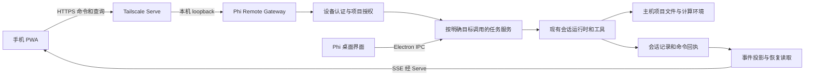
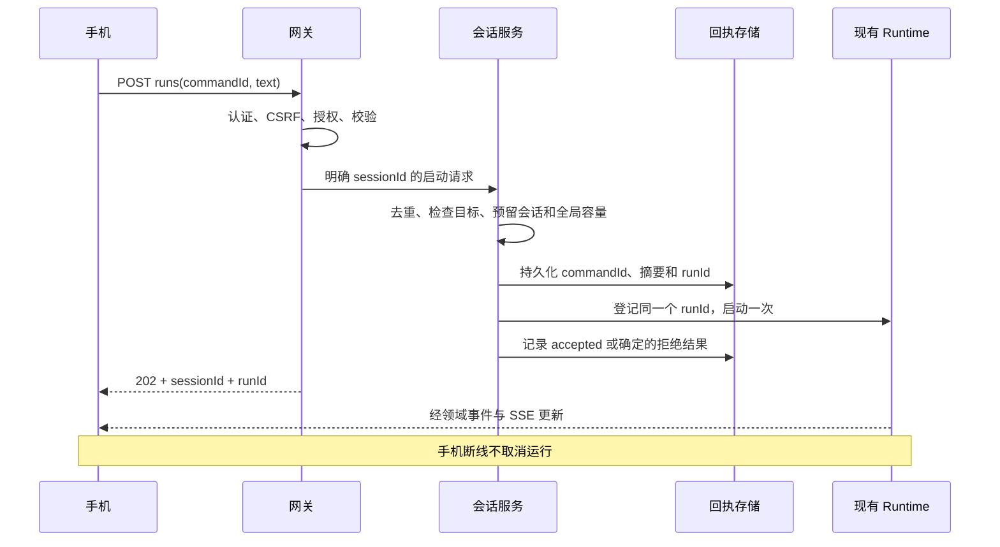

# Phi 手机伴随端：架构设计与实施方案

日期：2026-10-21  
状态：设计提案，尚未实现；已完成代码边界核对与一次独立架构复审。接口、目录和默认参数均为拟议契约。  
代码核对基线：`97461c53` 附近的当前工作区；工作区已有其他未提交改动，本文不修改应用代码。  
目标读者：产品负责人、桌面端与移动端开发者、测试与安全审查人员。

## 1. 目标与推荐结论

为 Phi 增加手机控制端，让用户在手机上选择自己的电脑和项目，下达自然语言任务、查看执行进度、回应审批和提问、获取结果。文件访问、工具执行和计算发生在用户自己的主机上，手机与桌面查看同一份会话和运行记录。

推荐从 **React PWA + Tailscale 私有连接 + Phi 内置远程网关 + 现有会话运行时** 开始。先验证一个人的一台电脑与少量手机设备，再增加 Capacitor 原生 App、通知、面向普通用户的连接服务以及独立后台运行时。

这里的“本地主机执行”不等于“完全离线”：模型请求仍服从 Phi 当前配置；在线模型会接收必要的提示词与工具上下文。Tailscale 可能使用协调服务和加密中继，手机系统推送也依赖平台服务。这些服务不承担用户任务的计算，但应在产品说明中准确披露。

本次仅编写实现文档，不将路线图中的待办视作已实现功能，也不自动引入新依赖。本文新增的功能范围是一项待实施的产品增量。

### 1.1 核心使用流程

1. 电脑端开启“手机连接”，确认允许访问的本地项目，并显示配对二维码。
2. 手机打开连接页面，完成配对，看到主机状态和获准的项目。
3. 用户选择会话，输入“继续分析数据并生成 PDF 报告”。
4. 主机确认接收，返回稳定的任务标识；手机随后锁屏或断网不会取消运行。
5. 工具需要审批或 agent 需要用户补充信息时，任务进入对应等待状态。
6. 用户在手机或电脑任一端处理；另一端同步显示处理结果。
7. 任务完成后，手机查看摘要、图片和报告，也可在电脑继续同一会话。

### 1.2 首版边界

首版是任务控制面：提交、查询、停止、审批、回答、获取产物。用户授权的能力仍由 Phi 的 agent 和工具提供。操作其他桌面应用的鼠标键盘、远程桌面视频流、任意交互终端、完整 Notebook 编辑器均属于独立能力，不混入首版。

先支持已登记的本地项目。普通会话目录、SSH/HPC 项目、跨主机任务调度留到后续明确授权与执行位置后再接入；不得把本地项目不可用悄悄解释为改用其他目录。手机端也不直接修改供应商密钥、权限模式、MCP 配置或安装系统工具。

## 2. 与现有 Phi 的关系

依据 [内部测试路线图](../roadmap/internal-beta-implementation.md)，保留项目绑定、多会话执行、可理解审批和可恢复历史的主线。该路线图尚未将手机端纳入既定 beta 范围，且明确延后系统通知与公开分发，因此本文把移动通知和应用商店发布放到首个任务闭环之后。

| 已核对的代码                                                                                             | 现有能力或限制                                                           | 接入方式                                                               |
| -------------------------------------------------------------------------------------------------------- | ------------------------------------------------------------------------ | ---------------------------------------------------------------------- |
| [agent-ipc.ts](../../src/main/ipc/agent-ipc.ts)                                                          | 提交会先对齐目标，再读取当前会话；普通停止操作也依赖当前会话             | 新增明确目标的应用服务，桌面适配层保留现有导航行为，手机调用不切换桌面 |
| [prompt-run-admission.ts](../../src/main/session-runtime/prompt-run-admission.ts)                        | 已有目标解析、运行 ID 分配、恢复/压缩/忙碌检查                           | 复用并补上针对外部命令的授权、原子准入与回执                           |
| [prompt-run-queue.ts](../../src/main/session-runtime/prompt-run-queue.ts)                                | `submitPromptRun` 已按显式 sessionKey 执行，但返回整个运行完成的 Promise | 增加“接收完成”与“执行完成”分离的入口，原桌面调用可继续等待 done        |
| [session-runner-registry.ts](../../src/main/agent/session/session-runner-registry.ts)                    | 每会话一个活跃运行，全局默认最多 4 个；有审批与结束事件                  | 共用同一登记表与容量限制，手机不能绕过或另设一套执行器                 |
| [session-store.ts](../../src/main/agent/session/session-store.ts)                                        | manifest、messages.jsonl、runId 与随机 UUID eventId 已存在               | 增加分页、恢复游标和命令回执；eventId 只作身份，不能按 UUID 排序       |
| [session-event-persistence.ts](../../src/main/agent/session/session-event-persistence.ts)                | 已有运行事件持久化与输出投影                                             | 从领域事件/存储边界订阅，经移动端 DTO 投影后输出                       |
| [tool-ipc.ts](../../src/main/ipc/tool-ipc.ts)、[tool-approval.ts](../../src/main/agent/tool-approval.ts) | 工具审批响应绑定 Electron sender                                         | 为已认证设备增加授权入口，保留现有桌面 sender 校验                     |
| [user-interaction.ts](../../src/main/agent/user-interaction.ts)                                          | 用户提问及回答同样具有窗口身份与生命周期约束                             | 独立支持 `needs_input`，不能将提问伪装为工具审批                       |
| [present-files.ts](../../src/main/agent/deliverables/present-files.ts)                                   | 已校验工作区内普通文件，但返回的是主机路径                               | 新增受授权的远程产物登记和下载，不把路径当下载凭证                     |
| [index.ts](../../src/main/index.ts)                                                                      | 事件发送、窗口关闭清理、退出与防休眠仍在主进程组装                       | 网关挂入同一生命周期；窗口常驻行为另设明确门槛                         |

需要纠正两个容易误判的地方：任务执行核心已经部分脱离“当前显示会话”，不需要重写 agent；但 renderer 的 IPC 和推送路径仍不等于可直接公开的网络 API。现有 `appendFileSync` 及随后的 manifest 更新也不构成跨文件事务或强持久化回执。

## 3. 系统原理与信任边界



手机是控制端，主机是权威状态源。HTTP 连接只传输命令和状态，不拥有任务生命周期；断开请求不能自动中止已经接受的运行。唯一的正常用户停止入口是针对明确 `sessionId + runId` 的停止命令。

网络网关负责协议、认证、输入校验、限流和输出边界；会话应用服务负责“哪个项目、哪个会话、哪次运行、当前是否允许”；现有 runtime 负责执行。网关不构造第二套 agent，也不把任意 IPC 通道转换成远程调用。

电脑端连接网络与手机端访问项目属于不同授权层。进入同一 Tailscale 网络不自动获得 Phi 权限；每个已配对设备仍需要自己的凭证和项目授权。

## 4. 技术路线及备选方案

### 4.1 手机界面

| 方案                     | 收益                                                | 代价                                                                | 决策                       |
| ------------------------ | --------------------------------------------------- | ------------------------------------------------------------------- | -------------------------- |
| React PWA                | 沿用 TypeScript/React，可添加到手机桌面，发布路径短 | 手机后台连接受系统管理；本地缓存、通知与安装需实机验证              | 首版                       |
| PWA 界面 + Capacitor     | 复用界面和协议，可增加原生通知、分享与安全存储      | 要维护 iOS/Android 构建、签名、插件及认证适配                       | 闭环稳定后的优先路线       |
| React Native             | 原生交互与系统整合空间较大                          | React DOM/MUI 组件不能直接复用，需要新 UI 层                        | 原生交互成为主要需求时评估 |
| Swift + Kotlin           | 平台控制力强                                        | 两套客户端及更高维护成本                                            | 当前不选                   |
| 现成远程桌面或聊天机器人 | 可用于人工验证需求                                  | 难提供 Phi 的结构化审批、产物和一致会话体验；机器人另有内容传输边界 | 不作为产品主架构           |

PWA 页面由主机网关同源提供，不直接复用依赖 `window.api` 的完整 Electron 页面。只提取已经适合浏览器运行的协议、格式化和消息展示能力。[Capacitor 官方文档](https://capacitorjs.com/docs)说明其 Web 与原生容器路线，但封装并不自动解决网络、认证或系统后台限制。

### 4.2 网络连接

| 方案                       | 特点                                           | 取舍                                                                                          |
| -------------------------- | ---------------------------------------------- | --------------------------------------------------------------------------------------------- |
| 局域网直连                 | 初期调试简单                                   | 离开 Wi-Fi 即不可达；手机访问普通 LAN HTTP 还会遇到安全上下文限制，不作为发布方案             |
| Tailscale + Serve          | 设备私网、穿透、私有 HTTPS；可能直连或加密中继 | 首版采用，用户需安装并登录 Tailscale                                                          |
| Cloudflare Tunnel + Access | 主机主动出站，适合已有域名/身份网关部署        | 可选部署路线；增加外部网关信任，不能将经过代理的 HTTPS 默认宣称为手机到主机的应用层端到端加密 |
| 自建 WebSocket 中继        | 可设计无需用户安装 VPN 的产品流程              | 需维护主机登记、连接路由、加密、限流、可用性；后续产品化再做                                  |
| WebRTC 数据通道            | 可尝试直连，适合未来实时音视频                 | 仍需信令及可能的中继，连接管理更复杂；文本任务控制暂不需要                                    |
| 公网端口映射               | 连接链路直观                                   | 公网 IP、证书和暴露面都要自行处理；不作为默认                                                 |

Serve 与 Funnel 不同：本方案使用仅限私网访问的 Serve。反向代理目标是 Phi 本机端口，不是把项目目录直接当静态站点分享。Tailscale 连接可能经 DERP 等中继，不能承诺所有网络都直连。[Serve](https://tailscale.com/docs/features/tailscale-serve)、[连接类型](https://tailscale.com/docs/reference/connection-types)、[Cloudflare Tunnel](https://developers.cloudflare.com/cloudflare-one/networks/connectors/cloudflare-tunnel/)

### 4.3 应用协议与执行位置

| 决策              | 首版选择                                 | 原因与后续边界                                           |
| ----------------- | ---------------------------------------- | -------------------------------------------------------- |
| 命令/查询         | 有版本的 HTTP JSON API                   | 容易验证、限流和记录回执，不与长任务绑定连接             |
| 当前会话实时更新  | SSE                                      | 下行为主，支持事件 ID 与重连；命令仍走 POST              |
| 会话列表/全局待办 | 前台低频轮询                             | 首版避免增加持久化的全主机事件日志；后台改用通知         |
| 执行进程          | 当前 Electron 主进程协调现有 runtime     | 复用生命周期；重计算与文件传输不得阻塞主进程             |
| 存储              | 沿用会话文件，增加小型命令回执与设备记录 | 不先迁移到数据库；若事务复杂度或规模验证不通过再专门决策 |
| 后续双向/中继连接 | 可增加 WebSocket 适配器                  | 复用命令 DTO 和事件信封，不把业务语义绑定到传输          |

SSE 的浏览器原生重连只解决重建连接，服务端仍须实现记录补取、去重和一致快照。本文选择由应用控制重连的 Fetch 流式 SSE 客户端，具体游标契约见第 10 节。[SSE 参考文档](https://developer.mozilla.org/en-US/docs/Web/API/Server-sent_events/Using_server-sent_events)

### 4.4 首版实现栈与依赖约束

网关优先使用当前 Electron 内置的 Node.js `http`、`crypto` 和文件流能力，采用少量显式路由，校验复用仓库已有 Zod。手机端使用现有 React、TypeScript、Vite，manifest 与仅缓存静态资源的 service worker 保持精简。先不引入 Express/Fastify、数据库、全局状态框架或完整离线同步框架；若标准库方案无法通过超时、背压与请求解析测试，再单独比较成熟服务器依赖。

二维码编码、标准 Web Push、Capacitor 及其原生安全存储插件属于可能新增的依赖；实现时逐项核对维护状态、许可证、平台兼容性，并遵循仓库“新增依赖需明确授权”的规则。C0 可先使用高熵配对链接验证流程，不为避免依赖而手写二维码编码或密码协议。本次文档不安装任何依赖。

## 5. 产品范围与阶段定义

| 能力       | V1：内部任务闭环                                   | V1.1：使用体验               | V2：产品化                           |
| ---------- | -------------------------------------------------- | ---------------------------- | ------------------------------------ |
| 主机与用户 | 一台主机，一个桌面账户，最多 5 个配对设备          | 少量主机可分别连接           | 统一多主机入口，继续区分每台主机授权 |
| 手机端     | 响应式 PWA                                         | Web Push、图片附件、分享优化 | Capacitor 原生客户端                 |
| 项目       | 桌面选定的本地项目                                 | 按需扩展普通会话             | 单独验证 SSH/HPC 项目                |
| 任务       | 创建会话、发送文本、查看进度、停止、审批、回答提问 | 小范围模型选择等             | 更丰富的协作控制                     |
| 产物       | 已登记的文本/图片/PDF/下载                         | 大文件及预览增强             | 按使用需求扩展                       |
| 连接       | Tailscale + Serve                                  | 连接诊断与恢复优化           | 可选自建加密中继                     |
| 生命周期   | Phi 运行且窗口保留，可最小化                       | 显式开启关闭窗口后常驻       | 独立后台服务另立项目                 |

首版不承诺关机收任务、合盖后持续执行、无网络执行在线模型任务、后台手机自动发送草稿或主机崩溃后自动重放命令。上述状态必须明确显示，不能用无限“正在连接”掩盖。

## 6. 代码组织与最小改造范围

拟议目录如下；只有实现对应切片时才创建文件，不预建空模块或抽象框架：

```text
src/main/remote-control/
  server.ts                   HTTP 生命周期、路由与连接关闭
  auth.ts                     认证、Origin/CSRF 与权限校验
  device-store.ts             配对、设备凭证摘要和撤销状态
  command-receipts.ts         幂等命令及崩溃恢复记录
  session-events.ts           游标、快照、分页和 SSE
  artifacts.ts                远程产物登记与受控下载
src/main/session-runtime/
  session-commands.ts         基于明确目标的应用服务
src/shared/remote-control/
  contracts.ts                纯数据契约、错误码与版本
src/renderer/src/features/remote-control/
  RemoteControlPanel.tsx      桌面开关、配对、项目授权、撤销
  components/ hooks/ lib/     功能私有实现和双语词典
src/mobile/
  index.html                  独立 Web 构建入口
  src/features/               connect、sessions、chat、approvals
  src/lib/                    HTTP、同步和本地偏好
```

桌面新增界面遵守 [前端 feature 边界](../architecture/frontend-feature-boundaries.md)，共享层仅放两端真正共用且不依赖 Electron 的部分。移动入口复用根依赖与构建工具，先避免 monorepo 迁移；构建输出拟为 `out/mobile`，需要同时调整打包资源清单并检查安装包。

`session-commands.ts` 应只组合现有准入、分配、执行、停止服务。推荐内部接口 `startRun(target, input, context) -> { sessionId, runId, done }`：`startRun` 完成准入与登记即返回，`done` 表示最终结果。网络层只序列化 ID 与当前状态；桌面旧入口通过等待 `done` 保留原返回语义。

必须保留桌面原有 sender/frame 校验、generation 检查、项目绑定检查及清理顺序。已有 [会话运行时设计](../architecture/session-runtime-service-design.md)可作为边界依据。不能通过临时切换全局 currentSession 再切回的方式实现手机提交。

## 7. 领域标识、状态与数据权威

| 字段                           | 含义与规则                                                       |
| ------------------------------ | ---------------------------------------------------------------- |
| `hostId`                       | 首次启用远程功能时生成并持久化；独立于主机名和 IP                |
| `deviceId`                     | 主机登记的客户端身份；浏览器安装实例不是可信硬件证明             |
| `projectId`                    | 现有项目标识；主机解析真实目录，手机不可提交任意 cwd             |
| `sessionId`                    | 现有 Phi 会话标识；不把 sessionKey 或 SDK sessionFile 当外部身份 |
| `runId`                        | 主机生成的一次执行标识；所有停止、审批、提问响应都核对归属       |
| `commandId`                    | 手机生成的随机 UUID；同一操作重试必须复用                        |
| `eventId`                      | 现有持久事件标识，随机 UUID，无排序语义                          |
| `cursor`                       | 主机生成的不透明恢复位置，绑定会话和日志代次；不含权限           |
| `approvalId` / `interactionId` | 分别标识工具审批与用户提问，不混用                               |

不新增第二套会话状态机。直接投影当前的 `idle / running / needs_approval / needs_input / failed / completed_unread`；停止和中断由 `lastRunOutcome` 及结束事件表达。手机“正在发送、已接收、连接中断”属于客户端/命令状态，不能冒充执行状态。

运行中的会话继续使用一个主运行与全局默认 4 个活跃运行的限制。容量占用应覆盖准入预留、执行与等待审批/回答阶段；计数与既有 runner 统一，不另维护失真的手机计数器。现有内部 Promise 串行化不等于向用户提供无限任务队列，满额应拒绝新运行并明确原因。

读取列表、后台刷新和通知点击不隐式清除桌面未读状态。V1 只在用户实际打开对应会话后提交显式 acknowledge；该动作沿用现有全局已读语义，多设备独立已读暂不引入。

## 8. API 契约草案

统一前缀 `/api/remote/v1`。以下为实施契约草案，尚未存在于应用中。除静态安装页、配对交换和最小 liveness 外，均须已认证；未认证 liveness 只返回是否存活，不返回用户名、项目或模型信息。

| 方法与相对路径                               | 用途                                 | 约束                                          |
| -------------------------------------------- | ------------------------------------ | --------------------------------------------- |
| `POST /pairing/exchange`                     | 消费配对码并建立设备会话             | 同源、短期一次性码、请求体限额；失败限流      |
| `GET /bootstrap`                             | 主机信息、协议范围、能力、CSRF token | 只返回该设备可见信息                          |
| `POST /auth/renew`、`POST /auth/logout`      | 续期、注销当前设备会话               | CSRF 校验、凭证轮换、撤销检查                 |
| `GET /projects`、`GET /sessions?projectId=…` | 项目与会话列表                       | 分页和项目授权，不能泄露未授权标题            |
| `POST /sessions`                             | 在获准项目中创建会话                 | commandId 幂等，项目必须仍可用                |
| `GET /sessions/:id/snapshot`                 | 清单、最近消息、待办和同步边界       | 原子一致快照；较早历史单独分页                |
| `GET /sessions/:id/events`                   | 分页补取记录                         | 不透明游标，最多 200 条且受字节上限约束       |
| `GET /sessions/:id/stream?after=…`           | 当前会话 SSE                         | Cookie 认证；应用确认游标后恢复               |
| `POST /sessions/:id/runs`                    | 提交自然语言任务                     | 返回 202 回执；不等待模型执行完毕             |
| `GET /commands/:commandId`                   | 查询发送结果                         | 只能查询本设备的命令；每次重新校验资源权限    |
| `POST /sessions/:id/runs/:runId/stop`        | 停止明确运行                         | 幂等，不得停止稍后出现的新运行                |
| `GET /attention`                             | 全部获准会话的待审批和待回答         | 仅当前有效请求；前台轮询                      |
| `POST /approvals/:id/decision`               | 批准或拒绝                           | 含 sessionId、runId、requestVersion，原子处理 |
| `POST /interactions/:id/response`            | 回答问题或取消                       | 匹配问题类型、有效选项与当前运行              |
| `POST /sessions/:id/acknowledge`             | 显式标为已读                         | 不消除仍有效的审批/提问                       |
| `GET /sessions/:id/artifacts`                | 产物元数据列表                       | 仅已登记产物，不暴露任意文件浏览              |
| `GET /artifacts/:artifactId/content`         | 下载或安全预览                       | 每次验证设备、项目、会话与登记记录            |

桌面配对码生成、设备撤销、项目授权调整只通过桌面受验证 IPC 提供；不在首版开放给手机。新建会话和发送任务分两步，各自幂等；第一步成功后第二步失败时允许重试发送，不创建重复会话。创建、发送、停止、审批、回答均带 commandId；认证续期使用单独的凭证轮换协议，已读操作按目标直接幂等。历史读取使用互斥的 after（向前补取）或 before（向后翻页）参数，由响应返回下一页游标。

提交示例与回执：

```json
{ "commandId": "cmd-example", "text": "分析项目中的结果并生成报告" }
```

```json
{
  "commandId": "cmd-example",
  "sessionId": "session-example",
  "runId": "run-example",
  "status": "accepted"
}
```

示例 ID 为说明性占位符；真实 commandId 按 UUID schema 校验。正文不接受 `cwd`、`permissionMode`、`automatic`、`suppressUserMessageEvent` 或内部 runtime 参数；使用严格字段白名单，未知字段返回校验错误。

错误格式统一为 `{ error: { code, message, retryable, requestId } }`。建议错误映射：401 `AUTH_REQUIRED`；403 `DEVICE_REVOKED` / `SCOPE_DENIED`；404 `RESOURCE_NOT_FOUND`（包括未授权资源探测）；409 `SESSION_BUSY` / `CAPACITY_REACHED` / `COMMAND_CONFLICT` / `REQUEST_ALREADY_RESOLVED`；410 `CURSOR_EXPIRED`；413 `PAYLOAD_TOO_LARGE`；426 `PROTOCOL_UPGRADE_REQUIRED`；429 `RATE_LIMITED`；503 `HOST_STOPPING`。敏感资源先作可见性检查，再返回细节错误，避免泄露存在性。

## 9. 任务提交、幂等与崩溃恢复



幂等键为 `(hostId, deviceId, commandId)`，请求摘要覆盖方法、规范化路由、目标和经过校验的正文。同一键同一摘要返回原回执；同一键不同内容返回冲突。重复请求先进行授权检查，再查询已有回执，不能因为已有运行变忙而把合法重试当新请求拒绝。

主机将回执写入拟新增的 `~/.phi/remote/command-receipts.jsonl`，至少保存命令摘要、目标、分配的 runId、阶段、结果与时间，不重复保存完整用户正文。接受前执行明确的落盘与同步；不能仅凭内存 Map 或普通 append 调用就承诺崩溃后不重复。设备状态写入采用临时文件、同步和原子替换；异常尾行只在可确认未完成写入时截断，不能静默丢弃中间损坏记录。

准入检查、全局名额预留和去重必须经过同一个短临界区；包括桌面请求，避免桌面与手机同时通过检查。此锁不能包住模型、网络、文件复制或整次工具执行。准入成功后立即返回身份；启动失败要记录终态并释放预留，不可永久占位。

| 中断位置                             | 恢复行为                                                                 |
| ------------------------------------ | ------------------------------------------------------------------------ |
| 请求未到达主机                       | 手机显示“尚未确认”，使用同一 commandId 查询或重试                        |
| 回执已保留，但未确定是否进入 runtime | 返回 `recovery_required`，结合相同 runId 的记录对账；不自动重放          |
| 任务已启动，HTTP 回执丢失            | 重试返回同一 runId，不重复执行                                           |
| 工具已产生外部副作用，主机崩溃       | 标记中断/待核对，用户查看证据后决定新任务；不承诺工具副作用 exactly-once |
| 任务结束后重试发送                   | 返回原结果；需要再次运行必须生成新 commandId                             |

V1 保留命令摘要和终态回执，不按短 TTL 自动删除；会话删除后保留不含正文的命令 tombstone，避免延迟重试重新执行。解除设备后旧凭证不可继续访问，重新配对获得新 deviceId。回执日志损坏时对受影响命令拒绝自动执行，并保留诊断证据。

手机在首次 POST 前，使用本地存储事务保存最小 pending command 记录：hostId、deviceId、commandId、操作与目标、请求摘要、状态，以及所引用的冻结草稿/答案版本。只有保存成功才发送；未确认操作的原始内容保持不变，新编辑另存草稿版本。重新打开先按原 commandId 查询，仍需重试时只允许人工触发原请求；已确认回执并完成 UI 状态转换后清理 pending 记录。这是发送结果恢复记录，不是后台自动发送队列。

没有收到主机回执时应显示“结果待确认”，不能声称“已开始”，也不能换一个 commandId 自动重发。若用户清除本机数据或重新配对导致恢复记录不可用，先展示已有会话与主机历史供核对，不推断“请求肯定没执行”。

## 10. 事件同步、断线补取与多端一致性

### 10.1 持久事件与即时预览分开

会话历史、工具调用结束、审批请求和处理、运行终态属于持久事件。逐 token 文本或细粒度进度可以是临时预览，V1 只要求可降级的实时展示，不要求把每个 token 同步落盘。重连时丢弃旧的临时预览，以已保存消息和当前运行快照恢复；随后收到新的预览继续展示。若运行仍在进行，快照可带主机内存中的当前文本预览，但必须标明其临时性质。

不能直接订阅 renderer 的 `agent:event` 并原样转发：现有广播受窗口、active run 和 UI payload 影响，可能包含本机绝对路径或内部字段。新增领域订阅出口必须覆盖用户消息、主运行与子任务审批、用户提问、终态、会话修改及删除；发往手机前按 schema 投影，禁止 provider 密钥、环境变量、内部连接信息进入响应。

### 10.2 游标与一致快照

每个会话使用一个带日志代次的恢复游标，内部可记录完整行末偏移与最后 eventId，再由主机签名封装。它既不是访问凭证，也不是由手机任意提供的磁盘偏移；先鉴权，再验证游标绑定的 sessionId、代次、完整行边界及大小范围。V1 不把 UUID eventId 当递增序号，也不新增全主机持久事件流。

首次连接取 snapshot，返回最近一页历史、当前 manifest、待处理请求、历史分页位置和 `snapshotCursor`。这个位置必须代表快照一致边界。针对这些读写增加短时会话协调点：所有会影响该投影的持久写入与状态更新完成后才暴露新边界，快照在边界内读取；不能在 JSONL 已追加而 manifest 尚未更新时发布半完成状态。C0/C3 必须枚举相关写入者，遗漏即不能通过验收。

随后连接 SSE，先补发游标之后的持久记录，再切到实时。服务端先登记短期缓冲订阅、取得历史截止位置、读取范围内记录，最后排空超出截止位置的缓冲，按 eventId 去重；慢客户端缓冲超限则主动断开并要求重建快照。禁止“先读完历史，再开始监听”造成中间事件丢失。

SSE 持久事件使用 `id: <cursor>`、`event: timeline` 和经过投影的 JSON data；临时 `preview` 消息不设置持久 id。V1 客户端使用同源 Fetch 读取 `text/event-stream`，串行校验和应用事件，只有成功后才推进 `lastAppliedCursor`；网络/解析/状态应用失败时中止旧流，并从最后成功位置重连。不能应用的事件反复失败时重建 snapshot 并提示协议问题，不能跳过它继续推进。

主机以 URL after 为恢复参数，只有未提供 after 时才读取 Last-Event-ID；两者同时存在却不一致时返回 400。V1 Fetch 客户端只发送 after，不使用原生 EventSource 的自动恢复状态。原生 EventSource 会在派发事件前更新其内部 Last-Event-ID，不能当作应用成功处理的确认。[WHATWG SSE 处理规范](https://html.spec.whatwg.org/multipage/server-sent-events.html#event-stream-interpretation)、[Fetch 流式读取](https://developer.mozilla.org/en-US/docs/Web/API/Fetch_API/Using_Fetch)

SSE 解析集中于独立模块，覆盖跨网络块的 UTF-8、CRLF、多行 data、注释心跳、半条消息与最大帧限制。若游标在响应头发送前已失效，返回 410；流中发现失效则发送无 id 的 `sync_required` 并关闭，客户端均重新取 snapshot。重复事件按 eventId 安全忽略。客户端重开且没有当前会话状态时直接取新 snapshot，不仅凭一个旧游标跳过历史。

进程重启时核对日志完整性与原代次，恢复有效游标；日志被重置、截断或替换时递增代次并要求重建快照。会话 fork 拥有新的会话身份和独立游标。不能复用另一个会话的位置。所有时间在协议中使用 UTC ISO 字符串，排序由主机持久化顺序确定，手机时钟不参与仲裁。

### 10.3 手机连接策略

当前会话维持一条 SSE；列表和 `/attention` 在前台每 5 秒刷新一次，回到前台立即同步。切换会话关闭旧连接，页面隐藏时允许释放连接；后台依靠后续通知或用户重开恢复。默认 15 秒心跳、45 秒未见活动进入重连，采用带随机抖动的 1–30 秒退避，恢复网络后可立即尝试。

HTTP/1.1 下浏览器对同源 SSE 连接数量有限，因此不为每个任务各开一条连接。[SSE 连接与重连说明](https://developer.mozilla.org/en-US/docs/Web/API/Server-sent_events/Using_server-sent_events) 手机短暂无法连接只表示主机不可达，不能据此将任务改成失败。

## 11. 配对、身份与授权

### 11.1 首次配对

桌面用户开启功能后，明确选择项目与权限，创建有效期默认 2 分钟的 256-bit 随机一次性配对秘密。主机仅保存其摘要、授权范围、到期时间和消费状态。二维码包含经过确认的 HTTPS origin、配对标识与秘密；秘密放 URL fragment，页面读取后立即从地址栏历史移除，通过同源 POST 交换。日志、分析脚本与 Referrer 不得包含秘密；配对页不加载第三方脚本。

消费过程原子化：同一码只能成功一次，错误或过期不建立设备。主机分配 deviceId 与随机 opaque 会话凭证，返回设备显示名称与权限摘要，桌面显示新增设备。桌面授权范围是权限上限，手机请求不能扩大它。V1 不提供易穷举的六位数字码作为唯一授权凭据；无法扫码时可复制同样高熵的配对链接。

PWA 安装后的存储上下文可能与浏览器标签页不同。引导先安装再在目标应用上下文配对；若安装后凭证不可见，则重新生成一次性码配对，不通过明文 localStorage 复制长期凭证。

### 11.2 凭证与权限

V1 使用同源 Cookie：`__Host-phi_session`，设置 `Secure; HttpOnly; SameSite=Strict; Path=/`，不设置 Domain。主机仅保存随机凭证的摘要；建议绝对有效期 30 天、7 天不活跃失效，已认证前台可通过受 CSRF 保护的 renew 轮换，过期后重新配对。凭证不放在 URL、SSE 参数、日志或 localStorage 中。[Cookie 属性参考](https://developer.mozilla.org/en-US/docs/Web/HTTP/Reference/Headers/Set-Cookie)

设备记录包含 `deviceId / label / credentialHash / allowedProjectIds / capabilities / createdAt / lastSeenAt / expiresAt / revokedAt / permissionEpoch`。最小 capability 集合为 `session:read`、`run:create`、`run:stop`、`approval:respond`、`interaction:respond`、`artifact:read`，可提供只读设备。桌面开通写能力时应说明它允许通过 Phi 请求执行任务，但不会自动越过工具审批。

每个 API 请求、事件订阅、记录补取和下载都校验设备有效性及资源归属。长连接发出下一批数据前核对 permissionEpoch；撤销或缩小授权时立即关闭受影响 SSE/下载，并使后续请求失败。撤销设备默认不停止其已合法启动的任务，任务继续由桌面管理；另提供桌面明确的“停止相关运行”动作，避免将撤销连接与执行取消隐式绑定。

项目授权只是远程控制入口的资源授权，不是操作系统文件沙箱。Phi 的现有 shell/工具能力仍可能访问该用户账户可访问的其他资源；需要强隔离时必须另设计工具权限或 OS 沙箱，不能把项目下拉框宣传成安全隔离。

### 11.3 网页与主机边界

网关默认关闭，仅监听固定 loopback 地址；生产入口由 Serve 提供 HTTPS。检查允许的 Host 与精确 origin，拒绝不符的 Host，防止 DNS rebinding。不能相信任意客户端传来的 Forwarded、Tailscale 身份头或 X-Forwarded-Proto；代理后的 host/header 行为须以打包实测为准，应用身份始终由自己的凭证判定。

所有修改状态的请求要求 JSON 内容类型、精确 Origin 与绑定会话的 CSRF token；配对交换使用其独立的短期秘密，并校验 Origin。GET 无执行副作用，静态页面和 API 不开放通配 CORS；SameSite 只作为额外防线。[OWASP CSRF 指南](https://cheatsheetseries.owasp.org/cheatsheets/Cross-Site_Request_Forgery_Prevention_Cheat_Sheet.html)

手机 UI 默认禁用 Markdown 原始 HTML，限制链接协议，采用 CSP 与 `frame-ancestors 'none'`。模型文本和文件内容均视为不可信输入。API 使用严格 schema、长度限制、超时与限流；错误信息需脱敏。V1 不提供任意 URL 代理、任意 shell 执行接口或任意路径下载接口。

## 12. 审批、用户提问与两端竞争

现有审批和提问不仅校验窗口身份，也在窗口销毁、主框架导航或 renderer 崩溃时取消。因此手机接入必须把 pending 请求所有权移动到主进程的运行域：窗口与手机都是展示/回答通道，均不是请求的唯一拥有者。桌面校验仍保留在 IPC adapter；网络 adapter 验证设备后，二者调用同一领域 resolver，禁止伪造 WebContents。

主机保存完整的 `requestId / sessionId / runId / toolCallId / generation / requestVersion / 参数摘要 / 类型 / pending 状态`。手机只提交自己的答案与预期版本，真正的命令、路径和归属从主机记录读取，不能接受客户端回传文本作为批准对象。

子 agent 的审批可能属于 agentRunId，而非父会话当前主运行 ID。请求记录必须保留实际执行者和父会话归属，通过现有运行登记验证，不能简单要求所有审批 runId 等于 manifest.currentRunId；权限仍按所属项目检查，停止操作按真正的执行目标路由。

处理顺序为：验证身份与权限 → 获取主机请求 → 检查运行和版本仍有效 → 校验答案类型 → 原子地从 pending 转为终态 → 保存决定及审计 → 仅一次唤醒对应 Promise → 广播结果。持久化失败时不得先执行批准的操作。两个设备或桌面与手机同时回答，只有第一条合法决定生效；重复相同 commandId 返回原回执，不同决定返回“已处理”和最新状态。

工具审批保留 approved、denied、cancelled 的区别；用户提问保留单选、多选、自定义输入、notes 与 globalNote 等真实类型。计划评审的 approve/revise/cancel 不能套用二选一审批：V1 若未实现其专用展示，应显示“请在电脑端处理”，且不向手机暴露会触发这种流程的新增模式。未知交互类型同样降级，不显示误导性“同意”按钮。

手机断线、网页刷新、桌面导航不取消有效等待；任务停止、运行失效、项目绑定变化或应用退出才取消对应请求。沿用 beta 的审批不自动超时规则，过期配对码与审批等待不能混淆。取消要按 session/run 定向，替换会误伤其他会话的全局提问取消调用。

主机重启后，历史审批决定可以读取，但内存 Promise 不可恢复；旧 pending 请求转为失效并告知用户，原运行按中断处理，不重放批准。手机界面明确显示主机、项目、会话、工具以及命令/路径摘要；完成后另一端立即移除操作按钮。

## 13. 文件产物、预览与附件

现有 `files_presented` 表达“展示当前文件链接”，并不自动复制文件。远程端新增 artifactId 与 `projectId / sessionId / runId / sourceEventId / displayName / mime / bytes / hash / createdAt` 关联；artifactId 不可猜测，但仍不是访问凭证。API 仅按 ID 查询主机登记记录，不接受路径参数。

**V1 选择受控快照语义：**当有远程授权的会话展示可分享文件时，主机从经过验证的文件句柄异步复制到该会话管理的远程产物目录，计算 hash、核对复制前后元数据，完成后发布 `artifact_ready`。手机看到的是快照生成时的版本，而不是以后被修改的源文件。复制中或失败时显示对应状态，不能提前宣布可下载；桌面原有文件链接行为保持原样。

单文件默认上限 25 MiB、远程快照总额默认 500 MiB，额度属于待实测的初始参数。超过上限返回明确的“仅电脑查看”，不拖慢任务终态。按需清理过期快照，下载中资源需持有引用，清理后保留可解释的元数据状态；源项目文件永不因清理远程快照被删除。大数据集传输与断点续传后续单独设计。

安全读取要覆盖完整目录链的符号链接、目录替换和文件替换竞争。不能只 `realpath` 校验后再按原路径打开；实现需使用平台支持的相对目录句柄/no-follow 或等价的经验证文件句柄方案，并通过替换竞态测试。若纯 JS 路径无法可靠验证，优先复用现有 native helper 的最小能力；无法确认来源时不提供远程快照，不能放宽边界绕过。

每次下载重新校验设备和资源授权；内容流式传输并设置字节上限、超时和背压。普通文本与栅格图片可受控展示，PDF 在受支持环境预览或交系统查看器；HTML/SVG 等主动内容默认强制附件下载，禁止在携带认证 Cookie 的同源页面执行。设置正确 Content-Type、Content-Disposition 与 `X-Content-Type-Options: nosniff`。不把用户项目根目录注册成静态服务器。

手机上传图片属于 V1.1：先上传到主机 staging，返回 uploadId，再在新任务中引用；绑定 device/session、检查真实文件类型与配额，主机决定文件名和位置，未引用上传按期限清理。使用已有 PromptImageInput 转换边界，不能让手机选择任意写入路径。任意文件上传和解压另行设计。

## 14. 主机生命周期与离线行为

| 主机/客户端状态                      | V1 保证                                                     |
| ------------------------------------ | ----------------------------------------------------------- |
| 手机锁屏、退出 PWA、断网             | 已接收任务继续，恢复后补取；不保证后台维持 SSE              |
| Phi 窗口最小化或隐藏、窗口对象仍存在 | 主机醒着且联网时可继续服务                                  |
| 用户关闭 Phi 主窗口                  | 当前实现会清理运行时；V1 保留此行为，连接端提示不可达或中断 |
| macOS 关窗后进程仍存在               | 不等同任务继续；网关必须随运行时停用，不能误报“可接任务”    |
| 用户明确退出 Phi                     | 先停止接单，再取消 pending 和运行，关闭连接并清理资源       |
| 主机睡眠、合盖、关机或强制结束       | 不保证接收或执行；恢复后对账，不自动重放                    |
| 主机可达但模型或工具失败             | 显示实际运行失败；与连接故障分开                            |

当前 `preventSleepDuringRuns` 仅在已有活跃运行且设置启用时使用 `prevent-app-suspension`；它不保证空闲时主机可达，也不保证阻止用户强制睡眠或笔记本合盖。复用当前设置，避免偷偷改变系统电源行为。[Electron powerSaveBlocker](https://www.electronjs.org/docs/latest/api/power-save-blocker)

V1.1 可增加用户显式开启的“手机连接期间关闭窗口改为隐藏”，保留窗口对象与现有 UI 能力；真正退出仍终止所有服务。要修改 close handler 时，先区分用户关窗与应用退出，防止退出被错误拦截。空闲保持可达需要独立设置、明确耗电提示与真实设备测试，不能仅沿用“运行时防休眠”。

关闭远程功能与退出应用不同：前者停止网关、撤销连接，不默认停止已接收的合法任务。连接重开时可继续查询历史；轮换或删除配对凭证的含义另设明确操作。

## 15. 手机交互、语言与通知

手机界面只保留四个主要入口：连接/主机、会话、待处理、结果。聊天页底部固定输入区，顶部持续显示主机与项目；任务运行时显示停止与状态，忙碌时新任务发送不可假装排队。默认支持文本和系统键盘语音输入，不先自建录音转写服务。

连接状态显示“可连接、正在重连、主机不可达、凭证失效”，任务状态独立显示“运行、待审批、待回答、完成、失败、中断”。恢复连接时先同步再启用审批按钮，避免用户按旧页面操作；草稿不因重新连接、语言切换或切会话丢失。

遵守 [UI 本地化约定](../architecture/ui-localization.md)：首次按手机系统语言选择英文/简体中文，手动选择优先并存为设备偏好，不修改电脑语言。功能词典随 feature 存放，状态与权限使用稳定英文 ID；路径、代码、模型 ID 和用户内容不翻译。语言切换不重建编辑器、会话或连接身份。

V1.1 使用标准 Web Push：用户主动启用后保存该设备的 subscription；任务完成、失败和需要人工操作时发送可合并的通知。iOS/iPadOS 16.4 起支持主屏幕 Web App 推送，并使用 Apple 推送服务；需要安装到主屏幕且授予权限。[WebKit 官方说明](https://webkit.org/blog/13878/web-push-for-web-apps-on-ios-and-ipados/)

推送默认仅包含“Phi 有任务需要处理”之类最小内容和不敏感事件标识，打开后重新鉴权取详情。用户关闭通知不影响任务；撤销设备同时停止其通知订阅。推送仅是提醒，可能延迟或重复，不能替代持久事件；按事件 ID 去重，失效订阅清理。Tailscale 断开时仍可能收到系统通知，但打开详情必须恢复到主机的连接。

通知发送端在本机主动连接平台推送端点，无需为此公开任务接口。VAPID 私钥仅存主机安全存储，subscription endpoint 也视为敏感数据；限制可接受的推送端点以避免 SSRF，不把用户提交的任意 URL 当推送服务。接入标准 Web Push 库应单独提交依赖选择，不自行编写加密协议。

## 16. 配置、持久化与运行参数

拟新增 `~/.phi/remote/` 保存设备记录、命令回执、游标签名密钥和非敏感配置，目录/文件使用当前用户最小权限。主机密钥与需要解密的秘密使用已验证的系统安全存储；设备 token 保存摘要即可。API key 仍由现有供应商配置管理，不复制到手机。

| 参数        | 初始建议                                          | 说明                                                     |
| ----------- | ------------------------------------------------- | -------------------------------------------------------- |
| 网关开关    | 默认关闭                                          | 仅桌面启用，退出或运行时清理时关闭                       |
| 本机监听    | `127.0.0.1:43127`                                 | 建议端口，可配置；被占用时报错，不静默换端口导致代理错连 |
| 外部 origin | 配置的 HTTPS `*.ts.net` 地址                      | 匹配 Host/Origin；主机名变化需更新、验证和重新连接       |
| 请求正文    | 128 KiB 上限；任务文本最多 32,000 字符            | 校验按实际 UTF-8 字节和字符语义测试                      |
| SSE         | 单设备最多 2 条；单连接缓冲最多 1 MiB             | 常态当前会话一条，切换允许短重叠；超限要求恢复           |
| 列表/历史   | 每页最多 200 条，响应最多 1 MiB                   | 大工具输出单独授权读取，不塞入整段历史                   |
| 限流        | 配对每来源每分钟 5 次；命令每设备每分钟 30 次     | 限流返回 Retry-After；内网多个设备共享来源时实测调整     |
| 网络超时    | 10 秒 headers、30 秒 request body、15 秒 SSE 心跳 | 长任务时限不等于 HTTP 请求时限                           |
| 配额        | 最多 5 设备；25 MiB 单产物；500 MiB 快照总量      | 用真实报告和图片校准，不宣称已验证性能                   |

SSE、下载和命令处理需要独立的限额，避免大文件占满实时事件队列。日志仅记 requestId、脱敏的设备/资源 ID、结果码、耗时和关闭原因，不记 Cookie、配对秘密、完整提示词或文件正文；沿用项目现有日志保留策略。

PWA service worker 首版只缓存版本化的应用静态资源，API、SSE、审批、产物响应使用 no-store，不缓存运行历史。设备本地持久数据限于用户草稿、语言偏好，以及第 9 节为安全恢复所需的 pending command 元数据和冻结输入；输入可能含敏感内容，应明确其本地保存行为并在确认结果后清理。提供“清除本机数据”，说明设备下载的文件不能由远程撤销追回。新 service worker 不在填写审批时强制刷新，协议不兼容时停止写操作并提示更新。

## 17. 实施切片与退出条件

以下切片按依赖顺序实施。C0–C6 构成内部 V1；通知、原生封装及中继不阻塞核心闭环。每个切片保持小改动、先保护现有行为，并单独记录验收证据。

| 切片                 | 工作内容与主要文件                                                                                         | 完成条件                                                                                       |
| -------------------- | ---------------------------------------------------------------------------------------------------------- | ---------------------------------------------------------------------------------------------- |
| C0：契约和探针       | 核对现有准入、所有事件写入路径、审批所有权、产物与关闭流程；固定 DTO 和错误码；临时私网 HTTPS/PWA/SSE 探针 | 两台真实设备能连接；已明确 API 边界、权限与重连契约；探针不暴露真实工作数据                    |
| C1：按目标的任务服务 | `session-commands.ts`、现有 admission/start/queue/stop；启动回执与 done 分离；统一全局容量预留             | 手机式调用不修改桌面 currentSession；两个入口同一会话不会并发运行；满额无暗队列；桌面回归通过  |
| C2：受认证网关与幂等 | server/auth/device-store/command-receipts；桌面 RemoteControlPanel；配对、撤销、续期、严格 schema          | 未授权设备无法读写；同一命令并发/超时重试只得到同一运行；崩溃窗口对账测试通过                  |
| C3：快照和事件同步   | session-events、领域事件出口、移动数据投影                                                                 | 历史到实时切换无漏项；重复可去重；日志重置能重建；断线不影响执行；无凭证泄露                   |
| C4：跨端审批和提问   | 审批/交互服务与两类 adapter；定向取消                                                                      | 两端争抢只生效一次；一个任务取消不误伤其他任务；窗口导航不取消仍有效的远程待办；重启不重放批准 |
| C5：手机闭环与产物   | mobile 独立入口、手机页面、双语、受控快照与下载                                                            | 在手机完成创建、发送、停止、审批、回答、重连、看结果；切语言保留草稿；文件替换与越权测试通过   |
| C6：打包与内部交付   | 移动资源打包、默认关闭、日志、限流、连接引导和人工清单                                                     | 安装包实机验证完整闭环；关闭/退出不遗留监听；项目既有检查通过                                  |
| C7：体验增强         | Web Push、图片附件、关闭改隐藏等分别提交                                                                   | 每项都有独立开关/回归与平台实测；不改变默认桌面退出语义                                        |
| C8：原生与连接产品化 | Capacitor、原生凭证存储/通知、可选中继、多主机                                                             | 先完成平台/加密/发布评审，再对外分发                                                           |

建议首先完成 C0 的可证伪探针：明确会话提交不触碰桌面选择、已接收命令在断网后继续、主机重启不重复执行、手机/电脑同时审批只有一次决定。任何一个不成立，都先修协议和生命周期边界，再投入界面细化。

粗略排期仅作容量规划：熟悉代码的一名主要开发者，C0–C2 约 5–8 个工作日，C3–C4 约 4–7 日，C5–C6 约 5–8 日，合计约 3–5 个工作周；假设已有真实测试设备且不包含原生发布、自建中继和强 OS 沙箱。并行 UI 工作可缩短日历时间，无法消除跨端一致性验证；以 C0 探针后重新估算为准。

## 18. 验证策略与验收矩阵

只使用隔离的测试 profile、临时项目和假 runtime 进行自动化测试，不连接用户真实模型或写入真实项目。先复用 [prompt-run-admission.test.ts](../../tests/prompt-run-admission.test.ts)、[prompt-run-start.test.ts](../../tests/prompt-run-start.test.ts)、[session-runner-registry.test.ts](../../tests/session-runner-registry.test.ts)、[present-files.test.ts](../../tests/present-files.test.ts) 等现有用例，再为新边界增加行为测试。

| 类别         | 必测场景                                                                     | 通过标准                                                                  |
| ------------ | ---------------------------------------------------------------------------- | ------------------------------------------------------------------------- |
| 指定目标     | 桌面查看 A，手机提交/停止 B；提交过程中切换桌面                              | 桌面选择不变；操作仅作用于 B 的指定 runId                                 |
| 并发准入     | 同会话两次发送；桌面和手机争抢最后名额                                       | 一个成功另一个明确忙碌；默认容量不超 4                                    |
| 幂等         | 同 commandId 重复、并发、正文改变、回执丢失后 PWA 被回收、会话已删除         | 重开仍使用原命令查询；无重复工具调用；冲突明确；删除后旧命令不复活        |
| 故障注入     | 回执落盘前后、runtime 登记前后、工具副作用后强杀                             | 无自动重放；可确定的状态恢复，不确定状态如实展示                          |
| 同步         | 补取期间连续写事件；断网、重复、日志截断、慢客户端、UTF-8 分块与状态应用失败 | 无持久事件遗漏；失败事件不推进确认游标；同 eventId 不重复显示；失效能恢复 |
| 审批/提问    | 两端相反决定、旧 runId、修改参数、停止某一个会话                             | 一次合法决定；过期请求拒绝；其余会话等待不受影响                          |
| 身份         | 未配对、过期、撤销、缩减项目、伪造 deviceId                                  | 请求与长连接及时失效，无跨项目数据泄露                                    |
| Web 边界     | 跨站 POST、伪造 Host、无 CSRF、过大正文、恶意 Markdown                       | 请求被拒，页面不执行注入内容，日志无秘密                                  |
| 文件         | `../`、目录/文件替换、符号链接、未登记文件、删除、主动 HTML/SVG              | 不越界读取；版本语义准确；主动内容不在认证源执行                          |
| 手机生命周期 | 锁屏 10 分钟、Wi-Fi/蜂窝切换、退出重开、系统回收                             | 运行继续；重连补取；草稿不被自动提交                                      |
| 桌面生命周期 | 最小化、隐藏、关闭、退出、睡眠恢复                                           | 行为符合第 14 节；无僵尸端口或虚假的就绪状态                              |
| 本地化/版本  | 中英切换、旧缓存客户端连新主机、未知状态                                     | 草稿保留；不兼容写操作停止；可提示更新                                    |

实机至少覆盖当前目标 iPhone Safari/PWA、Android Chrome/PWA，以及打包后的 macOS Phi；记录具体系统与浏览器版本。仅模拟浏览器不足以证明推送、后台回收、VPN 切换与文件预览行为。Windows/Linux 作为扩展支持时补对应关闭与权限验证，不借 macOS 结果推定。

初始体验目标：在已建立的良好私网连接中，小文本命令的接收回执 p95 不超过 1 秒、持久事件展示延迟 p95 不超过 1 秒、网络恢复后 5 秒内恢复当前会话。统计应分开记录网络、落盘、模型初始化与模型首 token，模型耗时不纳入“接收回执”目标。它们是验收目标，尚无实测数据。

实施代码后运行相关定向测试、`npm run check:architecture`（界面结构变动时）、现有 lint/typecheck/static boundary checks，按 [测试门约定](../architecture/test-gate.md)完成回归，打包切片再运行 build 与安装包烟测。纯文档阶段只检查格式、引用、契约一致性和代码证据，不以未执行的功能测试声称实现可用。

## 19. 部署、回滚与日常使用

内部首版的部署顺序：安装并启动 Phi → 两端加入 Tailscale 私网 → 桌面启用网关并选择项目 → 配置 Serve 指向 loopback 端口 → 确认实际 HTTPS origin → 手机安装 PWA 并配对 → 用临时项目运行一次完整闭环。按照 [Serve CLI 官方文档](https://tailscale.com/docs/reference/tailscale-cli/serve)使用本机已安装版本的参数，不在应用启动时自动改动系统 VPN 或网络设置。

关闭开关时停止接单、关闭 SSE 和下载连接、撤销内存配对码并释放监听；已接收任务保留桌面管理。退出/关闭主窗口时遵循运行时清理协议并停止网关。重新打开主窗口、runtime 完成初始化后才重新暴露 ready；不能以“端口还在”代表可执行。

回滚首选关闭功能开关，保留现有会话和项目文件；不迁移或删除既有 Phi 数据。若降级到不识别远程格式的旧版本，远程功能保持关闭；允许兼容读取的历史继续由旧桌面展示，新事件需遵循既有未知类型容错规则。设备与回执文件做版本标记，不用降级自动清空来解决格式冲突。

最小诊断应能回答：主机是否醒着、Phi runtime 是否就绪、Tailscale 是否可达、HTTPS origin 是否正确、设备是否仍授权、当前会话是否忙碌、最后成功游标是什么。用户界面显示可行动的原因，不公开原始堆栈、环境变量或供应商 token。

## 20. 后续演进及重新决策条件

**原生 App。** 只有在通知、分享扩展、相机或平台交互成为明确需求后引入 Capacitor。原生容器的 origin、Cookie 和后台机制与 PWA 不同，需增加原生 transport adapter；凭证放 Keychain/Keystore，通过受控网络层使用短期 token。不能把 PWA 的 Secure Cookie 方案原封不动搬到任意 WebView，也不能只套壳就宣称完成系统集成。

**免 VPN 的中继。** 主机主动连中继，手机通过 hostId 寻址；中继负责在线状态与密文转发。TLS 手机→中继与中继→主机两段加密不等于端到端加密，必须另用成熟且经过审查的端到端协议，绑定配对时确认的主机/设备身份，支持密钥轮换、撤销和重放保护，不自行设计密码算法。原生客户端本地打包应用代码可减小“中继篡改网页偷取密钥”的问题；若 Web 客户端代码由中继提供，则其分发信任必须纳入威胁模型。第一阶段中继不保存离线可执行命令，避免引入第二套调度与重放语义。

**独立后台服务。** 只有明确要求“桌面退出后仍执行”时，再把任务服务迁入守护进程，桌面和手机都作为客户端。该改造涉及操作系统服务安装、自动启动、升级交接、密钥访问、单写者锁和权限；还要处理 Electron 浏览器工具、系统 UI 与用户登录会话之间的依赖，不能简单把主进程代码换成 Node 启动就承诺功能等价。

**多主机/远程项目。** hostId 必须加入路由与 UI，任务记录归属实际主机。若手机控制本机 Phi 再经 SSH 执行，界面同时显示控制主机与执行项目位置；手机→Phi 和 Phi→SSH 为两个独立认证边界。网络不可达时不能把任务自动移到另一台主机执行。

重新决策条件包括：文件式回执无法通过崩溃测试、用户确实需要离线排队、PWA 在目标平台无法满足核心交互、私网安装成为主要使用障碍、或超过单用户设备规模。出现这些证据后分别评估数据库、持久任务队列、原生 UI 与中继；不为假设中的规模提前重构整个 Phi。

## 21. 关键决策记录与尚待验证事项

| 决策        | 选择                               | 暂不采用的替代方案与理由                              |
| ----------- | ---------------------------------- | ----------------------------------------------------- |
| D1 执行复用 | 显式目标的会话服务接入现有 runtime | 模拟点击桌面、临时切换 currentSession：并发下易串会话 |
| D2 手机入口 | PWA 先行                           | 立即维护两套原生 UI：尚未证明需求收益                 |
| D3 网络     | Tailscale Serve 私网 HTTPS         | 首版自建中继：增加部署、身份与加密负担                |
| D4 协议     | HTTP 命令 + SSE + 列表轮询         | 所有操作经一个无版本 WebSocket：恢复/回执责任难辨     |
| D5 状态     | 主机单一权威、回执幂等、无自动重放 | 手机/主机各自队列自动重试：可能重复产生副作用         |
| D6 权限     | 设备 scope + 既有工具审批          | 配对后开放任意 IPC：过大的控制与数据范围              |
| D7 文件     | 有配额的受控快照                   | 直接返回路径：缺乏下载权限和内容版本保障              |
| D8 生命周期 | V1 保留窗口，可最小化/隐藏         | 首版全面拆 daemon：涉及大量尚未解耦的桌面能力         |

实施前仍需通过 C0/C1 验证：Serve 在目标 macOS 安装方式下的代理头与 SSE 行为、iOS 安装上下文的 Cookie 保留、统一准入预留与现有自动续写的兼容性、所有事件写入者的一致边界、可移植的安全文件句柄复制，以及审批服务从窗口中解耦后的浏览器工具行为。它们是明确的验证工作，不是已经完成的能力。

## 22. 资料与维护

项目规范：本文引用的 [内部测试路线图](../roadmap/internal-beta-implementation.md)、[前端边界](../architecture/frontend-feature-boundaries.md)、[本地化约定](../architecture/ui-localization.md)和[会话运行时设计](../architecture/session-runtime-service-design.md)优先用于约束实施范围。外部资料核对日期为 2026-10-21，具体平台能力在实施时再次验证。

主要外部依据：[Tailscale Serve](https://tailscale.com/docs/features/tailscale-serve)、[Serve CLI](https://tailscale.com/docs/reference/tailscale-cli/serve)、[Tailscale 连接类型](https://tailscale.com/docs/reference/connection-types)、[SSE](https://developer.mozilla.org/en-US/docs/Web/API/Server-sent_events/Using_server-sent_events)、[Cookie](https://developer.mozilla.org/en-US/docs/Web/HTTP/Reference/Headers/Set-Cookie)、[OWASP CSRF](https://cheatsheetseries.owasp.org/cheatsheets/Cross-Site_Request_Forgery_Prevention_Cheat_Sheet.html)、[WebKit Web Push](https://webkit.org/blog/13878/web-push-for-web-apps-on-ios-and-ipados/)、[Capacitor](https://capacitorjs.com/docs)、[Electron 防休眠](https://www.electronjs.org/docs/latest/api/power-save-blocker)、[Cloudflare Tunnel](https://developers.cloudflare.com/cloudflare-one/networks/connectors/cloudflare-tunnel/)。外部资料支持平台事实；本文的架构选择、默认限额、排期和协议均为项目设计判断。

后续每个实施切片更新本文相应状态与证据链接；发生范围变化时更新决策表，避免让提案中的能力被误读为已发布。本文集中保存一条功能的完整设计；代码实现仍按上述边界拆分，不能据此生成单体服务文件。
